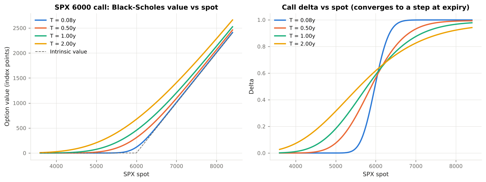
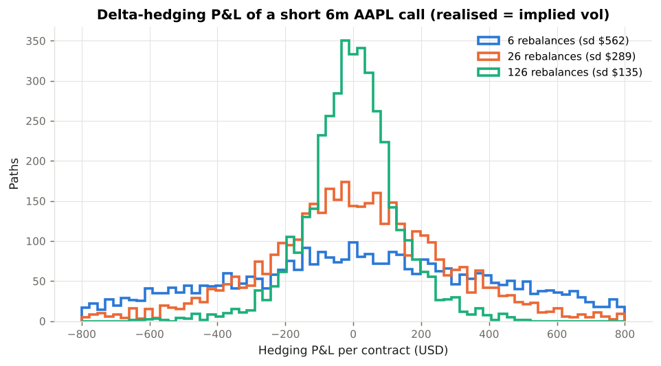
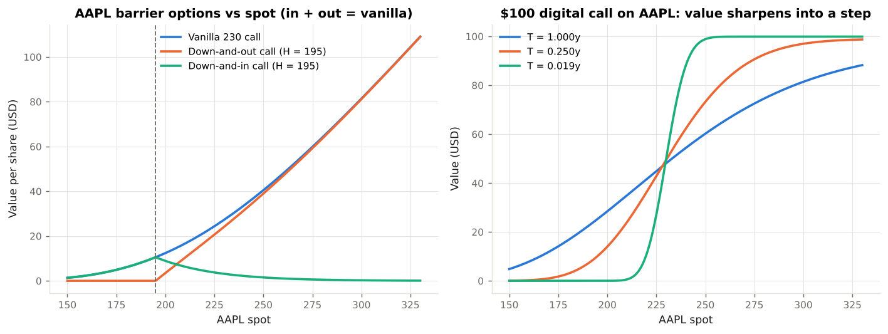
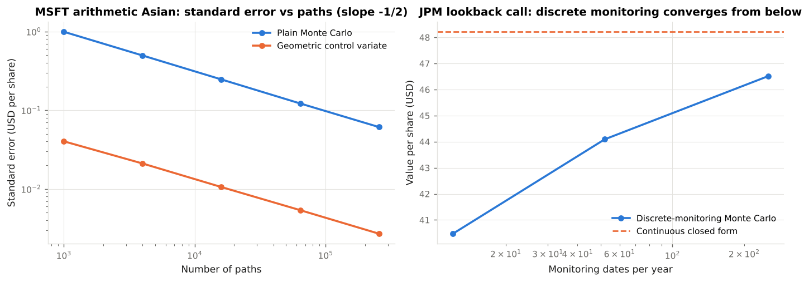
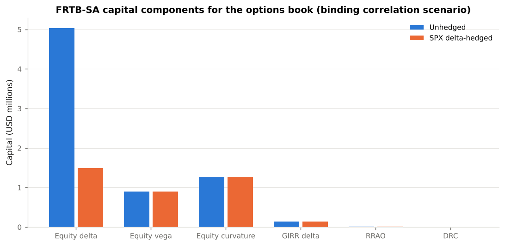
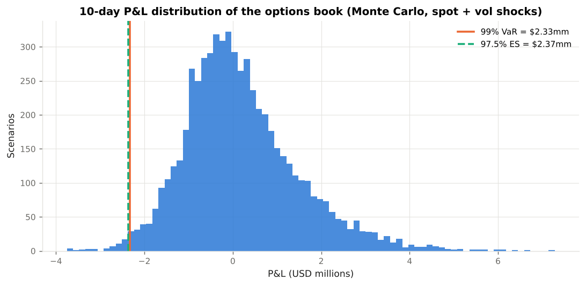
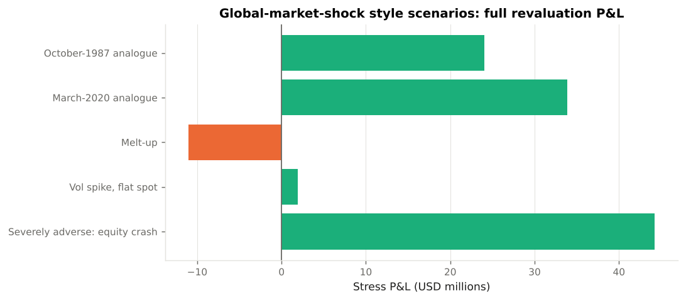
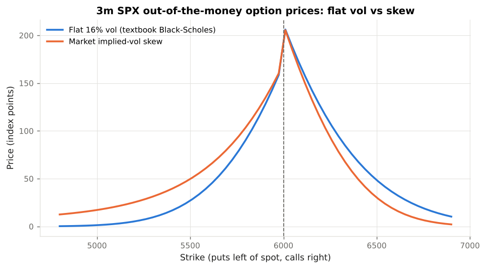

# Black-Scholes Laboratory

**An educational module on the Black-Scholes-Merton option pricing framework, exotic option simulation, and the use of option models in U.S. market-risk regulation.**

`black_scholes_lab` is a self-contained Python project (package `bslab`) that takes a reader from the 1973 derivation to the capital charge a U.S. bank would hold against an options book under the Basel III / FRTB standardised approach. Every formula is implemented, every implementation is tested against published reference values and no-arbitrage identities, and every risk-framework application cites the governing rule text.

All market data are **illustrative, USD-denominated** reference points (S&P 500 index options, Apple, Microsoft, JPMorgan single-stock options, a SOFR OIS discount curve). Nothing here is investment, legal or regulatory advice.

---

## Contents

```
black_scholes_lab/
├── README.md                      <- you are here
├── docs/                          <- the course text (read in order)
│   ├── 01_black_scholes_theory.md          Assumptions, Itô, replication, PDE, risk-neutral valuation, closed form
│   ├── 02_greeks_and_hedging.md            Greeks, gamma-theta trade-off, discrete hedging, regulatory sensitivities
│   ├── 03_exotic_options.md                Digital, barrier, Asian, lookback: payoffs, closed forms, simulation
│   ├── 04_monte_carlo_methods.md           Exact GBM simulation, error, variance reduction, model governance
│   ├── 05_us_regulatory_landscape.md       Who requires what: FRB/OCC/FDIC, SEC, FINRA, CFTC, FASB
│   ├── 06_frtb_standardised_approach.md    SBM delta/vega/curvature, RRAO, DRC — worked for an options book
│   ├── 07_other_risk_frameworks.md         VaR (Basel 2.5), ES (FRTB IMA), CCAR GMS, SIMM, Rule 18f-4, Volcker, SR 11-7
│   └── references.md                       Literature, Basel texts, CFR / SEC / FINRA / FASB citations
├── bslab/                         <- the library
│   ├── vanilla.py                 Black-Scholes-Merton, Black-76, Greeks, implied vol, put-call parity
│   ├── montecarlo.py              GBM path engine, antithetic & control variates, convergence study
│   ├── exotics.py                 Digital, barrier (8 types + rebate), geometric/arithmetic Asian, lookback
│   ├── instruments.py             Instrument / Position / Portfolio objects with bump-and-revalue market states
│   ├── market_data.py             Illustrative U.S. market data and FRTB vertex definitions
│   ├── reporting.py               Console tables
│   └── risk/
│       ├── frtb_sa.py             FRTB-SA: sensitivities, risk weights, correlations, curvature, RRAO, DRC
│       ├── var_es.py              Delta-normal, delta-gamma, Monte Carlo and historical VaR / ES
│       ├── stress.py              Global-market-shock style scenario revaluation
│       ├── model_validation.py    SR 11-7 style validation suite
│       └── simm.py                ISDA SIMM-style margin illustration
├── examples/                      <- runnable walkthroughs that generate the figures
│   ├── 01_vanilla_pricing.py
│   ├── 02_delta_hedging_simulation.py
│   ├── 03_exotic_options_simulation.py
│   ├── 04_frtb_sa_capital.py
│   ├── 05_var_es_and_stress.py
│   ├── 06_model_validation.py
│   └── run_all.py
├── figures/                       <- generated by the examples (committed for convenience)
├── tests/                         <- pytest suite (reference values, parities, MC statistics, FRTB mechanics)
├── pyproject.toml
└── requirements.txt
```

---

## Quick start

```bash
cd black_scholes_lab
pip install -r requirements.txt          # numpy, scipy, matplotlib, pytest
python -m pytest -q                      # 36 tests
python examples/run_all.py               # all six walkthroughs, ~1 minute, writes figures/
```

Or use the library directly:

```python
from bslab import bs_price, bs_greeks, implied_volatility, barrier_option, mc_arithmetic_asian

# Cboe SPX 1-year at-the-money call: spot 6000, SOFR 3.9%, vol 16%, dividend yield 1.3%
bs_price(6000, 6000, 1.0, 0.039, 0.16, "call", q=0.013)          # -> 453.69 index points
bs_greeks(6000, 6000, 1.0, 0.039, 0.16, "call", q=0.013).vega / 100   # -> 22.94 per vol point

# AAPL down-and-out call, barrier 195, continuous monitoring (Reiner-Rubinstein)
barrier_option(230, 230, 195, 1.0, 0.039, 0.26, "call", "down-and-out", q=0.005)

# MSFT arithmetic Asian call by Monte Carlo with a geometric control variate
mc_arithmetic_asian(420, 420, 1.0, 0.039, 0.24, n_fixings=12, q=0.008, n_paths=100_000)
```

---

## Learning path

| Step | Read | Run | You should be able to… |
|------|------|-----|------------------------|
| 1 | `docs/01` | `examples/01` | Derive the PDE from the hedging argument; explain why drift drops out; read `N(d₁)` and `N(d₂)`; invert for implied vol. |
| 2 | `docs/02` | `examples/02` | Compute and interpret every Greek; explain the gamma-theta trade-off; show hedging error ∝ 1/√n and the realised-vs-implied P&L drift. |
| 3 | `docs/03`, `docs/04` | `examples/03` | Price digitals, barriers, Asians and lookbacks; explain discretisation bias and its direction; reduce Monte Carlo variance by two orders of magnitude. |
| 4 | `docs/05` | — | Name the U.S. regulators and rules that consume option-model outputs, and where Black-Scholes appears explicitly in SEC/FASB requirements. |
| 5 | `docs/06` | `examples/04` | Turn Greeks into FRTB sensitivities; apply risk weights, correlations and the three scenarios; compute curvature, RRAO and DRC; explain why a delta-neutral book still attracts capital. |
| 6 | `docs/07` | `examples/05`, `examples/06` | Compare VaR methods and Expected Shortfall; run a global-market-shock style stress; produce SR 11-7 validation evidence; articulate the model's limitations (skew). |

---

## What the examples show

### 01 — Vanilla pricing on SPX and AAPL
Full Greek table for SPX strikes, `N(d₂)` as exercise probability, Black-76 for CME E-mini options, implied-vol inversion from a quoted AAPL price, and the smile the model cannot explain.



### 02 — Delta hedging a short AAPL call
Replication with 6, 26 and 126 rebalances: zero-mean hedging error with standard deviation falling as 1/√n, and systematic P&L when realised volatility differs from implied.



### 03 — Exotics: closed forms vs simulation
A $1mm SPX digital, an AAPL down-and-out call with discretisation-bias table and continuity correction, a MSFT arithmetic Asian with a 500× variance reduction from the geometric control variate, and a JPM lookback converging from below.




### 04 — FRTB-SA capital for a U.S. equity-options book
Equity delta / vega / curvature and GIRR charges under the low, medium and high correlation scenarios, the residual risk add-on for the exotics and the default risk charge for single names — before and after an SPX delta hedge.



### 05 — VaR, Expected Shortfall and stress
Delta-normal, delta-gamma, Monte Carlo full-revaluation (99 % VaR and 97.5 % ES) and historical simulation on the same book; the SEC Rule 18f-4 fund test; global-market-shock style scenarios.




### 06 — Model validation and limitations
Nineteen SR 11-7 style checks (all passing), the flat-vol vs skew mis-pricing table, and the same Greeks feeding an ISDA SIMM-style margin calculation.



---

## Regulatory references used

| Framework | Source text | Where applied |
|-----------|-------------|---------------|
| FRTB standardised approach | BCBS *Minimum capital requirements for market risk* (Jan 2019, d457); Basel Framework MAR20–MAR23 | `bslab/risk/frtb_sa.py`, `docs/06` |
| FRTB internal models approach | Basel Framework MAR30–MAR33 | `docs/07`, `var_es.py` (97.5 % ES) |
| Current U.S. market risk capital rule (Basel 2.5) | 12 CFR 217 Subpart F; 12 CFR 3 Subpart F; 12 CFR 324 Subpart F | `var_es.py` (99 % / 10-day VaR), `docs/07` |
| U.S. FRTB implementation | FRB/OCC/FDIC NPR, 88 FR 64028 (Sept 2023) — final rule pending | `docs/05`, `docs/06` |
| Model risk management | FRB SR 11-7 / OCC Bulletin 2011-12 | `model_validation.py`, `docs/04`, `docs/07` |
| Supervisory stress testing | 12 CFR 252 Subpart E (DFAST); 12 CFR 225.8 (CCAR); Global Market Shock | `stress.py`, `docs/07` |
| Uncleared margin | 12 CFR 237 / 45 / 349; 17 CFR 23.150–161; ISDA SIMM | `simm.py`, `docs/07` |
| Registered funds | SEC Rule 18f-4 (17 CFR 270.18f-4) | `var_es.py`, Example 05 |
| Broker-dealer capital and margin | SEC Rule 15c3-1 Appendix A; FINRA Rule 4210(g) | `docs/05` |
| Financial reporting | FASB ASC 718, ASC 820, ASC 815; SEC SAB Topic 14; Regulation S-K Item 402 | `docs/03`, `docs/05` |

Full citations with links are in [`docs/references.md`](docs/references.md).

---

## Design notes

* **Bump-and-revalue everywhere.** Risk modules never read analytic Greeks; they bump a `MarketState` and reprice, exactly as the FRTB text defines its sensitivities. Analytic Greeks are used only as benchmarks in the validation suite.
* **Reference-value testing.** Barrier, digital and geometric-Asian prices are tested against the values published in Haug (2007); the vanilla against Hull. In/out parity, put-call parity and the AM–GM ordering are enforced to 1e-9 or better.
* **Reproducible randomness.** Every Monte Carlo function takes a seed, and the arithmetic-Asian instrument fixes its seed so that bumped sensitivities use common random numbers.
* **Explicit simplifications.** Each regulatory module's docstring and `docs/06 §6.10` list what is simplified relative to the rule text, so the module can be extended rather than trusted blindly.

## Scope and disclaimer

Educational material. Regulatory parameters are those of the Basel text as revised in January 2019 and of U.S. rules as published; they are reproduced for teaching and may be superseded. Market data are synthetic. Verify every figure against primary sources before any professional use.
