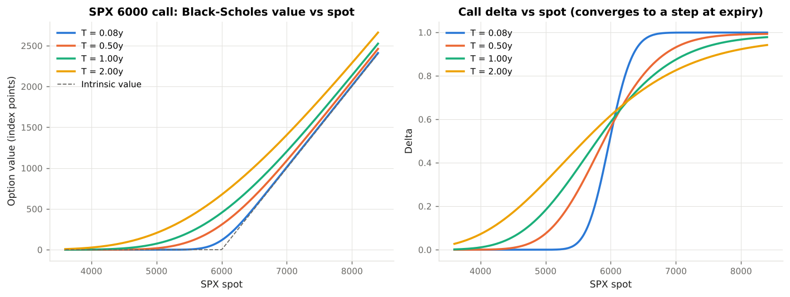
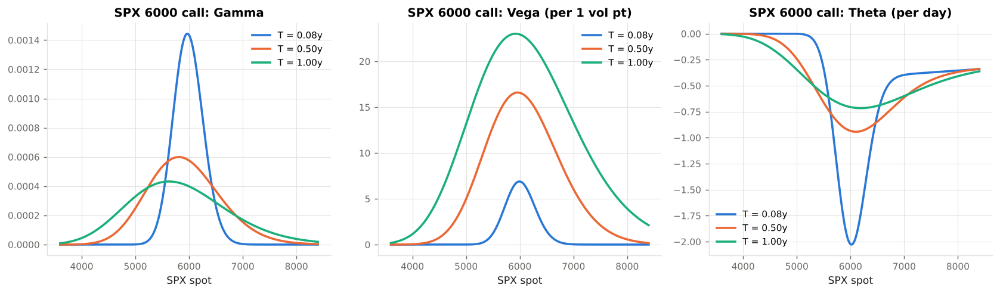
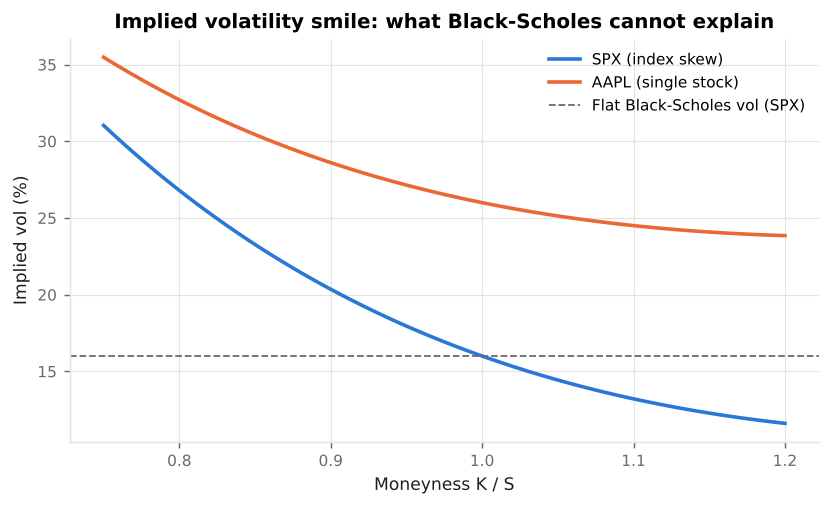
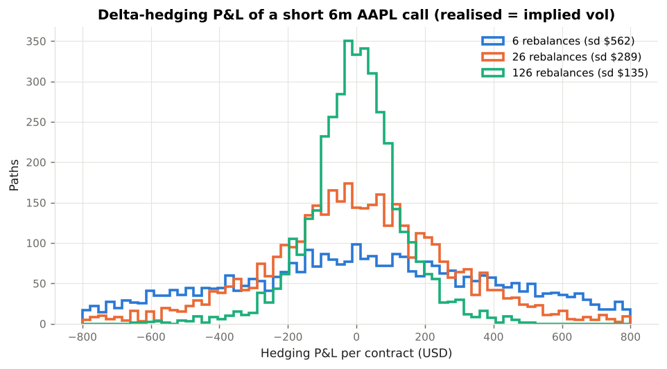
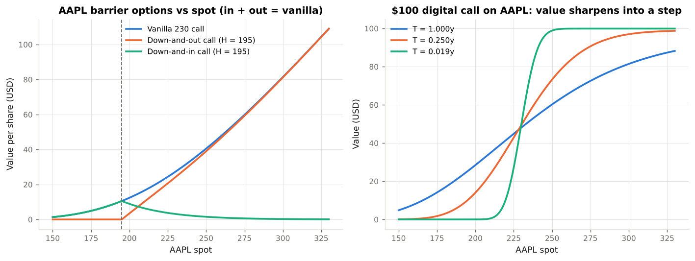
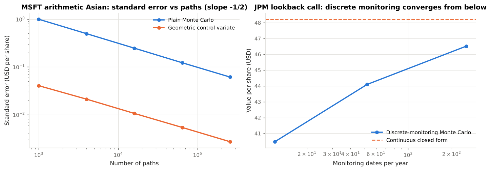
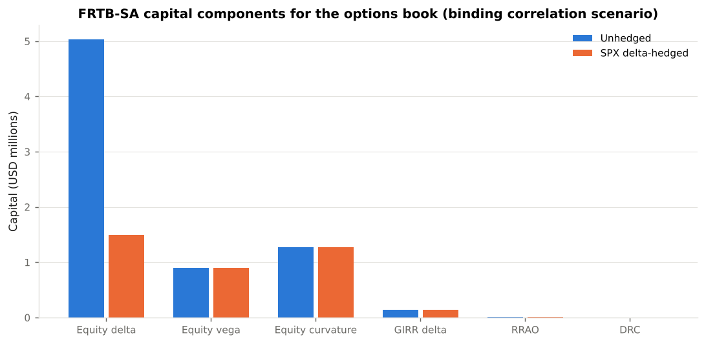
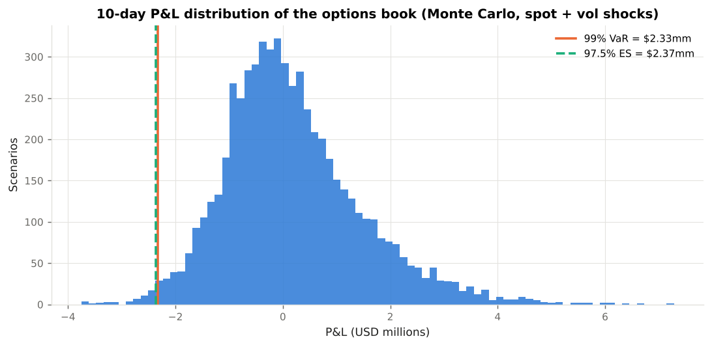
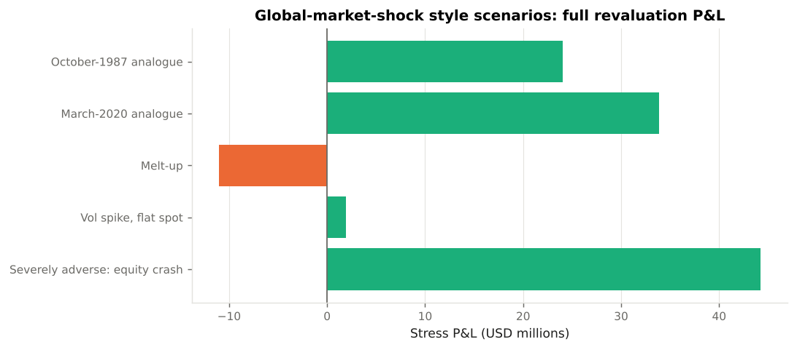
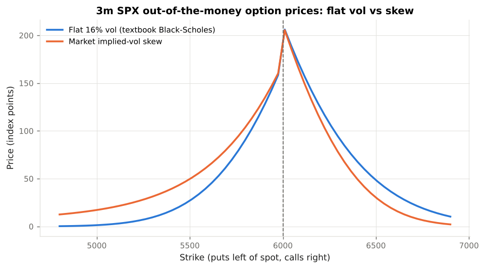

# Example Outputs

Console output captured from `python examples/run_all.py` with the illustrative market data in `bslab/market_data.py`. Every number below is reproducible: Monte Carlo runs are seeded and the exact commands are in the `examples/` directory.

!!! note "Reading the tables"
    Prices are per share or per index point unless a column says USD; portfolio values and capital figures are in USD. Standard errors and 95 % confidence intervals accompany every Monte Carlo estimate.

## Example 01 — Vanilla pricing and Greeks on SPX and AAPL

Source: `examples/01_vanilla_pricing.py`

```text
========================================================================
  01  Black-Scholes-Merton: vanilla options on SPX and AAPL
========================================================================
Risk-free rate (USD SOFR OIS, 1y, cont. comp.): 3.900%

SPX index options, T = 1y, spot 6,000, vol 16%, dividend yield 1.3% (per index point):
+----------+----------+----------+------------+-----------+------------+-----------------+---------------+------------+
| Strike   | Call     | Put      | Call delta | Put delta | Gamma x100 | Vega (1 vol pt) | Theta (1 day) | Parity gap |
+----------+----------+----------+------------+-----------+------------+-----------------+---------------+------------+
| SPX 5400 | 831.6308 | 102.5798 |     0.8057 |   -0.1814 |     0.0273 |         15.7447 |       -0.6006 |    -0.0000 |
| SPX 5700 | 625.3582 | 184.8325 |     0.7041 |   -0.2830 |     0.0350 |         20.1635 |       -0.6761 |     0.0000 |
| SPX 6000 | 453.6898 | 301.6893 |     0.5881 |   -0.3990 |     0.0398 |         22.9428 |       -0.7057 |     0.0000 |
| SPX 6300 | 317.5855 | 454.1101 |     0.4690 |   -0.5181 |     0.0409 |         23.5814 |       -0.6834 |    -0.0000 |
| SPX 6600 | 214.7065 | 639.7564 |     0.3573 |   -0.6298 |     0.0385 |         22.1987 |       -0.6163 |     0.0000 |
+----------+----------+----------+------------+-----------+------------+-----------------+---------------+------------+

Risk-neutral probability that SPX finishes above 6300: N(d2) = 0.412
  -> a $1 cash-or-nothing digital is worth e^-rT N(d2) = 0.3962

E-mini S&P 500 (CME) 6m futures fair value: 6,078.51
  Black-76 6m 6000 call on the future: 307.43 index points  (x $50 multiplier = $15,371.64)

AAPL 3m 230 call quoted at $14.10  ->  implied vol 28.65%  (model ATM input 26%)
Per-contract value (100 shares): $1,410.00
```







## Example 02 — Delta hedging a short AAPL call

Source: `examples/02_delta_hedging_simulation.py`

```text
========================================================================
  02  Delta hedging a short AAPL call: discrete replication
========================================================================

Hedging error when realised vol = implied vol (one contract, USD):
+----------------+----------+---------+-------------------------------------+
| Frequency      | Mean P&L | Std dev | Std x sqrt(n) (should be ~constant) |
+----------------+----------+---------+-------------------------------------+
| 6 rebalances   |   -16.75 |  562.34 |                            1,377.44 |
| 26 rebalances  |     2.39 |  288.52 |                            1,471.18 |
| 126 rebalances |    -1.98 |  135.06 |                            1,516.01 |
+----------------+----------+---------+-------------------------------------+

Daily hedging, implied vol 26%, varying realised vol:
+--------------+----------+---------+
| Realised vol | Mean P&L | Std dev |
+--------------+----------+---------+
|          20% |   386.25 |  162.64 |
|          26% |    -1.98 |  135.06 |
|          32% |  -388.73 |  238.39 |
+--------------+----------+---------+
Short-option desks profit when realised vol < implied vol and lose when it is higher.
```



## Example 03 — Exotic options: closed forms versus simulation

Source: `examples/03_exotic_options_simulation.py`

```text
========================================================================
  03a  Cash-or-nothing digital on SPX
========================================================================
Pays $1,000,000 if SPX > 6,300 in 9 months.
Closed form: $378,256     Monte Carlo: 377218.4097  (s.e. 639.3666, 95% CI [375965.2511, 378471.5682], paths=200,000)
Take-away: the digital's delta explodes near the strike as expiry approaches - a
textbook pin risk that FRTB handles through curvature risk and the residual risk add-on.

========================================================================
  03b  Down-and-out call on AAPL: discretisation bias
========================================================================
Vanilla 230 call: 27.2981   Down-and-out (H=195) continuous-monitoring closed form: 24.1702
+------------------+----------+------------+----------------+---------+-----------+
| Monitoring steps | MC price | Bias vs CF | MC + BGK shift | Bias    | Std error |
+------------------+----------+------------+----------------+---------+-----------+
|               12 |  25.8223 |     1.6521 |        24.0760 | -0.0942 |    0.1713 |
|               52 |  24.8940 |     0.7238 |        24.0166 | -0.1536 |    0.1737 |
|              252 |  24.8867 |     0.7165 |        24.4790 |  0.3088 |    0.1775 |
|             1008 |  24.4383 |     0.2681 |        24.2060 |  0.0358 |    0.1757 |
+------------------+----------+------------+----------------+---------+-----------+
Take-away: a discretely monitored knock-out is worth MORE than the continuous one (fewer
knock-outs).  Term sheets specify daily closes, so the MC price is the right one and the
closed form is a lower bound.  The Broadie-Glasserman-Kou shift removes most of the gap.

========================================================================
  03c  Arithmetic Asian call on MSFT: control variates
========================================================================
Monthly fixings, 1y.  Geometric-average closed form: 26.3648
Plain MC:            27.4455  (s.e. 0.0976, 95% CI [27.2543, 27.6367], paths=100,000)
Control-variate MC:  27.5255  (s.e. 0.0043, 95% CI [27.5171, 27.5340], paths=100,000)   (beta = 1.032)
Variance reduction factor: 512x
Vanilla 420 call for comparison: 45.8740  (averaging lowers volatility -> cheaper)

Convergence of the plain estimator (reference = control-variate price):
+--------+---------+-----------+---------+--------------+
| Paths  | Price   | Std error | |Error| | Error / s.e. |
+--------+---------+-----------+---------+--------------+
|   1000 | 27.8520 |    0.9931 |  0.3265 |       0.3287 |
|   4000 | 28.3133 |    0.4958 |  0.7878 |       1.5889 |
|  16000 | 27.9331 |    0.2462 |  0.4076 |       1.6557 |
|  64000 | 27.5136 |    0.1219 |  0.0119 |       0.0974 |
| 256000 | 27.4428 |    0.0611 |  0.0827 |       1.3534 |
+--------+---------+-----------+---------+--------------+

========================================================================
  03d  Floating-strike lookback call on JPM
========================================================================
Pays S_T - min(S).  Continuous-monitoring closed form (Goldman-Sosin-Gatto): 48.2167
+------------------+----------+------------+-----------+
| Monitoring steps | MC price | Bias vs CF | Std error |
+------------------+----------+------------+-----------+
|               12 |  40.4737 |    -7.7430 |    0.1478 |
|               52 |  44.0928 |    -4.1239 |    0.1446 |
|              252 |  46.5131 |    -1.7036 |    0.1469 |
+------------------+----------+------------+-----------+
Take-away: the discrete minimum is never lower than the continuous one, so MC converges from below.
```





## Example 04 — FRTB-SA capital for a U.S. equity-options book

Source: `examples/04_frtb_sa_capital.py`

```text
========================================================================
  04  FRTB-SA capital: U.S. equity options book (unhedged)
========================================================================
Portfolio market value: $1,300,397.14

Positions:
+---+------------+-------------------------+------+--------+--------------+
| # | Underlying | Instrument              | Qty  | Bucket | Market value |
+---+------------+-------------------------+------+--------+--------------+
| 0 | SPX        | 5400 put 6m             |  200 |     12 |      959,822 |
| 1 | SPX        | 6300 call 6m            | -150 |     12 |   -2,698,118 |
| 2 | SPX        | 6000 call 1y            |   50 |     12 |    2,268,449 |
| 3 | SPX        | digital call 9m ($1mm)  |    1 |     12 |      378,834 |
| 4 | AAPL       | 240 call 6m             | -300 |      8 |     -427,893 |
| 5 | AAPL       | 230 DOC (H=195) 1y      |  150 |      8 |      362,553 |
| 6 | MSFT       | 420 arithmetic Asian 1y |  100 |      8 |      275,210 |
| 7 | JPM        | 220 put 3m              |  400 |      8 |      181,539 |
+---+------------+-------------------------+------+--------+--------------+

Equity delta sensitivities  s_k = (V(1.01 S) - V(S)) / 0.01   [MAR21.19]:
+------------+--------+--------------------------------------------------+-------------+-----+------------+
| Underlying | Bucket | Bucket description                               | s_k (USD)   | RW  | WS_k (USD) |
+------------+--------+--------------------------------------------------+-------------+-----+------------+
| SPX        |     12 | Large-cap, advanced-economy equity indices (non- | -31,420,933 | 15% | -4,713,140 |
| AAPL       |      8 | Large cap, advanced: financials (incl. gov-backe |    -928,048 | 50% |   -464,024 |
| MSFT       |      8 | Large cap, advanced: financials (incl. gov-backe |   2,396,811 | 50% |  1,198,406 |
| JPM        |      8 | Large cap, advanced: financials (incl. gov-backe |  -2,065,254 | 50% | -1,032,627 |
+------------+--------+--------------------------------------------------+-------------+-----+------------+

Equity vega sensitivities  s_k = vega x sigma   [MAR21.25], RW = min(55% sqrt(LH/10), 100%)  [MAR21.92]:
+------------+--------+-----------------+-----------+-------+------------+
| Underlying | Bucket | Vega vertex (y) | s_k (USD) | RW    | WS_k (USD) |
+------------+--------+-----------------+-----------+-------+------------+
| SPX        |     12 |             0.5 |  -938,737 | 77.8% |   -730,166 |
| SPX        |     12 |             1.0 | 1,835,422 | 77.8% |  1,427,623 |
| AAPL       |      8 |             0.5 |  -504,317 | 77.8% |   -392,267 |
| AAPL       |      8 |             1.0 |   174,903 | 77.8% |    136,042 |
| MSFT       |      8 |             1.0 |   237,119 | 77.8% |    184,435 |
| JPM        |      8 |             0.5 |   388,772 | 77.8% |    302,394 |
+------------+--------+-----------------+-----------+-------+------------+

GIRR delta (USD SOFR curve, per 1bp / 0.0001)  [MAR21.8]:
+------------+-------------+-------------------+
| Vertex (y) | s_k (USD)   | PV01 (USD per bp) |
+------------+-------------+-------------------+
|       0.25 |    -587,707 |               -59 |
|       0.50 | -25,843,029 |            -2,584 |
|       1.00 |  19,109,064 |             1,911 |
+------------+-------------+-------------------+

Capital by correlation scenario  [MAR21.6-21.7]:
+------------------+-----------+-----------+-----------+
| Component        | Low       | Medium    | High      |
+------------------+-----------+-----------+-----------+
| Equity delta     | 5,038,593 | 5,053,651 | 5,068,665 |
| Equity vega      |   896,537 |   899,727 |   902,907 |
| Equity curvature | 1,276,081 | 1,233,308 | 1,188,997 |
| GIRR delta       |   136,064 |   120,043 |   101,525 |
| GIRR curvature   |         0 |         0 |         0 |
| SBM total        | 7,347,274 | 7,306,729 | 7,262,093 |
+------------------+-----------+-----------+-----------+

+----------------------------------------------------+-----------+
| Charge                                             | USD       |
+----------------------------------------------------+-----------+
| Equity delta                                       | 5,038,593 |
| Equity vega                                        |   896,537 |
| Equity curvature                                   | 1,276,081 |
| GIRR delta                                         |   136,064 |
| GIRR curvature                                     |         0 |
| Sensitivities-based method (binding scenario: low) | 7,347,274 |
| Residual risk add-on                               |     8,650 |
| Default risk charge                                |         0 |
| Total SA market-risk capital                       | 7,355,924 |
+----------------------------------------------------+-----------+

Residual risk add-on detail  [MAR23.6, 0.1% of gross notional for path-dependent payoffs]:
+------------------------------+-----------+------+--------+
| Position                     | Notional  | RW   | Charge |
+------------------------------+-----------+------+--------+
| SPX digital call 9m ($1mm)   | 1,000,000 | 0.1% |  1,000 |
| AAPL 230 DOC (H=195) 1y      | 3,450,000 | 0.1% |  3,450 |
| MSFT 420 arithmetic Asian 1y | 4,200,000 | 0.1% |  4,200 |
+------------------------------+-----------+------+--------+

DRC net jump-to-default by issuer  [MAR22]: {'AAPL': '-65,339', 'MSFT': '275,210', 'JPM': '-8,529,801'}
Gross market value (sum of |MV|): $7,552,417.73   Capital / gross MV: 97.4%

========================================================================
  04  FRTB-SA capital: same book with SPX delta hedge
========================================================================
Portfolio market value: $32,512,623.41

Positions:
+---+------------+-------------------------------------+------+--------+--------------+
| # | Underlying | Instrument                          | Qty  | Bucket | Market value |
+---+------------+-------------------------------------+------+--------+--------------+
| 0 | SPX        | 5400 put 6m                         |  200 |     12 |      959,822 |
| 1 | SPX        | 6300 call 6m                        | -150 |     12 |   -2,698,118 |
| 2 | SPX        | 6000 call 1y                        |   50 |     12 |    2,268,449 |
| 3 | SPX        | digital call 9m ($1mm)              |    1 |     12 |      378,834 |
| 4 | AAPL       | 240 call 6m                         | -300 |      8 |     -427,893 |
| 5 | AAPL       | 230 DOC (H=195) 1y                  |  150 |      8 |      362,553 |
| 6 | MSFT       | 420 arithmetic Asian 1y             |  100 |      8 |      275,210 |
| 7 | JPM        | 220 put 3m                          |  400 |      8 |      181,539 |
| 8 | SPX        | SPX delta-one hedge (deep-ITM call) |   52 |     12 |   31,212,226 |
+---+------------+-------------------------------------+------+--------+--------------+

Equity delta sensitivities  s_k = (V(1.01 S) - V(S)) / 0.01   [MAR21.19]:
+------------+--------+--------------------------------------------------+------------+-----+------------+
| Underlying | Bucket | Bucket description                               | s_k (USD)  | RW  | WS_k (USD) |
+------------+--------+--------------------------------------------------+------------+-----+------------+
| SPX        |     12 | Large-cap, advanced-economy equity indices (non- |   -203,574 | 15% |    -30,536 |
| AAPL       |      8 | Large cap, advanced: financials (incl. gov-backe |   -928,048 | 50% |   -464,024 |
| MSFT       |      8 | Large cap, advanced: financials (incl. gov-backe |  2,396,811 | 50% |  1,198,406 |
| JPM        |      8 | Large cap, advanced: financials (incl. gov-backe | -2,065,254 | 50% | -1,032,627 |
+------------+--------+--------------------------------------------------+------------+-----+------------+

Equity vega sensitivities  s_k = vega x sigma   [MAR21.25], RW = min(55% sqrt(LH/10), 100%)  [MAR21.92]:
+------------+--------+-----------------+-----------+-------+------------+
| Underlying | Bucket | Vega vertex (y) | s_k (USD) | RW    | WS_k (USD) |
+------------+--------+-----------------+-----------+-------+------------+
| SPX        |     12 |             0.5 |  -938,737 | 77.8% |   -730,166 |
| SPX        |     12 |             1.0 | 1,835,422 | 77.8% |  1,427,623 |
| AAPL       |      8 |             0.5 |  -504,317 | 77.8% |   -392,267 |
| AAPL       |      8 |             1.0 |   174,903 | 77.8% |    136,042 |
| MSFT       |      8 |             1.0 |   237,119 | 77.8% |    184,435 |
| JPM        |      8 |             0.5 |   388,772 | 77.8% |    302,394 |
+------------+--------+-----------------+-----------+-------+------------+

GIRR delta (USD SOFR curve, per 1bp / 0.0001)  [MAR21.8]:
+------------+-------------+-------------------+
| Vertex (y) | s_k (USD)   | PV01 (USD per bp) |
+------------+-------------+-------------------+
|       0.25 |    -587,707 |               -59 |
|       0.50 | -25,840,462 |            -2,584 |
|       1.00 |  19,109,064 |             1,911 |
+------------+-------------+-------------------+

Capital by correlation scenario  [MAR21.6-21.7]:
+------------------+-----------+-----------+-----------+
| Component        | Low       | Medium    | High      |
+------------------+-----------+-----------+-----------+
| Equity delta     | 1,493,982 | 1,438,654 | 1,381,112 |
| Equity vega      |   896,537 |   899,727 |   902,907 |
| Equity curvature | 1,276,081 | 1,233,308 | 1,188,997 |
| GIRR delta       |   136,038 |   120,015 |   101,494 |
| GIRR curvature   |         0 |         0 |         0 |
| SBM total        | 3,802,637 | 3,691,705 | 3,574,509 |
+------------------+-----------+-----------+-----------+

+----------------------------------------------------+-----------+
| Charge                                             | USD       |
+----------------------------------------------------+-----------+
| Equity delta                                       | 1,493,982 |
| Equity vega                                        |   896,537 |
| Equity curvature                                   | 1,276,081 |
| GIRR delta                                         |   136,038 |
| GIRR curvature                                     |         0 |
| Sensitivities-based method (binding scenario: low) | 3,802,637 |
| Residual risk add-on                               |     8,650 |
| Default risk charge                                |         0 |
| Total SA market-risk capital                       | 3,811,287 |
+----------------------------------------------------+-----------+

Residual risk add-on detail  [MAR23.6, 0.1% of gross notional for path-dependent payoffs]:
+------------------------------+-----------+------+--------+
| Position                     | Notional  | RW   | Charge |
+------------------------------+-----------+------+--------+
| SPX digital call 9m ($1mm)   | 1,000,000 | 0.1% |  1,000 |
| AAPL 230 DOC (H=195) 1y      | 3,450,000 | 0.1% |  3,450 |
| MSFT 420 arithmetic Asian 1y | 4,200,000 | 0.1% |  4,200 |
+------------------------------+-----------+------+--------+

DRC net jump-to-default by issuer  [MAR22]: {'AAPL': '-65,339', 'MSFT': '275,210', 'JPM': '-8,529,801'}
Gross market value (sum of |MV|): $38,764,644.00   Capital / gross MV: 9.8%

========================================================================
  04  Summary: effect of the delta hedge
========================================================================
+----------------------------------------------------+-----------+-----------+------------+
| Charge                                             | Unhedged  | Hedged    | Change     |
+----------------------------------------------------+-----------+-----------+------------+
| Equity delta                                       | 5,038,593 | 1,493,982 | -3,544,611 |
| Equity vega                                        |   896,537 |   896,537 |          0 |
| Equity curvature                                   | 1,276,081 | 1,276,081 |          0 |
| GIRR delta                                         |   136,064 |   136,038 |        -26 |
| GIRR curvature                                     |         0 |         0 |          0 |
| Sensitivities-based method (binding scenario: low) | 7,347,274 | 3,802,637 | -3,544,637 |
| Residual risk add-on                               |     8,650 |     8,650 |          0 |
| Default risk charge                                |         0 |         0 |          0 |
| Total SA market-risk capital                       | 7,355,924 | 3,811,287 | -3,544,637 |
+----------------------------------------------------+-----------+-----------+------------+
Delta hedging removes most of the equity delta charge but leaves vega and curvature untouched:
FRTB-SA deliberately capitalises non-linear option risk even for a delta-neutral book.
```



## Example 05 — VaR, Expected Shortfall and stress

Source: `examples/05_var_es_and_stress.py`

```text
========================================================================
  05  VaR and Expected Shortfall: four methods, one book
========================================================================
Book market value: $1,288,835.39

+------------------------------+-------+---------+-----------+----------------+-----------------------------+
| Method                       | Conf. | Horizon | VaR (USD) | ES 97.5% (USD) | Notes                       |
+------------------------------+-------+---------+-----------+----------------+-----------------------------+
| Parametric delta-normal      | 99.0% | 10d     | 2,415,314 | -              | linear; no gamma/vega       |
| Delta-gamma (Cornish-Fisher) | 99.0% | 10d     | 2,330,952 | -              | quadratic; no vega          |
| Monte Carlo full revaluation | 99.0% | 10d     | 2,627,090 |      2,653,509 | ES at 97.5%; vol-of-vol 0%  |
| Monte Carlo full revaluation | 99.0% | 10d     | 2,273,543 |      2,294,918 | ES at 97.5%; vol-of-vol 90% |
| Historical simulation        | 99.0% | 10d     | 2,222,113 |      2,172,515 | 747 scenarios               |
+------------------------------+-------+---------+-----------+----------------+-----------------------------+

Reading the table:
 * Delta-normal ignores gamma and vega.  Delta-gamma adds convexity.  Full revaluation adds vega
   and the cross effects.  Adding vol-of-vol with the negative spot/vol correlation seen in U.S.
   equity indices (the leverage effect) can raise OR lower VaR: this book loses when spot rallies,
   and at higher spot its short 6300 calls dominate the vega, so the vol decline that accompanies
   a rally cushions the loss.  That spot-dependence of vega is vanna, and only full revaluation sees it.
 * FRTB IMA replaces 99% VaR with 97.5% ES (MAR33.1).  For a normal distribution the two are
   nearly identical; for fat-tailed P&L the ES is materially larger.

SEC Rule 18f-4 absolute VaR test (illustrative fund with $25,000,000.00 net assets):
  99% / 20-day historical VaR = $3,074,444.80 = 12.3% of net assets  (limit 20%)  ->  PASS

========================================================================
  05  Supervisory-style global market shock
========================================================================
Gross market value (sum of |MV|): $7,540,855.98
+--------------------------------+--------+------------+------------+------------+-------------+----------------+
| Scenario                       | Equity | Vol (rel.) | Rates (bp) | Book value | P&L         | P&L / gross MV |
+--------------------------------+--------+------------+------------+------------+-------------+----------------+
| Baseline                       |    +0% |        +0% |         +0 |  1,288,835 |           0 |            +0% |
| Severely adverse: equity crash |   -45% |      +175% |       -150 | 45,507,891 |  44,219,056 |          +586% |
| Vol spike, flat spot           |    +0% |      +100% |         +0 |  3,235,814 |   1,946,979 |           +26% |
| Melt-up                        |   +25% |       -25% |       +100 | -9,711,000 | -10,999,835 |          -146% |
| March-2020 analogue            |   -34% |      +250% |       -125 | 35,153,651 |  33,864,816 |          +449% |
| October-1987 analogue          |   -22% |      +300% |        -50 | 25,335,950 |  24,047,115 |          +319% |
+--------------------------------+--------+------------+------------+------------+-------------+----------------+
This book is net long downside protection (SPX and JPM puts, long vega at 1y), so crash scenarios are
gains and the melt-up is the loss scenario - the mirror image of a typical sell-side short-volatility book.
Stress P&L is a full revaluation under instantaneous shocks (12 CFR 252 Subpart E - DFAST; the Board's
Global Market Shock component).  Unlike VaR it has no probability attached; it answers 'how bad', not 'how often'.
```





## Example 06 — Model validation and limitations

Source: `examples/06_model_validation.py`

```text
========================================================================
  06  Model validation suite (SR 11-7 / OCC 2011-12 pillars)
========================================================================
+----------------------+-------------------------------------------------------+-----------+-----------+--------+----------------------------+
| Pillar               | Check                                                 | Observed  | Tolerance | Result | Detail                     |
+----------------------+-------------------------------------------------------+-----------+-----------+--------+----------------------------+
| Conceptual soundness | Put-call parity                                       |  0.00e+00 |     1e-10 | PASS   |                            |
| Conceptual soundness | Vanilla = asset-or-nothing - K*cash-or-nothing        |  0.00e+00 |     1e-10 | PASS   |                            |
| Conceptual soundness | Barrier in/out parity (call, H=85)                    |  0.00e+00 |     1e-09 | PASS   |                            |
| Conceptual soundness | Barrier in/out parity (put, H=120)                    |  0.00e+00 |     1e-09 | PASS   |                            |
| Conceptual soundness | Barrier in/out parity (put, H=90)                     |  0.00e+00 |     1e-09 | PASS   |                            |
| Conceptual soundness | Barrier in/out parity (call, H=115)                   |  0.00e+00 |     1e-09 | PASS   |                            |
| Conceptual soundness | Implied volatility round trip                         | -1.19e-15 |     1e-08 | PASS   |                            |
| Benchmarking         | Delta: finite difference vs analytic                  | -5.99e-11 |     1e-06 | PASS   |                            |
| Benchmarking         | Gamma: finite difference vs analytic                  |  1.50e-08 |     1e-05 | PASS   |                            |
| Benchmarking         | Vega: finite difference vs analytic                   | -8.95e-08 |     1e-05 | PASS   |                            |
| Benchmarking         | Theta: finite difference vs analytic                  |  1.83e-11 |     1e-04 | PASS   |                            |
| Benchmarking         | Rho: finite difference vs analytic                    | -5.34e-07 |     1e-05 | PASS   |                            |
| Benchmarking         | MC European call vs Black-Scholes (in s.e.)           | -1.67e-01 |     3e+00 | PASS   | MC 10.0846 vs BS 10.0858   |
| Conceptual soundness | Arithmetic Asian >= geometric Asian (AM-GM)           |  0.00e+00 |     1e-12 | PASS   | arith 6.0477 >= geo 5.8130 |
| Benchmarking         | MC barrier (BGK-corrected) vs closed form (rel. err.) | -7.32e-03 |     3e-02 | PASS   | MC 9.2890 vs CF 9.3575     |
| Outcomes analysis    | Deep ITM call -> S e^{-qT} - K e^{-rT}                |  0.00e+00 |     1e-08 | PASS   |                            |
| Outcomes analysis    | Deep OTM call -> 0                                    |  2.39e-95 |     1e-08 | PASS   |                            |
| Outcomes analysis    | Zero-vol call -> discounted forward intrinsic         |  8.88e-15 |     1e-10 | PASS   |                            |
| Outcomes analysis    | At-expiry put -> intrinsic                            |  0.00e+00 |     1e-12 | PASS   |                            |
+----------------------+-------------------------------------------------------+-----------+-----------+--------+----------------------------+

19/19 checks passed.

========================================================================
  06  Model limitation: the SPX volatility skew
========================================================================
+--------+------+-----------+----------------+-------------+------------+-------+
| Strike | Type | Market IV | Flat-vol price | Smile price | Difference | Rel.  |
+--------+------+-----------+----------------+-------------+------------+-------+
|   5100 | put  |     23.3% |           2.71 |       20.69 |      17.98 | +664% |
|   5400 | put  |     20.4% |          16.47 |       39.23 |      22.76 | +138% |
|   5700 | put  |     18.0% |          63.38 |       81.24 |      17.87 |  +28% |
|   6000 | call |     16.0% |         211.36 |      211.36 |       0.00 |   +0% |
|   6300 | call |     14.4% |          93.04 |       76.68 |     -16.36 |  -18% |
|   6600 | call |     13.2% |          33.93 |       17.28 |     -16.65 |  -49% |
+--------+------+-----------+----------------+-------------+------------+-------+
A flat-vol Black-Scholes model under-prices out-of-the-money index puts by a wide margin.  Desks therefore
use Black-Scholes as a *quoting* convention (vol surface in, price out) and hedge with smile-adjusted Greeks.
For risk, FRTB vega buckets are defined on implied volatilities per (strike, maturity) point for this reason.

========================================================================
  06  Same Greeks, different framework: ISDA SIMM-style initial margin
========================================================================
+-----------------------+-----------+
| Component             | USD       |
+-----------------------+-----------+
| delta_margin          | 4,410,812 |
| vega_margin           |   513,918 |
| curvature_margin      |    35,200 |
| total_illustrative_im | 4,475,850 |
+-----------------------+-----------+
(Illustrative weights only - SIMM parameters are recalibrated annually by ISDA.)
```


