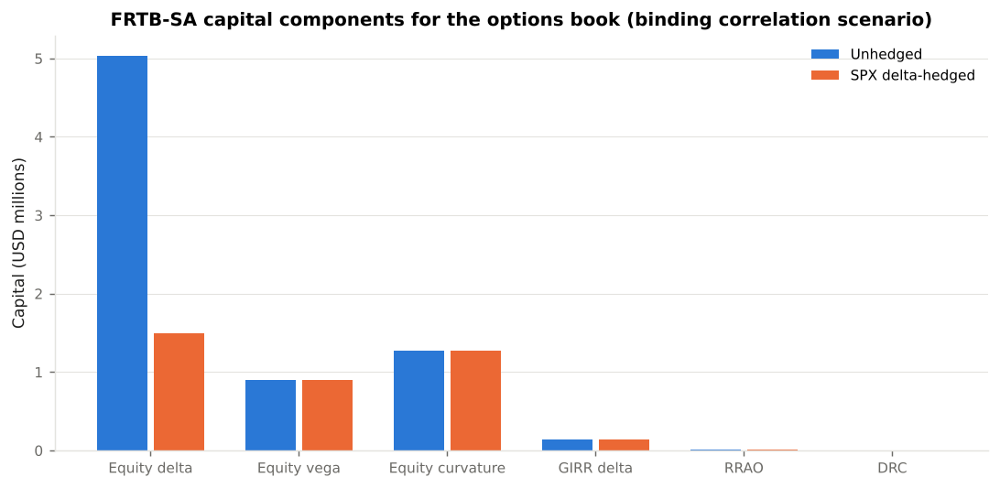
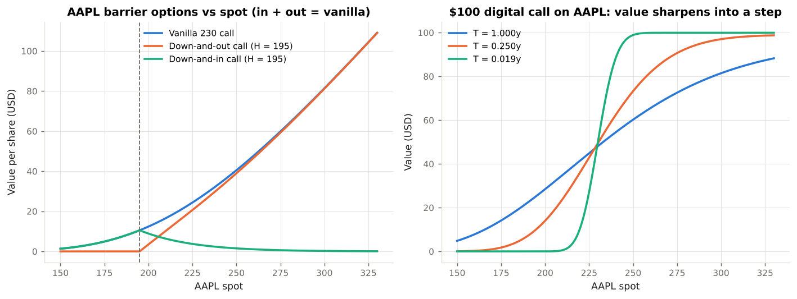

# Black-Scholes Laboratory

**From the 1973 formula to the capital charge: an educational module on option pricing, exotic simulation and U.S. market-risk regulation.**

Black-Scholes Laboratory takes a reader from the derivation of the Black-Scholes-Merton equation to the regulatory capital a U.S. bank would hold against an options book under the Basel III / FRTB standardised approach. Every formula is implemented in the companion Python package `bslab`, every implementation is tested against published reference values and no-arbitrage identities, and every risk-framework application cites the rule text that governs it.

All market data are illustrative and USD-denominated: S&P 500 index options, Apple, Microsoft and JPMorgan single-stock options, and a SOFR OIS discount curve. Nothing here is investment, legal or regulatory advice.

[Start with Chapter 1](01_black_scholes_theory.md){ .md-button .md-button--primary }
[Browse the code on GitHub](https://github.com/sguven/market-risk-toolkit/tree/main/black_scholes_lab){ .md-button }

---

## The course

<div class="grid cards" markdown>

-   :material-function-variant: **1. Black-Scholes theory**

    ---

    Assumptions, Itô's lemma, the replication argument, the PDE, risk-neutral valuation, the closed form and its variants (Merton, Black-76).

    [:octicons-arrow-right-24: Read](01_black_scholes_theory.md)

-   :material-chart-bell-curve: **2. Greeks and hedging**

    ---

    First- and second-order sensitivities, the gamma–theta trade-off, discrete delta hedging, and the mapping from desk Greeks to regulatory sensitivities.

    [:octicons-arrow-right-24: Read](02_greeks_and_hedging.md)

-   :material-shape-outline: **3. Exotic options**

    ---

    Digital, barrier, Asian and lookback options: payoffs, closed forms, discretisation bias and where they appear in U.S. markets.

    [:octicons-arrow-right-24: Read](03_exotic_options.md)

-   :material-dice-multiple-outline: **4. Monte Carlo methods**

    ---

    Exact GBM simulation, statistical error, antithetic and control variates, full-revaluation risk and model governance.

    [:octicons-arrow-right-24: Read](04_monte_carlo_methods.md)

-   :material-bank-outline: **5. U.S. regulatory landscape**

    ---

    Who requires what: FRB/OCC/FDIC capital rules, SR 11-7, DFAST/CCAR, Volcker, margin rules, SEC Rule 18f-4, FINRA, FASB.

    [:octicons-arrow-right-24: Read](05_us_regulatory_landscape.md)

-   :material-scale-balance: **6. FRTB standardised approach**

    ---

    Sensitivities-based method, curvature, residual risk add-on and default risk charge, worked for an equity-options book.

    [:octicons-arrow-right-24: Read](06_frtb_standardised_approach.md)

-   :material-shield-check-outline: **7. Other risk frameworks**

    ---

    Basel 2.5 VaR, FRTB IMA Expected Shortfall, Global Market Shock stress, ISDA SIMM, Rule 18f-4 and SR 11-7 validation.

    [:octicons-arrow-right-24: Read](07_other_risk_frameworks.md)

-   :material-console: **Example outputs and API**

    ---

    Captured output of the six runnable examples with their figures, and the auto-generated reference for the `bslab` package.

    [:octicons-arrow-right-24: Outputs](08_example_outputs.md) · [:octicons-arrow-right-24: API](09_api_reference.md)

</div>

---

## Learning path

| Step | Read | Run | You should be able to… |
|------|------|-----|------------------------|
| 1 | Chapter 1 | `examples/01_vanilla_pricing.py` | Derive the PDE from the hedging argument; explain why drift drops out; read `N(d₁)` and `N(d₂)`; invert for implied vol. |
| 2 | Chapter 2 | `examples/02_delta_hedging_simulation.py` | Compute and interpret every Greek; explain the gamma–theta trade-off; show hedging error ∝ 1/√n. |
| 3 | Chapters 3–4 | `examples/03_exotic_options_simulation.py` | Price digitals, barriers, Asians and lookbacks; explain discretisation bias; cut Monte Carlo variance by two orders of magnitude. |
| 4 | Chapter 5 | — | Name the U.S. regulators and rules that consume option-model outputs. |
| 5 | Chapter 6 | `examples/04_frtb_sa_capital.py` | Turn Greeks into FRTB sensitivities, apply risk weights and correlations, compute curvature, RRAO and DRC. |
| 6 | Chapter 7 | `examples/05_var_es_and_stress.py`, `examples/06_model_validation.py` | Compare VaR methods and ES; run a global-market-shock style stress; produce SR 11-7 validation evidence. |

---

## A glimpse of the results

<div class="grid" markdown>





</div>

Delta hedging the SPX exposure of the example book removes about 70 % of the equity-delta charge and none of the vega or curvature charge: under FRTB a delta-neutral options book is not capital-free. The barrier panel shows knock-in plus knock-out summing to the vanilla at every spot, one of the nineteen no-arbitrage and benchmarking checks that the validation suite enforces.

---

## Quick start

```bash
git clone https://github.com/sguven/market-risk-toolkit.git
cd market-risk-toolkit/black_scholes_lab
pip install -r requirements.txt
python -m pytest -q              # 36 tests
python examples/run_all.py       # six walkthroughs, regenerates docs/figures/
```

```python
from bslab import bs_price, bs_greeks, barrier_option, mc_arithmetic_asian

bs_price(6000, 6000, 1.0, 0.039, 0.16, "call", q=0.013)                    # SPX 1y ATM call
barrier_option(230, 230, 195, 1.0, 0.039, 0.26, "call", "down-and-out", q=0.005)
mc_arithmetic_asian(420, 420, 1.0, 0.039, 0.24, n_fixings=12, q=0.008)
```

## Regulatory sources

| Framework | Source text |
|-----------|-------------|
| FRTB standardised approach | BCBS *Minimum capital requirements for market risk* (January 2019); Basel Framework MAR20–MAR23 |
| FRTB internal models approach | Basel Framework MAR30–MAR33 |
| Current U.S. market risk rule | 12 CFR 217 Subpart F; 12 CFR 3 Subpart F; 12 CFR 324 Subpart F |
| U.S. FRTB implementation | FRB/OCC/FDIC notice of proposed rulemaking, 88 FR 64028 (September 2023) |
| Model risk management | FRB SR 11-7 / OCC Bulletin 2011-12 |
| Stress testing | 12 CFR 252 Subpart E; 12 CFR 225.8; Global Market Shock |
| Margin | 12 CFR 237 / 45 / 349; 17 CFR 23.150–161; ISDA SIMM |
| Funds, broker-dealers, reporting | SEC Rule 18f-4; Rule 15c3-1 Appendix A; FINRA Rule 4210; FASB ASC 718 / 820 / 815 |

Full citations with links: [References](references.md).
