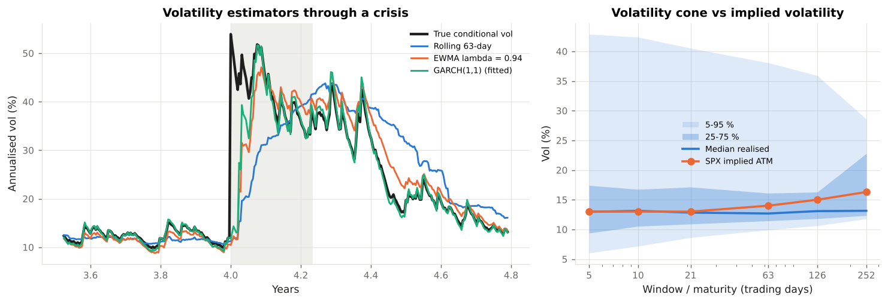
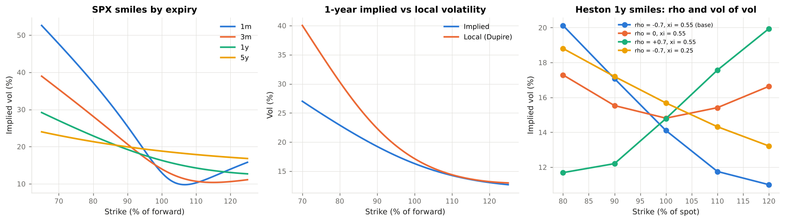
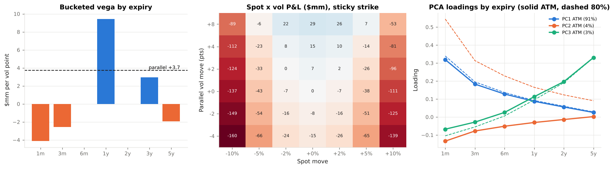
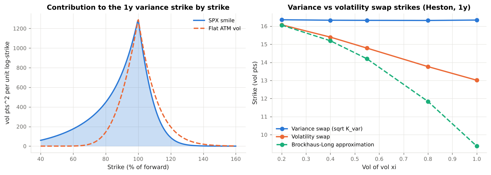
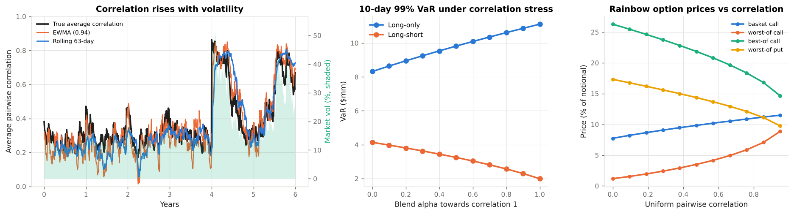
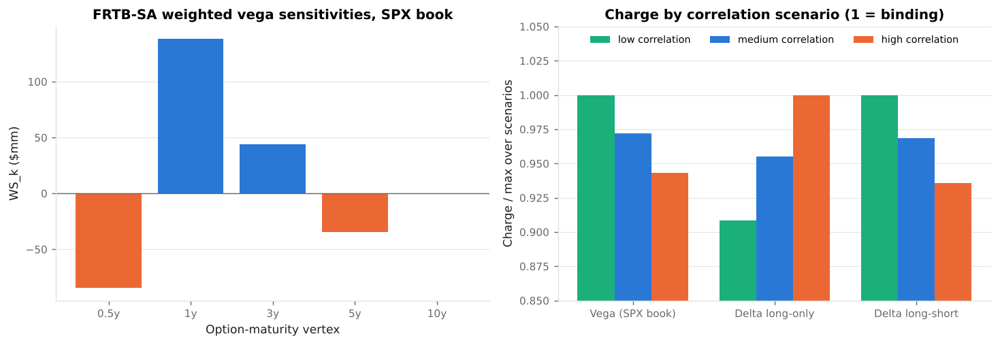

# Volatility & Correlation Risk Laboratory

**An educational module on the two second-order risks of a trading book: volatility risk (estimation, the implied volatility surface, vega risk, variance and volatility swaps) and correlation risk (estimation, breakdown, stress and repair, implied correlation, correlation products), and how FRTB capitalises both.**

`vol_corr_lab` is a self-contained Python project (package `vclab`) that takes a reader from *"what is today's volatility?"* to the capital a bank holds against an options book and a structured-products book. Every formula is implemented, every implementation is tested against closed forms, Monte Carlo and no-arbitrage identities, and every regulatory statement cites the rule text.

**Read it online:** https://sguven.github.io/market-risk-toolkit/vol-corr-lab/ (built from `docs/` with MkDocs Material and deployed by GitHub Actions together with the rest of the repository's site).

All market data are **illustrative, USD-denominated** reference points (an S&P 500-style implied volatility surface, five large-cap U.S. stocks with a one-factor correlation structure, simulated return histories with a scheduled crisis). Nothing here is investment, legal or regulatory advice.

---

## Contents

```
vol_corr_lab/
├── README.md                      <- you are here
├── docs/                          <- the course text (read in order)
│   ├── 01_volatility_and_correlation_risk.md   What the two risks are, where they live, 1987-2020 lessons
│   ├── 02_measuring_volatility.md               Rolling, EWMA, GARCH(1,1), forecast term structure, vol cone, variance risk premium
│   ├── 03_implied_volatility_surface.md         Smile and skew, SVI, static arbitrage, local vol, Heston, sticky rules
│   ├── 04_vega_risk.md                          Vanna/volga, bucketed vega, surface scenarios, spot-vol grid, P&L explain, PCA
│   ├── 05_volatility_products.md                Variance swap replication, VIX methodology, vol swaps and convexity
│   ├── 06_correlation_risk.md                   Breakdown, estimation and shrinkage, stress and repair, implied correlation, rainbows, tails
│   ├── 07_regulation.md                         FRTB vega, correlation scenarios, RRAO, liquidity horizons, RFET/NMRF; U.S., EU, margin
│   ├── 08_example_outputs.md                    Captured console output and figures of the six examples
│   ├── 09_api_reference.md                      Auto-generated from docstrings
│   └── references.md                            Literature and rule texts with links
├── vclab/                         <- the library
│   ├── blackscholes.py            BSM price, delta, gamma, vega, vanna, volga, theta, implied vol
│   ├── market.py                  Illustrative SPX surface, five-stock universe, GARCH factor history, surface history
│   ├── surface.py                 SVI slices, surface interpolation, arbitrage checks, Dupire local vol, shifted surfaces
│   ├── vol_estimation.py          Rolling and EWMA vol, GARCH(1,1) MLE and term structure, vol cone
│   ├── heston.py                  Heston characteristic-function pricing, simulation, expected variance
│   ├── instruments.py             Options and delta-hedged option books valued off a surface
│   ├── vol_risk.py                Bucketed vega, surface scenarios, spot-vol grid, smile delta, P&L explain, PCA
│   ├── vol_products.py            Variance swap strike, VIX-style index, variance swap P&L/MtM, vol swap convexity
│   ├── correlation.py             EWMA, Ledoit-Wolf, nearest correlation, stress, implied correlation, basket/rainbow, cega, tail dependence
│   ├── regulatory.py              FRTB-SA vega and delta charges with correlation scenarios, RRAO, ES liquidity cascade, RFET, SES, IMCC
│   └── reporting.py               Console tables
├── examples/                      <- runnable walkthroughs that generate the figures
│   ├── 01_measuring_volatility.py
│   ├── 02_implied_volatility_surface.py
│   ├── 03_vega_risk.py
│   ├── 04_volatility_products.py
│   ├── 05_correlation_risk.py
│   ├── 06_regulatory_capital.py
│   ├── run_all.py                 Run everything
│   └── _build_outputs_page.py     Regenerate docs/08_example_outputs.md from the captured output
├── tests/                         <- pytest suite (reference values, arbitrage, Monte Carlo repricing, additivity, FRTB mechanics)
├── mkdocs.yml                     <- site configuration (MkDocs Material)
├── pyproject.toml
└── requirements.txt
```

---

## Quick start

```bash
cd vol_corr_lab
pip install -r requirements.txt          # numpy, scipy, matplotlib, pytest
python -m pytest -q                      # 50 tests, ~5 s
python examples/run_all.py               # all six walkthroughs, ~15 s, writes docs/figures/
pip install mkdocs-material "mkdocstrings[python]" && mkdocs serve   # browse the site locally
```

Or use the library directly:

```python
from vclab import *

s = SPX_SURFACE
book = example_book(s.spot, s)                                      # delta-hedged SPX options book
book.greeks(s.spot, s)                                              # vega, vanna, volga per vol point; theta per day
vega_buckets(book, s.spot, s, [1/12, 0.25, 0.5, 1, 2, 3, 5])        # bucketed vega, adds up to parallel vega
book.value(s.spot, surface_scenario(s, "weighted", 0.01))           # sqrt-time weighted vol scenario
variance_swap_strike(s, 1.0) ** 0.5                                 # 1y variance swap vol by replication

g = fit_garch11(simulate_factor_returns().market)                   # GARCH(1,1) by maximum likelihood
nearest_correlation(override_pairs(STOCK_CORRELATION, {(0, 1): 0.95, (0, 4): -0.6}))   # repair a stressed matrix
rainbow_price("worst-of call", STOCK_VOLS[:3], STOCK_CORRELATION[:3, :3], 1.0, 1.0, 0.039)
equity_vega_charge({("SPX", 12): vega_sensitivities(book, s.spot, s)}).by_scenario    # FRTB-SA vega, 3 scenarios
```

---

## Learning path

| Step | Read | Run | You should be able to… |
|------|------|-----|------------------------|
| 1 | `docs/01` | — | Explain why volatility and correlation are risks, name the instruments that carry them, and say why both rise in a crisis. |
| 2 | `docs/02` | `examples/01` | Compare rolling, EWMA and GARCH volatility; fit GARCH; build a forecast term structure; explain the variance risk premium. |
| 3 | `docs/03` | `examples/02` | Read a vol surface; fit SVI; check butterfly and calendar arbitrage; derive local vol; explain how spot-vol correlation creates skew. |
| 4 | `docs/04` | `examples/03` | Bucket vega so that it adds up; run weighted, twist and skew scenarios; explain sticky strike vs sticky moneyness; attribute P&L. |
| 5 | `docs/05` | `examples/04` | Price a variance swap by replication; rebuild a VIX-style index; explain the convexity between variance and volatility swaps. |
| 6 | `docs/06` | `examples/05` | Estimate, shrink, stress and repair a correlation matrix; compute implied correlation; sign the cega of rainbow options. |
| 7 | `docs/07` | `examples/06` | Compute the FRTB vega charge and the binding correlation scenario; apply the RRAO, the liquidity cascade and the RFET. |

---

## What the examples show

### 01 — Measuring volatility
Rolling, EWMA and GARCH estimates scored against the true conditional vol through a simulated crisis; GARCH fitted by maximum likelihood (persistence 0.982 vs 0.980 true); forecast term structures in calm and stress; the volatility cone against implied vols.



### 02 — The implied volatility surface
The SPX surface by expiry and moneyness, SVI parameters and arbitrage checks, an SVI fit to noisy quotes, Dupire local vol (skew 1.5–1.7 times the implied skew), and Heston smiles showing that spot-vol correlation makes the skew.



### 03 — Vega risk
A delta-hedged SPX book long $3.7mm of parallel vega that loses $9.4mm on a sqrt-time weighted vol rise; bucketed vega by expiry and moneyness; spot × vol grids under two smile rules; P&L explain (3.5 % unexplained on a normal day, 20 % on a stress day); PCA of surface moves.



### 04 — Volatility products
Variance swap strikes 3.6–5.5 points above ATM vol, half of the one-year strike coming from puts below 90 %; a Cboe-style 30-day index and the cost of truncating the strip; convex variance swap P&L; the volatility-swap convexity adjustment growing with vol of vol.



### 05 — Correlation risk
Average correlation rising from 0.25 to 0.76 in the crisis and the diversification ratio collapsing; Ledoit-Wolf shrinkage; correlation stress for long-only vs long-short books; repairing an inconsistent stressed matrix; implied correlation and the correlation risk premium; prices and cega of basket, worst-of and best-of options; tail dependence.



### 06 — Regulatory capital
FRTB-SA vega sensitivities and charge under the three correlation scenarios (and why the SA nets the book's term-structure risk); delta charges whose binding scenario flips with portfolio direction; the RRAO for correlation products; the MAR33.4 liquidity cascade; the risk-factor eligibility test and stress-scenario capital for non-modellable vol and correlation factors.



---

## Regulatory references used

| Framework | Source text | Where applied |
|-----------|-------------|---------------|
| SBM vega, correlation scenarios, equity delta | Basel Framework MAR21 (21.4, 21.6–21.7, 21.8, 21.25, 21.77–21.80, 21.92 ff.) | `regulatory.equity_vega_charge`, `equity_delta_charge`, `scenario_correlation` |
| Residual risk add-on | Basel Framework MAR23 | `regulatory.rrao_correlation` |
| Risk-factor eligibility test | Basel Framework MAR31.12 | `regulatory.rfet` |
| P&L attribution | Basel Framework MAR32 | `docs/04`, `docs/07` |
| ES, liquidity horizons, IMCC, SES | Basel Framework MAR33.4, 33.5, 33.12, 33.15–33.17 | `regulatory.liquidity_adjusted_es`, `imcc`, `ses_aggregate` |
| U.S. market risk capital | 12 CFR 217 subpart F; 88 FR 64028 (proposal) | `docs/07` |
| EU | CRR2 / CRR3, Articles 325 ff. | `docs/07` |
| Model risk | FRB SR 11-7 / OCC 2011-12 | `docs/02`, `docs/03`, `docs/06` |
| Volatility index | Cboe VIX White Paper | `vol_products.vix_style_index` |

Full citations with links are in [`docs/references.md`](docs/references.md); the machine-readable list is `vclab.regulatory.REGULATORY_REFERENCES`.

---

## Design notes

* **Known truth.** Return histories come from a one-factor model with a GARCH market factor, so the true conditional volatility and correlation are known and every estimator is scored against them.
* **An arbitrage-free surface.** The SPX surface is built from SVI slices that pass Durrleman's butterfly test, the calendar test and Lee's wing bound (tested); local volatility from it reprices the smile by Monte Carlo to within 0.3 vol points.
* **Additive risk measures.** Vega buckets use hat-function bumps that sum to a parallel bump, so bucketed vega adds up to parallel vega; FRTB vertices use the same allocation.
* **Common random numbers.** Rainbow prices reuse the same draws across correlation bumps, so cega is smooth and its sign is stable.
* **Explicit simplifications.** Flat rates and dividends; one underlying for the vol book; Gaussian innovations in GARCH; strike not a separate FRTB vega risk factor; additive P&L across risk-factor groups in the ES cascade; the SES formula transcribed from MAR33.17 and flagged for verification.

## Scope and disclaimer

Educational material. Regulatory parameters are those of the Basel Framework as in force on 1 January 2023; the U.S. FRTB proposal is described as a proposal. Market data are synthetic. Verify every figure against primary sources before any professional use.
