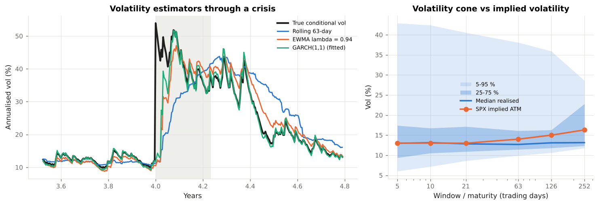

# 2. Measuring Volatility

This chapter covers **how volatility is estimated from a price history and how it is forecast**: rolling windows, the exponentially weighted moving average of RiskMetrics, GARCH(1,1), the term structure of forecasts, the volatility cone, and the variance risk premium that separates statistical forecasts from implied volatility. Code: `vclab/vol_estimation.py`. Example: `examples/01_measuring_volatility.py`.

---

## 2.1 What is being estimated

Volatility is the standard deviation of returns per unit of time. For daily log returns `r_t = ln(S_t / S_{t−1})` the annualised volatility is `σ = sd(r) × sqrt(252)`. Three facts about real returns shape every estimator:

* **Volatility clusters.** Large moves follow large moves. The variance of today's return is predictable from recent returns, even though the sign is not.
* **Volatility mean-reverts.** High-volatility episodes end; a forecast should drift back towards a long-run level.
* **The mean is noise.** At a daily horizon the expected return is tiny compared with its standard error, so risk estimators use **zero-mean** variance `(1/n) Σ r²`. That is also the convention of variance swaps.

The module's synthetic market factor is a GARCH(1,1) process with long-run volatility 16 %, so the "true" conditional volatility is known and every estimator can be scored against it (`market.simulate_factor_returns`).

---

## 2.2 Three estimators

### Rolling window

```
σ²_t = (1/n) Σ_{i=1..n} r²_{t−i}
```

Every return in the window has weight `1/n` and then disappears. A crisis day keeps the estimate high for exactly `n` days and then drops out abruptly (the *ghost effect*). Short windows are noisy; long windows are slow.

### EWMA (RiskMetrics 1996)

```
σ²_t = λ σ²_{t−1} + (1 − λ) r²_{t−1}
```

Weights decay geometrically. The half-life is `ln 0.5 / ln λ`: 11 days for the RiskMetrics daily choice `λ = 0.94`, 23 days for 0.97. EWMA has no long-run level, so its forecast is the same at every horizon.

### GARCH(1,1) (Bollerslev 1986)

```
σ²_t = ω + α r²_{t−1} + β σ²_{t−1}          ω > 0, α, β ≥ 0, α + β < 1
V_L  = ω / (1 − α − β)                        long-run variance
```

EWMA is the special case `ω = 0, α + β = 1`. With `α + β < 1` variance mean-reverts to `V_L`; the persistence `α + β` sets the half-life of a shock, `ln 0.5 / ln(α + β)`. Parameters are estimated by maximising the Gaussian log-likelihood `−½ Σ [ln σ²_t + r²_t / σ²_t]` (`vol_estimation.fit_garch11`).

### Scoring them through a crisis

Example 01 forecasts tomorrow's volatility with each estimator and compares it with the volatility the simulation used:

| Estimator | RMSE, all days (vol pts) | RMSE, crisis | Days to reach the peak |
|---|---|---|---|
| Rolling 21-day | 3.6 | 14.6 | 26 |
| Rolling 63-day | 5.1 | 18.1 | 68 |
| EWMA λ = 0.94 | 3.3 | 13.7 | 22 |
| EWMA λ = 0.97 | 4.2 | 16.0 | 73 |
| GARCH(1,1), fitted | 2.5 | 12.0 | 19 |

The fitted GARCH recovers the true persistence (0.982 against 0.980) and long-run vol (16.7 % against 16 %). It wins here because it is the true model; on real data the gap is narrower and the choice of estimator is itself a model-risk decision under SR 11-7.



---

## 2.3 Forecasting a term structure

GARCH's expected variance `h` days ahead is

```
E[σ²_{t+h}] = V_L + (α + β)^{h−1} (σ²_{t+1} − V_L)
```

and the average expected variance over the next `T` days, the quantity an option of maturity `T` cares about, is

```
σ²(T) = 252 × [ V_L + (1 − p^T) / (T (1 − p)) × (σ²_{t+1} − V_L) ],     p = α + β
```

(`Garch11.term_structure`; Hull 2022, ch. 23). After a shock the forecast term structure is **inverted** (short-dated vol above long-dated); in calm markets it **slopes upwards**. Example 01 shows both:

| Forecast made on | 1m | 3m | 1y | 2y |
|---|---|---|---|---|
| A calm day (GARCH vol 10 %) | 11.5 | 13.2 | 15.5 | 16.1 |
| The crisis peak (52 %) | 47.8 | 41.4 | 28.3 | 23.3 |
| SPX implied ATM (illustrative) | 13.0 | 14.0 | 16.3 | 17.5 |

Implied volatility has the same shapes, which is why the illustrative SPX surface slopes upwards in calm conditions and why short-dated implied vol moves most in a shock (Chapter 4's sqrt-time rule).

---

## 2.4 The volatility cone

The **volatility cone** (Burghardt & Lane 1990) plots quantiles of rolling realised volatility for windows of different length. Short windows have a wide cone because short-horizon realised vol is noisy and mean-reverting; long windows converge on the long-run level. Overlaying implied vol by maturity on the cone shows whether options are rich or cheap relative to history. It is a simple, model-free tool that every options desk uses, and also a reminder that a "normal" 10-day realised vol ranges from 7 % to over 40 % in the same history.

---

## 2.5 Realised versus implied: the variance risk premium

Implied volatility is a **price**, not a forecast. On average index implied volatility exceeds subsequently realised volatility: investors pay for protection against volatility spikes, which come with market falls (Bakshi & Kapadia 2003; Carr & Wu 2009). The difference is the **variance risk premium**. It is why:

* a delta-hedged short option position earns money on average and loses heavily in crises;
* a variance swap's fair strike (Chapter 5) sits above the expected realised variance;
* volatility-selling strategies have high Sharpe ratios and large negative skewness.

A risk manager therefore keeps two volatilities apart: the **risk-neutral** implied vol that values the book, and the **statistical** vol that drives VaR and capital. Mixing them up overstates or understates risk depending on the regime.

---

## 2.6 Volatility of volatility

Volatility itself is volatile. Example 01 measures the annualised volatility of daily log changes in 21-day realised vol at about 86 %; implied vol indices show similar orders of magnitude. Volatility of volatility matters for three reasons covered later:

* it creates the curvature of the smile (Heston's `ξ`, Chapter 3);
* it is the convexity between variance and volatility swaps (Chapter 5);
* it makes vega risk non-linear (volga, Chapter 4).

---

## 2.7 Model risk

Every estimator above embeds choices: window length, decay factor, distribution of innovations (Gaussian versus Student-t), whether to use intraday data (realised-variance estimators from high-frequency returns are more efficient), and how to treat holidays and asynchronous closes. Supervisory guidance on model risk (SR 11-7 / OCC 2011-12) expects these choices to be documented, benchmarked against alternatives, and backtested. FRTB adds an explicit requirement to calibrate the expected shortfall to a period of stress (MAR33.5), which removes the incentive to pick a short, calm window.
