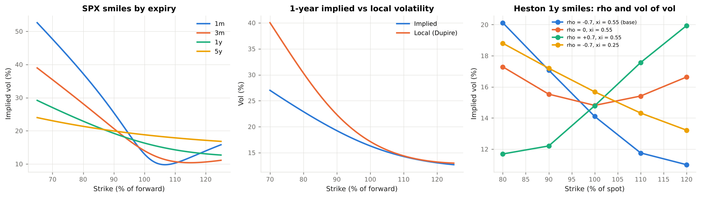

# 3. The Implied Volatility Surface

This chapter explains **what the option market says about volatility and how to represent it**: the smile and the term structure, the SVI parameterisation, the static no-arbitrage conditions, local volatility, stochastic volatility and spot-vol correlation, and the rules for how the surface moves when spot moves. Code: `vclab/surface.py`, `vclab/heston.py`, `vclab/market.py`. Example: `examples/02_implied_volatility_surface.py`.

---

## 3.1 From one number to a surface

Black-Scholes assumes one constant volatility. Inverting the formula on market prices gives a different **implied volatility** for every strike `K` and expiry `T`. The resulting function `σ(K, T)` is the implied volatility surface, and it is how options are quoted, marked and risk-managed. The illustrative SPX surface of `vclab` (strike as a percentage of the forward):

| Expiry | 70 % | 80 % | 90 % | 100 % | 110 % | 120 % |
|---|---|---|---|---|---|---|
| 1m | 47.6 | 37.2 | 25.5 | 13.0 | 10.3 | 13.9 |
| 3m | 35.4 | 28.2 | 20.7 | 14.0 | 10.7 | 10.6 |
| 1y | 27.0 | 22.9 | 19.2 | 16.3 | 14.3 | 13.1 |
| 5y | 23.0 | 21.3 | 19.9 | 18.8 | 17.9 | 17.1 |

Three features matter:

* **Skew.** Implied vol falls as the strike rises. Equity-index puts are expensive relative to a lognormal model because the market prices crash risk and because index returns are negatively correlated with volatility.
* **Skew term structure.** The skew is steepest at short maturities and flattens roughly like `T^−0.5` (here `T^−0.55`): 8.9 vol points per 10 % of moneyness at one month, 2.5 at one year, 1.0 at five years.
* **ATM term structure.** In calm markets ATM vol rises with maturity (13 % to 18.8 %); after a shock it inverts (Chapter 2).



---

## 3.2 SVI: one smile per expiry

The module stores each expiry as a **raw SVI** slice (Gatheral 2004) in log forward-moneyness `k = ln(K/F)`:

```
w(k) = σ²_imp(k) T = a + b [ ρ (k − m) + sqrt((k − m)² + s²) ]
```

| Parameter | Role |
|---|---|
| `a` | overall level of total variance |
| `b` | angle between the wings (how fast variance grows away from the money) |
| `ρ` | rotation: the skew (negative for equities) |
| `m` | horizontal shift |
| `s` | ATM curvature: smoothness of the vertex |

SVI is popular because its wings are linear in `k`, matching Roger Lee's (2004) result that total variance grows at most linearly in the wings, and because it fits liquid index smiles with five numbers. `fit_svi` calibrates a slice to quotes by least squares; in Example 02 a fit to quotes with 15 bp of noise lands 8 bp from the true smile, halving the error, while guaranteeing a smooth, arbitrage-free curve. With noisy data individual SVI parameters are poorly identified (the fitted `ρ` hits its bound) even though the smile is well determined: one reason to monitor the fitted *smile*, not the parameters.

The illustrative surface is built from ATM level, ATM skew and a `ρ` that moves from −0.6 at one month to −0.9 at five years (`market.build_spx_surface`). Between expiries the surface interpolates **total variance linearly in time at fixed `k`**, which is the simplest interpolation that keeps calendar arbitrage away when the slices are ordered.

---

## 3.3 Static arbitrage

A surface can only be used for pricing if no static portfolio of options makes money for nothing. Three conditions are checked:

| Condition | Meaning | Test | Code |
|---|---|---|---|
| **Butterfly** | The implied risk-neutral density is non-negative: a butterfly spread has non-negative value. | Durrleman's `g(k) = (1 − k w′/2w)² − (w′²/4)(1/w + 1/4) + w″/2 ≥ 0` | `SviSlice.durrleman_g`, `VolSurface.butterfly_arbitrage` |
| **Calendar** | A longer-dated option is worth at least a shorter one at the same moneyness. | `∂w/∂T ≥ 0` at every `k` | `VolSurface.calendar_arbitrage` |
| **Wing slope** | Moments of the underlying are finite (Lee 2004). | wing slopes `b(1 ± ρ) ≤ 2` | `SviSlice.wing_slopes` |

The SPX surface passes all three (minimum `g` above 0.12, minimum calendar increase 0.0008). The tests also construct an SVI slice that violates the butterfly condition and check that `g` detects it. Gatheral & Jacquier (2014) give conditions under which SVI surfaces are arbitrage-free by construction.

Why a risk manager cares: an arbitrageable surface produces negative densities, negative prices for some payoffs, and Monte Carlo or PDE models that cannot be calibrated. A surface with tiny violations still passes most pricing tests but fails in exotic pricing and in stressed scenarios; arbitrage checks belong in the daily controls of the market-data process.

---

## 3.4 Local volatility

Dupire (1994) and Derman & Kani (1994) showed that there is exactly one diffusion `dS/S = (r − q) dt + σ_loc(S, t) dW` that reprices every European option on the surface. In total-variance form (Gatheral 2006, eq. 1.10):

```
σ²_loc(K, T) = (∂w/∂T) / [ 1 − (k/w) ∂w/∂k + ¼(−¼ − 1/w + k²/w²)(∂w/∂k)² + ½ ∂²w/∂k² ]
```

(`surface.local_vol`). The tests check the implementation two ways: it reduces to the implied vol for a flat surface and to the forward variance for a surface with term structure only; and a Monte Carlo simulation with the local volatility function reprices 1-year options at the 85 % and 110 % strikes to within 0.3 vol points.

Near the money the **local-vol skew is steeper than the implied skew**: implied vol at strike `K` is roughly an average of local vols along the way from spot to `K`. For a skew constant in maturity the ratio is two (Derman's "rule of two"); for a skew decaying like `T^−p` the short-maturity ratio is about `2 − p`. Example 02 measures 1.5–1.7 on the SPX surface.

Local volatility reprices vanillas perfectly but predicts that the smile flattens in the future and moves the "wrong" way when spot moves. Products that depend on the *forward* smile (cliquets, forward-starting options, autocallables) are mispriced by it, which is the main reason stochastic-volatility and local-stochastic-volatility models exist.

---

## 3.5 Stochastic volatility and spot-vol correlation

The Heston (1993) model lets variance follow its own mean-reverting process:

```
dS/S = (r − q) dt + sqrt(v) dW₁
dv   = κ (θ − v) dt + ξ sqrt(v) dW₂,      corr(dW₁, dW₂) = ρ
```

`vclab.heston` prices European options with the characteristic function (in the numerically stable form of Albrecher et al. 2007) and simulates paths with a full-truncation Euler scheme. Example 02 shows the two parameters that shape the smile:

| Heston 1y smile (v₀ = 15 %², θ = 17.3 %², κ = 2) | 80 % | 100 % | 120 % |
|---|---|---|---|
| ρ = −0.7, ξ = 0.55 | 20.1 | 14.1 | 11.0 |
| ρ = 0, ξ = 0.55 | 17.3 | 14.8 | 16.6 |
| ρ = +0.7, ξ = 0.55 | 11.7 | 14.8 | 19.9 |
| ρ = −0.7, ξ = 0.25 | 18.8 | 15.7 | 13.2 |

* **Spot-vol correlation `ρ` creates the skew.** With `ρ < 0` variance rises when spot falls, fattening the left tail. This is the first *correlation* risk an options desk faces: the joint move of spot and vol determines vanna P&L and the effective hedge ratio.
* **Vol of vol `ξ` creates the curvature** and the convexity of volatility products (Chapter 5).

Other models in common use include SABR (Hagan et al. 2002) for rates and FX, Bergomi's variance-curve models for forward-smile products, and local-stochastic-volatility hybrids calibrated to both the surface and a view on its dynamics.

---

## 3.6 Smile dynamics: how the surface moves with spot

A risk system must decide what happens to implied vol at a fixed strike when the spot moves. The classic rules (Derman 1999):

| Rule | Assumption | Vol at fixed strike when spot rises (downward skew) | Effect on delta |
|---|---|---|---|
| **Sticky strike** | `σ(K)` unchanged | unchanged | Black-Scholes delta |
| **Sticky moneyness / sticky delta** | `σ(K/F)` unchanged: the smile moves with the forward | rises (the strike is now lower in moneyness) | BS delta + vega × `∂σ/∂S`, higher for a long option |
| **Local volatility** | implied by the Dupire model | falls | lower than BS delta |

`VolSurface.with_spot` implements sticky moneyness; keeping the surface object is sticky strike. For the example book the two rules give deltas that differ by 50,000 index units (about $300mm of SPX exposure). Empirically index smiles behave differently in different regimes; in sharp sell-offs fixed-strike vols rise, which neither of the first two rules predicts. The rule is therefore a model choice with P&L consequences: it decides how much the desk hedges, and an unhedged smile-delta shows up as unexplained P&L (Chapter 4).

---

## 3.7 Model governance of the surface

The implied vol surface is a model output built from quotes, interpolation, extrapolation and arbitrage repairs. The controls a validator expects:

* **Independent price verification** of marked vols against consensus services and trades, with stale-quote detection.
* **Daily arbitrage checks** (butterfly, calendar, wing slopes) and documented repairs.
* **Extrapolation policy** for strikes and maturities beyond the quotes, with prudent-valuation reserves where the extrapolation drives value; in the EU these are additional valuation adjustments for model risk and close-out costs.
* **Observability classification**: deep out-of-the-money and long-dated vols are often unobservable (Level 3 under ASC 820 / IFRS 13) and non-modellable under FRTB (Chapter 7).
