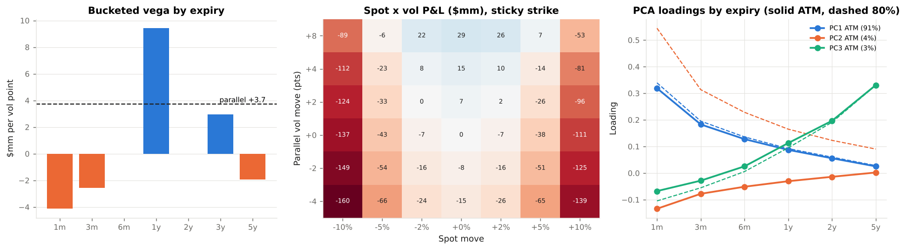

# 4. Vega Risk

This chapter shows **how an options desk measures, decomposes and limits its exposure to the implied volatility surface**: position Greeks, bucketed vega, surface scenarios, the spot-vol grid, smile-adjusted deltas, P&L explain and principal components. Code: `vclab/instruments.py`, `vclab/vol_risk.py`. Example: `examples/03_vega_risk.py`.

---

## 4.1 The example book

`instruments.example_book` is an illustrative SPX dealer book, delta-hedged with the underlying:

| Position | Contracts | Strike | Vega ($k / vol pt) |
|---|---|---|---|
| 1m ATM straddle (short) | −3,000 + −3,000 | 6,000 | −4,130 |
| 3m 90 % put (short) | −4,000 | 5,400 | −2,570 |
| 1y ATM call | +2,500 | 6,000 | +5,742 |
| 1y 85 % put | +2,500 | 5,100 | +3,679 |
| 3y ATM call | +800 | 6,000 | +2,944 |
| 5y 80 % put (short) | −600 | 4,800 | −1,927 |
| **Total** | | | **+3,738** |

Gross notional is $9.8bn. The book is long $3.7mm of vega per point: "long vol". Everything below shows why that single number is not enough.

---

## 4.2 Second-order vol Greeks

| Greek | Shown in Example 03 as | Where it comes from |
|---|---|---|
| **Vanna** `∂²V/∂S∂σ` | change in vega for +1 % spot | out-of-the-money options; sign depends on strike side |
| **Volga** `∂²V/∂σ²` | change in vega for +1 vol point | out-of-the-money options; zero at the money |

At-the-money options carry almost no vanna or volga; the 3m 90 % put and the 1y 85 % put carry most of it. Vanna links vega P&L to the spot move, so with negative spot-vol correlation a short-put book loses twice in a sell-off: on delta-gamma and on vega rising as the puts move towards the money. Volga is what makes vol-of-vol a priced risk: a long-volga book benefits from large vol moves in either direction.

---

## 4.3 Bucketed vega

A vega **bucket** is the P&L of bumping the surface by one vol point in one region. `vol_risk.vega_buckets` shapes each bump as a hat (tent) function in expiry and, optionally, in moneyness; the hats in each dimension sum to one, so the buckets add up to the parallel vega exactly (tested). For the example book:

| Expiry | 1m | 3m | 6m | 1y | 2y | 3y | 5y | Sum |
|---|---|---|---|---|---|---|---|---|
| Vega ($mm / pt) | −4.13 | −2.57 | 0.00 | +9.42 | 0.00 | +2.94 | −1.93 | +3.74 |

and by expiry × moneyness the short exposure sits in the 1m ATM and 3m 90 % buckets, the long exposure in the 1y 80–100 % buckets, and the 5y exposure entirely in the 80 % put wing. The book is short the front end and long the one-year point; two books with the same parallel vega can have opposite risks.

Practical choices that change bucketed vega and must be documented:

* **Bump shape**: hat functions (additive, used here), step functions (each option to its nearest bucket), or bumps in total variance rather than vol.
* **Bump coordinates**: absolute strike, moneyness `K/F`, or delta. Bucketing by delta is common in FX.
* **Bump size and differencing**: central differences with a small bump make buckets additive to second order.



---

## 4.4 Surface scenarios

Implied vols do not move in parallel. Short-dated vol moves more than long-dated, roughly in proportion to `sqrt(1y / T)`, and skew steepens in sell-offs. `vol_risk.surface_scenario` provides the standard shapes:

| Scenario | P&L ($mm) |
|---|---|
| Parallel +1 pt | +3.72 |
| sqrt-time weighted +1 pt (1y) | **−9.39** |
| Twist: 1m +1 pt, 5y −1 pt | −7.65 |
| Skew +1 pt per 10 % of moneyness | +0.50 |

The book is long parallel vega but **loses on the most common empirical move**, because its short 1m and 3m vega is multiplied by `sqrt(12) ≈ 3.5` and `2` in the weighted scenario. Desks therefore limit *weighted* vega and term-structure and skew buckets, not parallel vega.

---

## 4.5 The spot × vol grid and smile dynamics

The classic risk report is a grid of P&L for joint spot and vol moves (`spot_vol_grid`). The example book loses in every large spot move (it is short gamma through the short-dated options) and the loss is only partly offset by a vol rise. The grid depends on the smile-dynamics rule of Chapter 3.6: the same −5 % spot, +4 pt vol scenario loses $23.4mm under sticky strike and $18.2mm under sticky moneyness.

The rule also changes the hedge. Under sticky strike the book is delta-neutral; under sticky moneyness its delta is about −50,000 index units. That gap is the **smile delta**, `vega × ∂σ/∂S`, and choosing the rule is choosing how much of the vega risk to hedge with the underlying.

---

## 4.6 P&L explain

A Taylor expansion attributes daily P&L to the Greeks:

```
dV ≈ Δ dS + ½ Γ dS² + ν dσ + vanna dS dσ + ½ volga dσ² + θ dt
```

with each option's `dσ` read at its own strike (`vol_risk.pnl_explain`). Comparing with full revaluation:

| | Normal day (spot −0.5 %, vol +0.5 pt) | Stress day (spot −3 %, vol +4 pt) |
|---|---|---|
| Gamma | −0.46mm | −16.6mm |
| Vega | −3.15mm | −30.0mm |
| Vanna + volga | −0.10mm | −6.3mm |
| Theta | +1.25mm | +1.25mm |
| Actual | −2.55mm | −42.9mm |
| **Unexplained** | **3.5 %** | **20 %** |

On a normal day the Greeks explain the P&L well. On a stress day the higher-order terms dominate. This gap is what the FRTB **P&L attribution test** (MAR32) measures between the risk model's P&L and the front office's: a desk whose risk model omits vol risk factors, smile dynamics or cross-gamma fails it and loses internal-model approval.

---

## 4.7 Principal components of surface moves

Daily changes of an implied vol grid are highly correlated. A principal-component analysis (`vol_risk.pca`) of the synthetic surface history in `market.simulate_surface_history` finds:

| Component | Shape | Share of variance |
|---|---|---|
| PC1 | level, larger at the short end | 91 % |
| PC2 | term-structure tilt | 4 % |
| PC3 | skew | 3 % |

Empirical studies of S&P 500 surfaces report the same small number of dominant factors (Skiadopoulos, Hodges & Clewlow 1999; Cont & da Fonseca 2002). PCA gives a compact vega risk model: the book loses $3.0mm on a one-standard-deviation daily level move, gains $0.4mm on PC2 and $0.9mm on PC3. Its weaknesses are that factor shapes change across regimes and that the residual components carry exactly the localised risks (a single expiry, a single wing) that bucketed limits are designed to catch.

---

## 4.8 A vega risk framework

| Layer | Measure | Purpose |
|---|---|---|
| Sensitivities | Parallel, weighted and bucketed vega; vanna; volga | Daily limits and hedging |
| Scenarios | Parallel, weighted, twist, skew, spot × vol grids under two smile rules | Limits on shapes that sensitivities miss |
| Statistical | PCA factors in VaR / ES, with liquidity horizons for vol factors | Capital and risk appetite |
| Stress | Historical (1987, 2008, 2018, 2020) and hypothetical surface shocks | Tail risk, recovery planning |
| Controls | P&L explain, surface arbitrage checks, independent price verification | Model risk and valuation |
