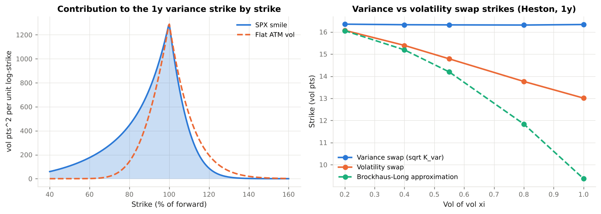

# 5. Volatility Products

This chapter covers **instruments that trade volatility directly**: variance swaps and their replication, the VIX methodology, volatility swaps and the convexity adjustment, and what these products teach about the tail risk of selling volatility. Code: `vclab/vol_products.py`, `vclab/heston.py`. Example: `examples/04_volatility_products.py`.

---

## 5.1 Why trade volatility directly

An option is a bundled bet on direction and volatility; delta hedging removes the direction but leaves a vega that depends on where spot goes (an ATM option's vega fades as spot moves away). Variance swaps deliver **pure exposure to realised variance**, whatever the path of the spot.

| Product | Payoff at maturity | Main users |
|---|---|---|
| Variance swap | `N_var (σ²_R − K_var)` | Volatility funds, dealers hedging exotic books, dispersion traders |
| Volatility swap | `N_vol (σ_R − K_vol)` | Investors wanting linear vol exposure |
| VIX futures and options | VIX at expiry (a 30-day implied variance index) | Hedgers, ETPs, tail-risk funds |
| Correlation swap | `N (ρ_R − K_ρ)` | Structured-products desks hedging correlation (Chapter 6) |

`σ²_R` is the annualised realised variance of daily log returns, `(252/n) Σ r²_t`.

---

## 5.2 Replicating a variance swap

Itô's lemma gives `d ln S = dS/S − ½ σ² dt`, so

```
(1/T) ∫₀ᵀ σ²_t dt  =  (2/T) [ ∫₀ᵀ dS/S − ln(S_T / S_0) ]
```

Realised variance equals twice the P&L of a delta-hedged *short log contract*. The log payoff is replicated statically by a strip of out-of-the-money options weighted by `1/K²` (Carr & Madan 1998; Demeterfi, Derman, Kamal & Zou 1999), which gives the fair strike:

```
K_var = (2 e^{rT} / T) [ ∫₀^F P(K) / K² dK + ∫_F^∞ C(K) / K² dK ]
```

(`vol_products.variance_swap_strike`). On a flat surface `K_var = σ²` (tested). With a skew the strike exceeds ATM variance because the strip is long low-strike puts at high vols:

| Maturity | ATM vol | Variance swap strike (vol pts) | Strike − ATM |
|---|---|---|---|
| 1m | 13.0 | 16.8 | +3.8 |
| 1y | 16.3 | 20.4 | +4.1 |
| 5y | 18.8 | 24.3 | +5.5 |

Example 04 decomposes the one-year strike by strike range: puts below 90 % of the forward contribute **51 %** of the fair variance, strikes below 60 % alone 15 %. A variance swap is mostly a claim on the crash tail. The dealer who sells it and hedges by buying the strip needs deep out-of-the-money puts; where those do not trade, the hedge is truncated and the dealer is short the tail. Variance swaps on single stocks are often sold with a **cap** (typically 2.5 × the strike in vol terms) for exactly this reason.



---

## 5.3 The VIX methodology

Cboe's VIX discretises the same integral with listed SPX strikes and interpolates two expiries to 30 days:

```
σ² = (2/T) Σ_i (ΔK_i / K_i²) e^{rT} Q(K_i)  −  (1/T) (F/K₀ − 1)²
```

where `Q(K_i)` is the out-of-the-money option mid price, `K₀` the first strike at or below the forward, and the strip extends until two consecutive zero bids (Cboe VIX White Paper). `vix_style_index` applies it to one expiry of the illustrative surface:

| Strike range | Strikes | Index | Error vs continuous strip |
|---|---|---|---|
| 60 – 120 % of F, every 5 pts | 724 | 16.82 | +0.11 |
| 80 – 110 % | 362 | 16.23 | −0.47 |
| 90 – 105 % | 182 | 14.84 | −1.87 |

Truncation matters more than strike spacing. When far out-of-the-money puts start to trade in a sell-off, more of the tail enters the index and VIX rises faster than ATM vol. The 30-day index (16.8) sits 3.8 points above 30-day ATM vol (13.0): VIX is a variance-swap rate, not an ATM vol.

---

## 5.4 Notionals, P&L and mark-to-market

Variance swaps are quoted in vol points with a **vega notional**; the variance notional is `N_var = N_vega / (2 K_vol)`, so a one-point move above the strike pays about `N_vega`. Because the payoff is quadratic in realised vol, the P&L is convex:

| Realised vol (strike 20.4) | 10 | 15 | 25 | 30 | 40 | 60 |
|---|---|---|---|---|---|---|
| Variance swap ($k, $100k vega) | −774 | −467 | +514 | +1,189 | +2,906 | +7,813 |
| Linear vol payoff ($k) | −1,038 | −538 | +462 | +962 | +1,962 | +3,962 |

The seller of variance collects the variance risk premium most of the time and loses many times that in a crash: at 60 % realised vol the loss is twice what a linear vol position would lose. On 5 February 2018 VIX more than doubled in a day and exchange-traded notes that were short VIX futures lost most of their value and were wound down; the products had the payoff profile of the table's last column turned against them.

Realised variance is additive in time, so the mark-to-market at `t` mixes what has been realised with the current fair strike for the remainder (`variance_swap_mtm`):

```
MtM = N_var × DF × [ (t/T) σ²_realised + ((T − t)/T) K²_remaining − K² ]
```

---

## 5.5 Volatility swaps and the convexity adjustment

A volatility swap pays linearly in realised vol. Since `σ_R = sqrt(σ²_R)` is concave, Jensen's inequality gives `E[σ_R] < sqrt(E[σ²_R])`: the fair vol-swap strike is **below** the variance-swap vol by a convexity adjustment that depends on the volatility of realised variance. The second-order approximation (Brockhaus & Long 2000) is

```
K_vol ≈ sqrt(K_var) − Var(σ²_R) / (8 K_var^{3/2})
```

`vol_swap_convexity` measures it under Heston by simulating daily returns:

| Vol of vol ξ | sqrt K_var | Vol swap strike | Convexity (pts) | Brockhaus-Long |
|---|---|---|---|---|
| 0.20 | 16.35 | 16.07 | 0.28 | 16.06 |
| 0.55 | 16.32 | 14.78 | 1.53 | 14.19 |
| 1.00 | 16.34 | 13.01 | 3.33 | 9.37 |

The variance-swap strike does not depend on vol of vol (the closed form `θ + (v₀ − θ)(1 − e^{−κT})/(κT)` and the simulation agree); the vol-swap strike does. A volatility swap is therefore a variance swap plus a short position in vol of vol, and its price depends on a model of the vol of vol that the vanilla surface pins down only partly. The second-order approximation is good when vol of vol is low and overshoots badly when it is high.

---

## 5.6 Risk management of volatility products

* **Vega decays.** A variance swap's vega per vol point is about `2 K_vol × N_var × (T − t)/T`: the vega notional at inception, falling linearly as variance is realised. A desk hedging it with options must rebalance the strip.
* **Jump and gap risk.** Replication assumes continuous paths. A jump adds realised variance that the delta-hedged log contract does not capture in the same way, so sellers of variance are short jump risk beyond the option strip.
* **Liquidity of the tail.** The strip's low-strike puts are the least liquid options; in stress the cost of buying them back rises fastest.
* **Capital.** Under FRTB, variance swaps generate vega sensitivities on the option-maturity vertices. They may also attract the residual risk add-on; MAR23 and the Basel FAQs on it decide whether and at which rate (Chapter 7).
