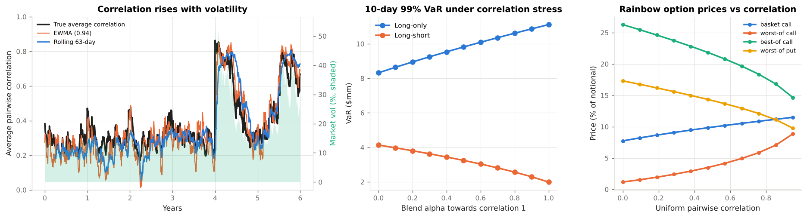

# 6. Correlation Risk

This chapter covers **how correlation is estimated, why it breaks down, how to stress and repair a correlation matrix, what implied correlation is, and how correlation is priced in multi-asset products**. Code: `vclab/correlation.py`, `vclab/market.py`. Example: `examples/05_correlation_risk.py`.

---

## 6.1 Correlation goes up when markets go down

The module's five stocks follow a one-factor model, `r_i = β_i M + ε_i`, with a GARCH market factor. The correlation it implies is

```
ρ_ij = β_i β_j σ²_M / (σ_i σ_j),       σ²_i = β²_i σ²_M + σ²_ε,i
```

When the market factor's volatility rises and idiosyncratic volatility does not, **every correlation rises**. Example 05 shows it in the simulated history:

| Period | Average correlation | Index vol | Diversification ratio |
|---|---|---|---|
| Calm (years 1–4) | 0.25 | 14.7 % | 1.48 |
| Crisis (first 60 days) | 0.76 | 40.5 % | 1.08 |
| Six months later | 0.66 | 28.4 % | 1.14 |

The diversification ratio, undiversified volatility `Σ w_i σ_i` over portfolio volatility, collapses towards one exactly when diversification is needed. Real equity markets show the same asymmetry: correlations are higher in down markets than in up markets (Longin & Solnik 2001), and they rose sharply in 1987, 2008 and March 2020. The practical consequences:

* VaR and ES estimated on calm-period correlations understate stress losses of long portfolios.
* Correlation risk and volatility risk are not separate: they arrive together.
* A correlation estimate is a regime-dependent quantity. Regulators respond with stressed calibration (MAR33.5) and correlation scenarios (MAR21.6).



---

## 6.2 Estimation

### Speed versus noise

The EWMA covariance (`ewma_covariance`, λ = 0.94) catches the break within 8 days; a 63-day rolling window takes 16. A sample correlation over `n` observations has a standard error of about `(1 − ρ²)/sqrt(n)` under i.i.d. normality: 0.18 for a 21-day window and a correlation of 0.4. In the GARCH history the spread across windows is larger still, because the true correlation itself moves.

### Many assets, few observations

With `N` assets there are `N(N−1)/2` correlations. A 50-asset portfolio has 1,225; sixty days of returns give 3,000 numbers to estimate them. The sample covariance is then noisy and **ill-conditioned**: its smallest eigenvalues are biased towards zero (exactly zero when `T < N`), and portfolio optimisers load on the spurious "riskless" combinations.

**Shrinkage** (Ledoit & Wolf 2004) replaces the sample covariance `S` by `δ F + (1 − δ) S`, where `F` is a structured target, here the constant-correlation matrix, and the intensity `δ` is estimated from the data to minimise expected error (`ledoit_wolf_constant_correlation`). On a 50-stock universe drawn from the same factor model:

| Observations | Sample error | Ledoit-Wolf error | δ |
|---|---|---|---|
| 40 | 36 % | 28 % | 0.94 |
| 120 | 24 % | 21 % | 0.69 |
| 1,000 | 7.5 % | 7.5 % | 0.14 |

Shrinkage trades a little bias for a large cut in variance; the optimal intensity falls as the sample grows. Its estimated intensity is itself noisy and can overshoot when the target is far from the truth, which the tests document.

---

## 6.3 Stress and repair

### Stress that stays valid

A correlation matrix must be symmetric, have a unit diagonal and be positive semi-definite. Blending towards a constant-correlation matrix (`stress_correlation`)

```
C_stress = (1 − α) C + α J_c,     J_c = constant correlation c on the off-diagonal
```

always gives a valid matrix (a convex combination of correlation matrices), so it is the safe way to stress. Example 05:

| Blend towards ρ = 1 | Average correlation | 10-day 99 % VaR, long-only | Long-short |
|---|---|---|---|
| 0 | 0.38 | $8.3mm | $4.1mm |
| 0.5 | 0.69 | $9.8mm | $3.3mm |
| 1 | 1.00 | $11.1mm | $2.0mm |
| 0.7 towards ρ = 0 | 0.11 | $6.4mm | $5.1mm |

Higher correlation raises the risk of the long-only portfolio and lowers the risk of the long-short one. A hedged book's correlation risk points the other way, which is why stress tests and FRTB look at both directions. `var_correlation_sensitivity` gives the VaR change per pairwise correlation, `∂VaR/∂ρ_ij = z x_i σ_i x_j σ_j / σ_p`: positive for same-sign pairs and negative for opposite-sign pairs.

### Repairing an inconsistent matrix

Overriding individual pairs, mixing estimates from different windows, or filling a matrix with implied correlations can produce a matrix that is not positive semi-definite. Example 05 sets AAPL–MSFT to 0.95, AAPL–JNJ to −0.60 and MSFT–JNJ to 0.90. These are mutually impossible, and the smallest eigenvalue becomes −0.66. A Cholesky factorisation fails and any simulated VaR is meaningless. `nearest_correlation` finds the closest valid matrix in Frobenius norm by Higham's (2002) alternating projections: project onto positive semi-definite matrices (clip negative eigenvalues), project onto unit-diagonal matrices, repeat with Dykstra's correction. The repaired matrix keeps the direction of the overrides (0.61, −0.29, 0.57) but spreads the inconsistency over all pairs. Weighted variants exist to keep trusted entries fixed.

---

## 6.4 Implied correlation

Index variance is a weighted sum of constituent variances and covariances. Solving for a single average correlation gives the **implied correlation**:

```
ρ_impl = (σ²_I − Σ w²_i σ²_i) / (Σ_{i≠j} w_i w_j σ_i σ_j)
```

(`implied_correlation`; Cboe's implied correlation indices use this formula). The large-basket proxy `(σ_I / Σ w_i σ_i)²` overstates it for a small basket (0.62 against 0.50 in Example 05).

Index options are usually priced at a higher correlation than subsequently realises: investors buy index puts for protection and sell single-stock calls for yield. The **correlation risk premium** (Driessen, Maenhout & Vilkov 2009) is what a dispersion trader collects by selling index volatility and buying constituent volatility, or by selling a correlation swap. In Example 05 a short correlation swap struck at 0.50 makes $2.1mm per $10mm of correlation notional if correlation realises at the calm level and loses $3.1mm at the crisis level. Like short variance, it pays small and often and loses large and rarely.

---

## 6.5 Correlation products

A payoff on several underlyings has a price that moves with correlation. Example 05 prices one-year at-the-money options on AAPL, MSFT and XOM by Monte Carlo (`rainbow_price`, common random numbers) and measures **cega**, the price change per +1 point of every pairwise correlation (`cega`):

| Payoff on performances `R_i = S_i(T)/S_i(0)` | Price (% notional) | Cega (bp per corr pt) | Holder is |
|---|---|---|---|
| Basket call `max(Σ a_i R_i − 1, 0)` | 9.6 | +4.0 | long correlation |
| Worst-of call `max(min R_i − 1, 0)` | 3.1 | +6.0 | long correlation |
| Best-of call `max(max R_i − 1, 0)` | 22.5 | −10.3 | short correlation |
| Worst-of put `max(1 − min R_i, 0)` | 14.7 | −6.8 | short correlation |

The basket option also has a closed-form approximation, matching the first two moments of the basket to a lognormal (`basket_option_levy`, Levy 1992), which agrees with Monte Carlo to within 1 %. Worst-of and best-of options on two assets have closed forms (Stulz 1982); for more assets simulation is standard.

Structured products concentrate correlation risk. An investor who buys a worst-of autocallable note is short a worst-of put and therefore long correlation; the dealer who issues the note is long the put and short correlation. Single-name deltas and vegas do not show this exposure, it is rarely observable in the market, and it is hedged imperfectly with correlation swaps, dispersion trades or offsetting products. That is why it is capitalised separately (Chapter 7).

---

## 6.6 Beyond linear correlation

Correlation describes dependence in the centre of the distribution. Joint crashes are governed by **tail dependence**, `λ = lim_{u→0} P(U₂ < u | U₁ < u)`. A Gaussian copula has `λ = 0` for any correlation below one, so joint extremes become independent in the limit; a Student-t copula with the same correlation keeps them dependent (`tail_dependence_t`):

| ρ | Gaussian | t, ν = 10 | t, ν = 4 |
|---|---|---|---|
| 0.5 | 0 | 0.08 | 0.25 |
| 0.7 | 0 | 0.19 | 0.39 |

A risk model can have the right correlations and still understate the probability that everything falls together. The use of the Gaussian copula for CDO pricing before 2008 is the standard example (Embrechts, McNeil & Straumann 2002; McNeil, Frey & Embrechts 2015).

---

## 6.7 Governance of correlation inputs

* **Document the source of every correlation**: historical window and weighting, implied, proxy or expert judgement. Correlation parameters are among the least observable inputs in a bank's models.
* **Test positive definiteness** whenever a matrix is assembled or stressed; repair with a documented method.
* **Stress in both directions** and against regime breaks, not only by scaling.
* **Classify observability**: correlation-dependent instruments are often Level 3 under ASC 820 / IFRS 13, and most correlations are non-modellable risk factors under FRTB (Chapter 7).
