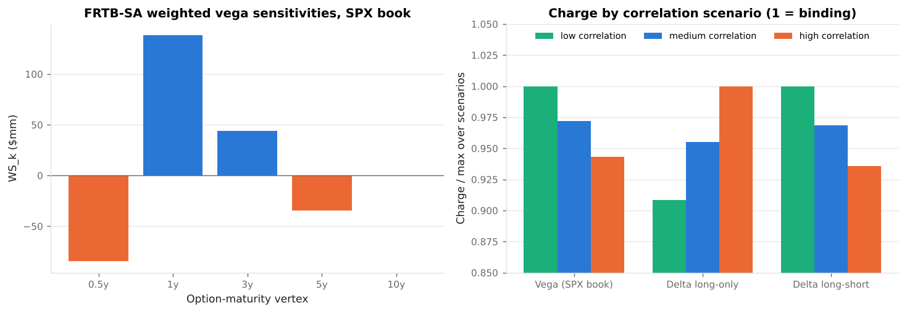

# 7. The Regulatory Framework

This chapter maps **how capital and margin rules treat volatility and correlation risk**: the FRTB standardised approach (vega, correlation scenarios, residual risk add-on), the internal models approach (liquidity horizons, risk-factor eligibility, stress scenarios for non-modellable factors), the U.S. and EU implementations, and margin. Code: `vclab/regulatory.py`. Example: `examples/06_regulatory_capital.py`. Paragraph references are to the Basel Framework chapters MAR21–MAR33 as in force from 1 January 2023 (text of BCBS d457, January 2019).

---

## 7.1 The map

```
STANDARDISED APPROACH
  Sensitivities-based method (MAR21)
    delta ........ spot, rates, spreads
    vega ......... implied vols by option-maturity vertex     <- volatility risk
    curvature .... non-linear delta risk
    3 correlation scenarios: low / medium / high             <- correlation risk
  Residual risk add-on (MAR23)
    exotic underlyings 1 %; other residual risks 0.1 %       <- multi-asset payoffs
  Default risk charge (MAR22)

INTERNAL MODELS APPROACH
  ES 97.5 %, liquidity horizons 10-120 days (MAR33.4, 33.12) <- vol factors 20-120d
  Risk-factor eligibility test (MAR31.12)
    fails -> non-modellable: stress scenario capital (MAR33.16-17)
  Constrained diversification across risk classes (MAR33.15)
  P&L attribution and backtesting (MAR32)
```

---

## 7.2 Vega under the standardised approach

### Sensitivities

Vega risk factors are the implied volatilities of options mapped to five **option-maturity vertices** of 0.5, 1, 3, 5 and 10 years (MAR21.8). The sensitivity is a *relative* vega:

```
s_k = vega × σ                       (MAR21.25)
```

the P&L of a 100 % relative move in the implied vol. `regulatory.vega_sensitivities` allocates each option to the two adjacent vertices by linear interpolation; options shorter than six months map entirely to the 0.5-year vertex. Strikes are not separate risk factors for equity vega in this simplified treatment, so the skew is not capitalised directly.

### Risk weights from liquidity horizons

```
RW = min( 55 % × sqrt(LH / 10), 100 % )        (MAR21.92)
```

with the liquidity horizon `LH` of MAR33.12. Equity large-cap and index volatility has `LH = 20` days, so `RW = 77.8 %`; small-cap equity, interest-rate and commodity volatility have 60 days or more and reach the 100 % cap.

| Volatility risk factor | LH (days) | Vega RW |
|---|---|---|
| Equity, large cap and indices | 20 | 77.8 % |
| FX | 40 | 100 % |
| Equity small cap, interest rates, energy and metals | 60 | 100 % |
| Credit spreads, other commodities | 120 | 100 % |

### Aggregation and correlation

Within a bucket, weighted sensitivities are aggregated with

```
ρ_kl = min( ρ_name × exp(−1 % |T_k − T_l| / min(T_k, T_l)), 1 )        (MAR21.93 ff.)
K_b  = sqrt( max(0, Σ WS²_k + Σ_{k≠l} ρ_kl WS_k WS_l) )                  (MAR21.4)
```

and buckets with the delta cross-bucket correlations (MAR21.80). For the example SPX book (bucket 12):

| Vertex | 0.5y | 1y | 3y | 5y | 10y |
|---|---|---|---|---|---|
| WS = RW × s ($mm) | −84.6 | +138.2 | +44.0 | −34.4 | 0 |

The charge is $66.9mm under the low correlation scenario, $65.1mm medium and $63.1mm high. The low scenario binds because the book has offsetting vertices. All three, however, net vega across maturities almost completely: the maturity correlation between 0.5 and 1 year is 0.99, and between 0.5 and 5 years 0.91. The same net vega on one vertex would cost $63.1mm. **The standardised approach does not see the term-structure risk of Chapter 4**, where the book loses $9.4mm on a one-point sqrt-time weighted vol move while being long parallel vega. Internal limits, stress tests or an internal model must catch it.



---

## 7.3 Correlation scenarios

Every prescribed correlation `ρ` (and cross-bucket `γ`) in the sensitivities-based method is replaced in turn by

```
high:    min(1.25 ρ, 1)
medium:  ρ
low:     max(2ρ − 1, 0.75 ρ)                (MAR21.6)
```

and the capital requirement is the **largest of the three totals** of delta, vega and curvature across all risk classes (MAR21.7). This is FRTB's explicit answer to correlation risk: no estimate of correlation is trusted in one direction. Example 06 shows that the binding scenario depends on the portfolio:

| Equity delta portfolio | Low | Medium | High | Binding |
|---|---|---|---|---|
| Long-only ($100mm across five stocks) | 27.8 | 29.3 | 30.6 | high |
| Long-short (same names, two shorts) | 21.1 | 20.4 | 19.7 | low |

The scenarios are crude: one multiplicative shock to every correlation, chosen for the whole book. They capture the direction of correlation risk but not its size in a crisis, where equity correlations can double.

---

## 7.4 Residual risk add-on for correlation

Correlation between the underlyings of a single instrument is not a risk factor of the sensitivities-based method. Multi-underlying payoffs (basket, worst-of, best-of, spread options) are among the instruments bearing **"other residual risks"** in MAR23 and attract an add-on of 0.1 % of gross notional (MAR23.8). Instruments with exotic underlyings, which the rule illustrates with examples such as longevity, weather and natural disasters, attract 1.0 %; MAR23.2 and the Basel FAQs decide whether a given volatility or variance product falls in that class. The add-on is gross, with no netting or diversification. Example 06: $450mm of worst-of, basket and best-of notes cost $450k.

---

## 7.5 The internal models approach

### Liquidity horizons

The 10-day ES is extended to each risk factor's liquidity horizon by the cascade (MAR33.4)

```
ES = sqrt( ES_T(P)² + Σ_{j≥2} ( ES_T(P, j) × sqrt((LH_j − LH_{j−1}) / T) )² ),   T = 10 days
```

where `ES_T(P, j)` shocks only factors with horizon at least `LH_j`. A factor with a 20-day horizon has its ES counted again for the extra ten days; a 120-day factor is scaled by up to `sqrt(12)`. For the example book the 10-day ES is $239mm and the liquidity-adjusted ES $244mm. The uplift is small because the book's ES is dominated by short gamma on the 10-day spot leg; a vega-only book would see its ES scaled by up to `sqrt(2)` (`liquidity_adjusted_es`).

### Risk-factor eligibility test

A risk factor can enter the ES model only if it is supported by enough real price observations (MAR31.12):

* at least 24 observations in the last 12 months **and** no 90-day period with fewer than 4, **or**
* at least 100 observations in the last 12 months.

`regulatory.rfet` implements both criteria. In Example 06 the 1-year ATM and 3-month 90 % SPX vols pass; a 5-year 70 % vol with 30 quotes fails the 90-day criterion; a 2-year single-stock vol whose quotes cluster in one quarter fails; implied correlations with five or two trades a year fail.

### Non-modellable risk factors

Factors that fail are capitalised with a **stress scenario** at least as severe as the ES calibration, over a liquidity horizon of at least 20 days (MAR33.16). The stress-scenario capital is aggregated with little diversification (MAR33.17): idiosyncratic equity and credit-spread factors with zero correlation, all others with `ρ = 0.6`:

```
SES = sqrt( Σ ISES²_i ) + sqrt( (ρ Σ SES_j)² + (1 − ρ²) Σ SES²_j )
```

(`ses_aggregate`, transcribed from the rule text; verify before professional use.) Example 06's four non-modellable vol and correlation factors with stand-alone stress losses of $6.5mm, $2.0mm, $3.0mm and $4.0mm aggregate to $11.5mm, against $15.5mm undiversified and $8.4mm at zero correlation. Because most implied correlations and many long-dated or deep out-of-the-money vols are non-modellable, **correlation risk under the IMA is largely capitalised outside the ES model**, at a punitive rate. That is a strong incentive to standardise products or to move them to the standardised approach.

### Constrained diversification and model approval

Across broad risk classes the IMA gives only half the diversification benefit: `IMCC = 0.5 ES(all) + 0.5 Σ ES(class)` (MAR33.15; `regulatory.imcc`). Desk-level approval requires passing backtesting and the P&L attribution test (MAR32), which compares the risk model's P&L with the front office's using Spearman correlation and Kolmogorov-Smirnov metrics. A desk whose risk model misses vol surface or smile dynamics, the gap shown in Chapter 4.6, fails attribution.

---

## 7.6 United States

* **Rules in force.** The market risk capital rule, 12 CFR part 217 subpart F (Federal Reserve; parallel OCC and FDIC rules), requires a VaR-based measure at 99 % over 10 days (§217.205) and a stressed VaR (§217.206). Internal models must capture the non-linear price characteristics of options and their sensitivity to volatility; correlations are recognised within and across risk categories only where the bank can validate them.
* **FRTB proposal.** The 2023 proposal of the banking agencies (88 FR 64028) would replace subpart F with an FRTB-based framework, including the sensitivities-based method, the residual risk add-on and the IMA described above. Check its current status before relying on it.
* **Model risk management.** SR 11-7 / OCC Bulletin 2011-12 applies to surface construction, volatility estimators and correlation matrices as much as to pricing models.
* **Funds.** SEC Rule 18f-4 limits registered funds' derivatives risk with a VaR test, so fund VaR models face the same volatility and correlation estimation questions (see the Black-Scholes Laboratory, Chapter 7).

## 7.7 European Union

FRTB is implemented in the Capital Requirements Regulation as amended by CRR2 (Regulation (EU) 2019/876, reporting) and CRR3 (Regulation (EU) 2024/1623, capital), Articles 325 ff. The application date of the FRTB capital requirements has been deferred; check the current date. Separately, the EU **prudent valuation** standard requires additional valuation adjustments for model risk and close-out costs, which are material for unobservable vol and correlation inputs.

## 7.8 Margin and accounting

* **Uncleared margin.** ISDA SIMM, used to compute initial margin under the BCBS-IOSCO framework, has vega and curvature margin for every risk class and its own correlation parameters, recalibrated annually. A dealer with a large short-vol or correlation book pays for it in margin as well as capital.
* **Fair value.** Under ASC 820 and IFRS 13, instruments whose value depends significantly on unobservable volatilities or correlations are classified as Level 3, with disclosure of the unobservable inputs and their ranges. Banks' Level 3 disclosures typically list volatility and correlation ranges for structured products.

---

## 7.9 Rule-to-code map

| Rule | Paragraph | Function |
|---|---|---|
| Vega sensitivity `s = vega × σ` | MAR21.25 | `vega_sensitivities` |
| Vega risk weight | MAR21.92 | `vega_risk_weight` |
| Vega correlation across maturities | MAR21.93 | `equity_vega_charge` |
| Bucket and cross-bucket aggregation | MAR21.4 | `aggregate_bucket`, `aggregate_buckets` |
| Correlation scenarios | MAR21.6–21.7 | `scenario_correlation`, `ScenarioCharge.charge` |
| Equity delta risk weights and correlations | MAR21.77–21.80 | `equity_delta_charge` |
| Residual risk add-on | MAR23.8 | `rrao_correlation` |
| Liquidity horizons | MAR33.12 | `LIQUIDITY_HORIZONS` |
| ES liquidity cascade | MAR33.4 | `liquidity_adjusted_es` |
| Risk-factor eligibility test | MAR31.12 | `rfet` |
| Stress scenario capital | MAR33.16–33.17 | `ses_aggregate` |
| Constrained diversification | MAR33.15 | `imcc` |
