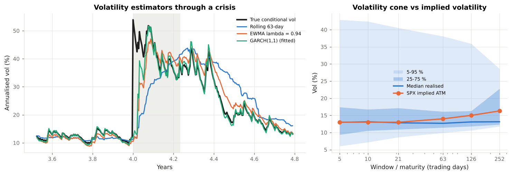
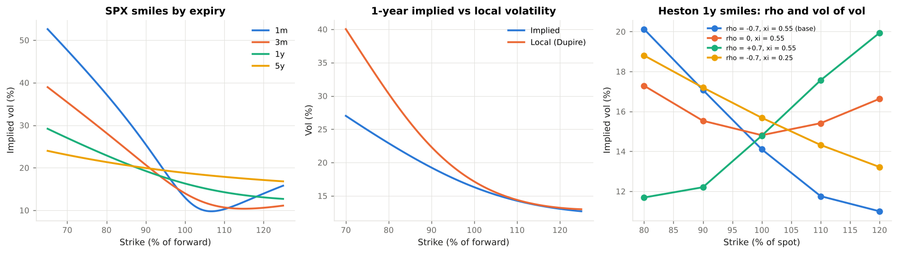
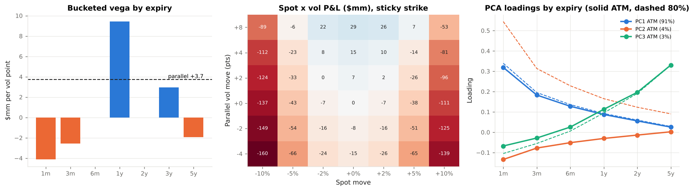
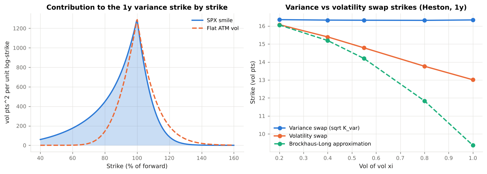
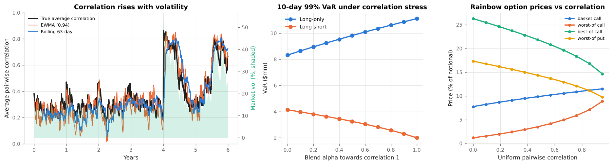
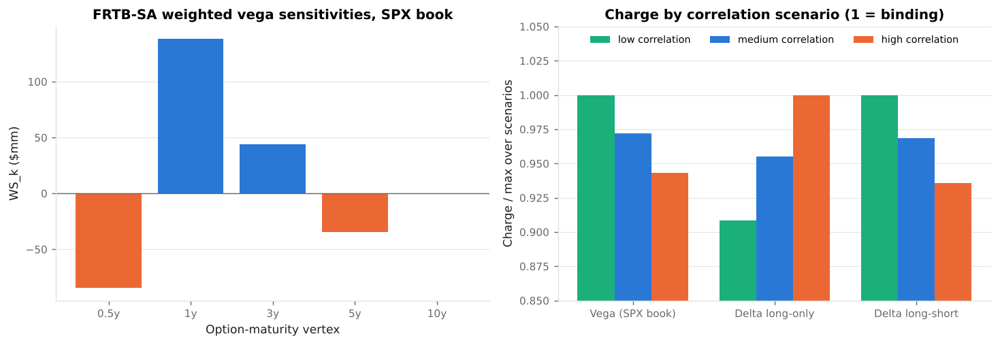

# Example Outputs

Console output captured from `python examples/run_all.py` with the illustrative market data in `vclab/market.py` and the SPX options book in `vclab/instruments.py`. Every number is reproducible: all simulations are seeded and the exact commands are in the `examples/` directory.

!!! note "Reading the tables"
    Money amounts are in USD; `mm` is millions, `k` thousands, `bn` billions. Vols are in percent or vol points (one point = 0.01 of implied vol); vega is per vol point. Monte Carlo prices of rainbow options and volatility swaps carry a standard error of a few basis points of notional and a few hundredths of a vol point respectively.


## Example 01 — Measuring volatility

Source: `examples/01_measuring_volatility.py`

```text
========================================================================
  01  Estimating the conditional volatility of daily index returns
========================================================================
1512 trading days; market factor is GARCH(1,1) with long-run vol 16%; crisis starts on day 1008.

+---------------------+--------------------+-------------+-------------+--------------+
| Estimator           | RMSE all (vol pts) | RMSE crisis | Bias crisis | Days to peak |
+---------------------+--------------------+-------------+-------------+--------------+
| Rolling 21-day      |               3.64 |       14.58 |       -4.03 |           26 |
| Rolling 63-day      |               5.09 |       18.06 |      -11.74 |           68 |
| EWMA lambda = 0.94  |               3.28 |       13.73 |       -5.38 |           22 |
| EWMA lambda = 0.97  |               4.24 |       15.98 |       -9.91 |           73 |
| GARCH(1,1) (fitted) |               2.51 |       12.04 |       -5.33 |           19 |
+---------------------+--------------------+-------------+-------------+--------------+

 * Every estimator is a forecast for tomorrow made with data up to today, compared with the volatility
   the simulation actually used.  Equal-weight windows react late and then drop off a cliff when the
   crisis day leaves the window (the 'ghost' effect); EWMA reacts within days.
 * EWMA half-life: lambda 0.94 -> 11.2 days, 0.97 -> 22.8 days.  RiskMetrics (1996) chose 0.94 for
   daily data; the trade-off is noise in calm markets against speed in a break.
 * GARCH nests EWMA and adds mean reversion; fitted on the same data it is the most accurate here because it
   is the true model.  On real data the gap is smaller and model risk is the point (SR 11-7).

========================================================================
  01  GARCH(1,1) by maximum likelihood
========================================================================
+-----------------------------+-----------+-----------+
| Parameter                   | True      | Fitted    |
+-----------------------------+-----------+-----------+
| omega (daily)               | 2.032e-06 | 1.997e-06 |
| alpha                       |     0.080 |     0.101 |
| beta                        |     0.900 |     0.881 |
| persistence alpha + beta    |     0.980 |     0.982 |
| long-run vol                |     16.0% |     16.7% |
| half-life of a shock (days) |      34.3 |      38.2 |
+-----------------------------+-----------+-----------+
The crisis is not in the model (it is an injected variance jump), so the fit absorbs it partly into alpha.

========================================================================
  01  Term structure of volatility forecasts vs implied volatility
========================================================================
+--------------------------------+------+------+------+------+------+
| Forecast made on               | 1m   | 3m   | 6m   | 1y   | 2y   |
+--------------------------------+------+------+------+------+------+
| calm (day 550, GARCH vol 10%)  | 11.5 | 13.2 | 14.5 | 15.5 | 16.1 |
| crisis peak (day 1027, 52%)    | 47.8 | 41.4 | 35.0 | 28.3 | 23.3 |
| 6 months after the peak (20%)  | 19.2 | 18.6 | 18.0 | 17.4 | 17.1 |
| SPX implied ATM (illustrative) | 13.0 | 14.0 | 15.0 | 16.3 | 17.5 |
+--------------------------------+------+------+------+------+------+

GARCH forecasts of average variance converge on the long-run level at a speed set by alpha + beta:
an inverted term structure after a shock, upward sloping when current vol is low.  Implied vols
add a *variance risk premium* (investors pay for protection), so in calm markets implied sits above
the statistical forecast; Example 04 prices the variance swap that trades exactly that premium.

========================================================================
  01  Volatility cone
========================================================================
+----------+------+------+------+------+------+-----------------+
| Window   | 5%   | 25%  | 50%  | 75%  | 95%  | SPX implied ATM |
+----------+------+------+------+------+------+-----------------+
| 5 days   |  6.0 |  9.4 | 13.0 | 17.4 | 42.9 |            13.0 |
| 10 days  |  7.2 | 10.5 | 13.1 | 16.7 | 42.4 |            13.0 |
| 21 days  |  8.6 | 10.9 | 12.8 | 17.1 | 40.5 |            13.0 |
| 63 days  |  9.9 | 11.4 | 12.7 | 16.1 | 38.1 |            14.0 |
| 126 days | 10.6 | 11.8 | 13.1 | 16.3 | 35.9 |            15.0 |
| 252 days | 11.8 | 12.3 | 13.1 | 22.8 | 28.6 |            16.3 |
+----------+------+------+------+------+------+-----------------+
Vol of vol (21-day rolling vol, daily log changes, annualised): 86%.
```





## Example 02 — The implied volatility surface

Source: `examples/02_implied_volatility_surface.py`

```text
============================================================================
  02  Illustrative SPX implied volatility surface (strike as % of forward)
============================================================================
+--------+------+------+------+------+------+------+------+------+
| Expiry | 70%  | 80%  | 90%  | 95%  | 100% | 105% | 110% | 120% |
+--------+------+------+------+------+------+------+------+------+
| 1m     | 47.6 | 37.2 | 25.5 | 19.0 | 13.0 |  9.9 | 10.3 | 13.9 |
| 3m     | 35.4 | 28.2 | 20.7 | 17.1 | 14.0 | 11.8 | 10.7 | 10.6 |
| 6m     | 30.4 | 24.8 | 19.4 | 17.0 | 15.0 | 13.4 | 12.3 | 11.2 |
| 1y     | 27.0 | 22.9 | 19.2 | 17.7 | 16.3 | 15.2 | 14.3 | 13.1 |
| 2y     | 24.8 | 21.9 | 19.5 | 18.4 | 17.5 | 16.7 | 16.0 | 15.0 |
| 3y     | 23.8 | 21.5 | 19.6 | 18.8 | 18.1 | 17.5 | 16.9 | 16.0 |
| 5y     | 23.0 | 21.3 | 19.9 | 19.3 | 18.8 | 18.3 | 17.9 | 17.1 |
+--------+------+------+------+------+------+------+------+------+

+--------+---------+--------+-------+-------+-----------+--------------------+----------+----------------+
| Expiry | a       | b      | rho   | s     | ATM vol % | Skew (pts per 10%) | min g(k) | max wing slope |
+--------+---------+--------+-------+-------+-----------+--------------------+----------+----------------+
| 1m     | -0.0017 | 0.0354 | -0.60 | 0.087 |      13.0 |               8.88 |    0.123 |           0.06 |
| 3m     | -0.0034 | 0.0551 | -0.68 | 0.150 |      14.0 |               5.21 |    0.168 |           0.09 |
| 6m     | -0.0047 | 0.0751 | -0.73 | 0.212 |      15.0 |               3.62 |    0.207 |           0.13 |
| 1y     | -0.0047 | 0.1042 | -0.78 | 0.300 |      16.3 |               2.49 |    0.219 |           0.19 |
| 2y     |  0.0004 | 0.1435 | -0.83 | 0.424 |      17.5 |               1.70 |    0.230 |           0.26 |
| 3y     |  0.0089 | 0.1720 | -0.86 | 0.520 |      18.1 |               1.36 |    0.241 |           0.32 |
| 5y     |  0.0322 | 0.2155 | -0.90 | 0.671 |      18.8 |               1.03 |    0.267 |           0.41 |
+--------+---------+--------+-------+-------+-----------+--------------------+----------+----------------+

 * Skew: implied vol falls as the strike rises - the market charges more for crash protection than a
   lognormal model would.  It is steepest at short maturities and flattens roughly like T^-0.55.
 * Static arbitrage checks: Durrleman's g(k) >= 0 on every slice (no negative densities, i.e. no
   butterfly arbitrage); total variance increases with maturity at every k (min increase
   0.0008, no calendar arbitrage); wing slopes below Roger Lee's bound of 2.

========================================================================
  02  Fitting SVI to noisy quotes (6-month slice)
========================================================================
+------------+-------+-------+---------+-----------------+
| Strike / F | True  | Quote | SVI fit | Fit - true (bp) |
+------------+-------+-------+---------+-----------------+
|        70% | 30.35 | 30.25 |   30.27 |            -8.0 |
|        75% | 27.55 | 27.53 |   27.58 |            +2.5 |
|        80% | 24.78 | 25.02 |   24.86 |            +8.4 |
|        85% | 22.05 | 22.15 |   22.13 |            +8.0 |
|        90% | 19.44 | 19.19 |   19.44 |            +0.6 |
|        95% | 17.04 | 17.04 |   16.94 |           -10.1 |
|       100% | 15.00 | 14.91 |   14.85 |           -14.5 |
|       105% | 13.41 | 13.43 |   13.32 |            -9.1 |
|       110% | 12.29 | 12.05 |   12.26 |            -2.4 |
|       115% | 11.60 | 11.63 |   11.55 |            -4.4 |
+------------+-------+-------+---------+-----------------+
Fitted parameters a=0.0034 b=0.0592 rho=-1.00 m=-0.012 s=0.140; min g = 0.233.
RMSE against the true smile: quotes 14.5 bp, SVI fit 7.9 bp.  Five parameters average out part of the noise and
guarantee a smooth, arbitrage-free smile; an interpolating spline through the quotes would reproduce the noise and could
create butterfly arbitrage.  The fitted rho sits on its bound: with noisy quotes SVI parameters are not individually identified.

========================================================================
  02  Local volatility (Dupire) vs implied volatility, 1 year
========================================================================
+------------+-----------+---------+
| Strike / F | Implied % | Local % |
+------------+-----------+---------+
|        70% |      27.0 |    40.0 |
|        80% |      22.9 |    30.3 |
|        90% |      19.2 |    22.3 |
|       100% |      16.3 |    17.1 |
|       110% |      14.3 |    14.4 |
|       120% |      13.1 |    13.2 |
+------------+-----------+---------+

Local volatility is steeper than implied near the money: local/implied skew = 1.71 at 1m, 1.54 at 1y,
1.72 at 5y.  Implied vol at strike K is roughly an average of local vols along the way from spot to K, so
a skew that is constant in maturity needs a local skew twice as steep (Derman's 'rule of two'); when the implied
skew decays like T^-p the short-maturity ratio is about 2 - p = 1.45.  Local vol reprices every vanilla exactly
(tests/test_surface.py checks it by Monte Carlo) but implies that the smile flattens and moves the 'wrong' way as
spot moves - a known limitation for forward-starting and cliquet products, which is why stochastic-vol models exist.

===============================================================================
  02  Heston: spot-vol correlation makes the skew, vol of vol makes the smile
===============================================================================
+----------------------------------------------------------------+------+------+------+------+------+
| 1y smile under Heston (v0 = 15%^2, theta = 17.3%^2, kappa = 2) | 80%  | 90%  | 100% | 110% | 120% |
+----------------------------------------------------------------+------+------+------+------+------+
| rho = -0.7, xi = 0.55 (base)                                   | 20.1 | 17.1 | 14.1 | 11.8 | 11.0 |
| rho = 0, xi = 0.55                                             | 17.3 | 15.5 | 14.8 | 15.4 | 16.6 |
| rho = +0.7, xi = 0.55                                          | 11.7 | 12.2 | 14.8 | 17.6 | 19.9 |
| rho = -0.7, xi = 0.25                                          | 18.8 | 17.2 | 15.7 | 14.3 | 13.2 |
+----------------------------------------------------------------+------+------+------+------+------+

rho < 0: when spot falls variance rises, fattening the left tail -> downward skew (equities).
rho = 0: a symmetric smile, from vol of vol alone (closer to FX).  rho > 0: upward skew (some commodities).
Lower vol of vol (xi) flattens the smile.  Spot-vol correlation is the first correlation risk an options
desk meets: it sets how vega and delta interact (vanna) and how the surface moves in a sell-off.
```





## Example 03 — Vega risk of an options book

Source: `examples/03_vega_risk.py`

```text
========================================================================
  03  The book: a delta-hedged SPX options book (illustrative)
========================================================================
+------------------------------+-----------+--------+-------+------------+---------------------------+------------------------+--------------+
| Position                     | Contracts | Strike | Vol % | Vega $k/pt | Vanna: dVega per +1% spot | Volga: dVega per +1 pt | Theta $k/day |
+------------------------------+-----------+--------+-------+------------+---------------------------+------------------------+--------------+
| 1m ATM call (short straddle) |    -3,000 |  6,000 |  13.2 |   -2,064.8 |                      20.4 |                   -0.4 |        513.3 |
| 1m ATM put (short straddle)  |    -3,000 |  6,000 |  13.2 |   -2,064.8 |                      20.4 |                   -0.4 |        385.7 |
| 3m 90% put (short)           |    -4,000 |  5,400 |  21.1 |   -2,570.0 |                     245.2 |                 -136.4 |        272.7 |
| 1y ATM call                  |    +2,500 |  6,000 |  17.0 |    5,741.8 |                     -23.1 |                    5.5 |       -183.4 |
| 1y 85% put                   |    +2,500 |  5,100 |  21.8 |    3,678.6 |                    -127.3 |                  123.9 |        -89.2 |
| 3y ATM call                  |      +800 |  6,000 |  19.2 |    2,943.8 |                      -6.0 |                    4.2 |        -39.1 |
| 5y 80% put (short)           |      -600 |  4,800 |  23.0 |   -1,927.0 |                      16.1 |                  -34.1 |          5.8 |
| Total (incl. delta hedge)    |           |        |       |    3,737.7 |                     145.7 |                  -37.8 |        865.8 |
+------------------------------+-----------+--------+-------+------------+---------------------------+------------------------+--------------+

Gross notional $9.84bn; the underlying hedge (-200,868 index units) makes the book
delta-neutral.  Vega is the P&L for one vol point; vanna is shown as the change in vega (in $k per point) when spot
rises 1 %, volga as the change in vega when vol rises one point.  Out-of-the-money options carry the vanna and volga;
ATM options carry almost none.  The book is long $3.74mm of vega per point: a single number that says
'long vol' and hides everything below.

========================================================================
  03  Bucketed vega: where the vega is
========================================================================
+-----------------+-------+-------+------+------+------+------+-------+------+----------+
| Expiry node     | 1m    | 3m    | 6m   | 1y   | 2y   | 3y   | 5y    | Sum  | Parallel |
+-----------------+-------+-------+------+------+------+------+-------+------+----------+
| Vega ($mm / pt) | -4.13 | -2.57 | 0.00 | 9.42 | 0.00 | 2.94 | -1.93 | 3.74 |     3.74 |
+-----------------+-------+-------+------+------+------+------+-------+------+----------+

+--------------+-------+-------+-------+------+
| Expiry \ K/F | 80%   | 90%   | 100%  | 110% |
+--------------+-------+-------+-------+------+
| 1m           |  0.00 | -0.08 | -4.04 | 0.00 |
| 3m           | -0.14 | -2.43 |  0.00 | 0.00 |
| 6m           |  0.00 |  0.00 |  0.00 | 0.00 |
| 1y           |  2.60 |  2.50 |  4.32 | 0.00 |
| 2y           |  0.00 |  0.00 |  0.00 | 0.00 |
| 3y           |  0.00 |  2.18 |  0.76 | 0.00 |
| 5y           | -1.93 |  0.00 |  0.00 | 0.00 |
+--------------+-------+-------+-------+------+

Each bucket is a bump of one vol point shaped as a hat (tent) function in expiry and in moneyness; the hats
sum to one, so the buckets add up to the parallel vega exactly (3.738 vs 3.738).  The book is short the front
(-6.7mm in 1m and 3m), long the 1y (+9.4mm) and short the 5y put wing.  Two books with the same parallel vega
can have opposite risks.

========================================================================
  03  Surface scenarios
========================================================================
+-------------------------------+-----------+
| Scenario                      | P&L ($mm) |
+-------------------------------+-----------+
| Parallel +1 pt                |     +3.72 |
| Parallel -1 pt                |     -3.76 |
| sqrt-time weighted +1 pt (1y) |     -9.39 |
| Twist: 1m +1 pt, 5y -1 pt     |     -7.65 |
| Twist: 1m -1 pt, 5y +1 pt     |     +7.59 |
| Skew +1 pt per 10% (1y)       |     +0.50 |
| Skew -1 pt per 10% (1y)       |     -0.83 |
+-------------------------------+-----------+

Long parallel vega, but the book *loses* on the empirically typical move - short-dated vols rising more than
long-dated ones (sqrt-time weighting) - and on an inverting term structure, which is what a sell-off looks
like.  Desks therefore set limits on weighted vega and on term-structure and skew buckets, not on parallel vega.

========================================================================
  03  Spot x vol P&L grid ($mm): sticky strike vs sticky moneyness
========================================================================

sticky strike
+------------+--------+--------+--------+--------+--------+-------+
| Spot \ vol | -4 pt  | -2 pt  | +0 pt  | +2 pt  | +4 pt  | +8 pt |
+------------+--------+--------+--------+--------+--------+-------+
|       -10% | -160.4 | -148.6 | -136.5 | -124.3 | -112.3 | -89.3 |
|        -5% |  -66.4 |  -54.3 |  -43.1 |  -32.9 |  -23.4 |  -6.0 |
|        -2% |  -24.2 |  -15.5 |   -7.4 |   +0.3 |   +7.7 | +22.0 |
|        +0% |  -15.3 |   -7.6 |   +0.0 |   +7.4 |  +14.7 | +28.8 |
|        +2% |  -26.0 |  -16.2 |   -7.0 |   +1.7 |  +10.1 | +26.2 |
|        +5% |  -64.8 |  -51.1 |  -38.1 |  -26.0 |  -14.5 |  +6.6 |
|       +10% | -138.5 | -125.2 | -110.9 |  -96.1 |  -81.4 | -52.9 |
+------------+--------+--------+--------+--------+--------+-------+

sticky moneyness
+------------+--------+--------+--------+--------+--------+-------+
| Spot \ vol | -4 pt  | -2 pt  | +0 pt  | +2 pt  | +4 pt  | +8 pt |
+------------+--------+--------+--------+--------+--------+-------+
|       -10% | -158.3 | -147.5 | -135.9 | -123.9 | -111.8 | -87.9 |
|        -5% |  -68.4 |  -54.3 |  -41.1 |  -29.1 |  -18.2 |  +1.2 |
|        -2% |  -21.1 |  -11.6 |   -2.9 |   +5.2 |  +13.0 | +27.6 |
|        +0% |  -15.3 |   -7.6 |   +0.0 |   +7.4 |  +14.7 | +28.8 |
|        +2% |  -29.7 |  -20.8 |  -12.2 |   -3.9 |   +4.2 | +19.7 |
|        +5% |  -64.6 |  -53.8 |  -43.4 |  -33.4 |  -23.7 |  -5.4 |
|       +10% | -127.3 | -115.8 | -104.2 |  -92.7 |  -81.4 | -59.5 |
+------------+--------+--------+--------+--------+--------+-------+

Delta under sticky strike +4 units, under sticky moneyness -49,682 units (-298.1mm of SPX).
The book was hedged with the Black-Scholes (sticky-strike) delta; if the smile moves with the spot it is not
hedged.  Which rule holds is an empirical, regime-dependent question (Derman 1999).  In a sell-off, index vols at
fixed strikes usually rise, which neither rule predicts (sticky strike says unchanged, sticky moneyness says lower);
local-volatility dynamics come closer.  The down-spot, up-vol corner of the grid is the relevant one.

========================================================================
  03  P&L explain: Taylor expansion vs full revaluation ($k)
========================================================================
+---------------------------+------------------------------------------------+--------------------------------------------+
| Component                 | Normal day: spot -0.5%, vol +0.5 pt (weighted) | Stress day: spot -3%, vol +4 pt (weighted) |
+---------------------------+------------------------------------------------+--------------------------------------------+
| Delta                     |                                             -0 |                                         +0 |
| Gamma                     |                                           -462 |                                    -16,630 |
| Vega                      |                                         -3,151 |                                    -29,992 |
| Vanna                     |                                            -81 |                                     -4,429 |
| Volga                     |                                            -24 |                                     -1,903 |
| Theta                     |                                         +1,254 |                                     +1,254 |
| Explained                 |                                         -2,464 |                                    -51,699 |
| Actual (full revaluation) |                                         -2,553 |                                    -42,928 |
| Unexplained               |                                            -89 |                                     +8,771 |
+---------------------------+------------------------------------------------+--------------------------------------------+

On a normal day the Greeks explain the P&L to 3.5%; on a stress day the unexplained part
is 20%.  The higher-order and cross terms that Greeks miss are exactly what the FRTB P&L
attribution test (MAR32) checks between the risk model and the front office.

====================================================================================
  03  Principal components of daily implied-vol changes (synthetic 3-year history)
====================================================================================
+-----------+-----------+------------+
| Component | Explained | Cumulative |
+-----------+-----------+------------+
| PC1       |     91.4% |      91.4% |
| PC2       |      4.2% |      95.7% |
| PC3       |      3.4% |      99.0% |
| PC4       |      0.0% |      99.1% |
| PC5       |      0.0% |      99.1% |
+-----------+-----------+------------+
+--------------------------+----------------+---------------+
| Move                     | Avg vol change | Book P&L ($k) |
+--------------------------+----------------+---------------+
| PC1 (+1 s.d. daily move) | +45 bp avg     |        -2,981 |
| PC2 (+1 s.d. daily move) | +0 bp avg      |          +441 |
| PC3 (+1 s.d. daily move) | +6 bp avg      |          +921 |
+--------------------------+----------------+---------------+

A level move that is larger at the short end dominates; a term-structure tilt and a skew move follow.  Empirical
studies of index-option surfaces find the same small number of factors (Skiadopoulos, Hodges & Clewlow 1999;
Cont & da Fonseca 2002).  Scenario and VaR models built on them capture vega risk with three numbers instead of a
full grid - at the cost of missing whatever the residual components carry.
```





## Example 04 — Variance swaps, VIX and volatility swaps

Source: `examples/04_volatility_products.py`

```text
========================================================================
  04  Variance swap strikes from the SPX surface (static replication)
========================================================================
+----------+---------+---------+---------------------------+--------------+
| Maturity | ATM vol | 90% vol | Var swap strike (vol pts) | Strike - ATM |
+----------+---------+---------+---------------------------+--------------+
| 1m       |   13.00 |   25.48 |                     16.76 |        +3.76 |
| 3m       |   14.00 |   20.68 |                     17.60 |        +3.60 |
| 6m       |   15.00 |   19.44 |                     18.73 |        +3.73 |
| 1y       |   16.30 |   19.24 |                     20.38 |        +4.08 |
| 2y       |   17.50 |   19.45 |                     22.06 |        +4.56 |
| 3y       |   18.10 |   19.64 |                     23.01 |        +4.91 |
| 5y       |   18.80 |   19.95 |                     24.32 |        +5.52 |
+----------+---------+---------+---------------------------+--------------+

K_var = (2 e^{rT} / T) [ int_0^F P(K)/K^2 dK + int_F^inf C(K)/K^2 dK ]   (vol_products.variance_swap_strike)
The strike is a 1/K^2-weighted average over the whole smile, so a downward skew lifts it 3.5-5.5 points
above ATM.  A variance swap seller is short every one of those puts: the strike prices the crash tail.

========================================================================
  04  Where the variance strike comes from (1 year)
========================================================================
+-----------------------+----------------------+-------+
| Strike range (% of F) | Variance (vol pts^2) | Share |
+-----------------------+----------------------+-------+
| 20% - 60%             |                 62.5 | 15.1% |
| 60% - 80%             |                 81.5 | 19.6% |
| 80% - 90%             |                 67.9 | 16.3% |
| 90% - 100%            |                104.1 | 25.1% |
| 100% - 110%           |                 76.4 | 18.4% |
| 110% - 120%           |                 18.9 |  4.6% |
| 120% - 300%           |                  3.8 |  0.9% |
| Total                 |                415.1 | 99.9% |
+-----------------------+----------------------+-------+

Puts struck below 90 % of the forward contribute 51% of the fair variance, and strikes below 60 % alone
15%.  A replicating dealer must buy deep out-of-the-money puts; if they are not available, the variance
swap is under-hedged precisely in a crash.

========================================================================
  04  A VIX-style 30-day index (Cboe methodology)
========================================================================
+-----------------+-------------+---------+-------+------------------+-------------+
| Strike range    | Strike step | Strikes | Index | Continuous strip | Error (pts) |
+-----------------+-------------+---------+-------+------------------+-------------+
| 60% - 120% of F |           5 |     724 | 16.82 |            16.70 |       +0.11 |
| 80% - 110% of F |           5 |     362 | 16.23 |            16.70 |       -0.47 |
| 90% - 105% of F |           5 |     182 | 14.84 |            16.70 |       -1.87 |
| 60% - 120% of F |          50 |      74 | 16.86 |            16.70 |       +0.16 |
+-----------------+-------------+---------+-------+------------------+-------------+

sigma^2 = (2/T) sum dK_i/K_i^2 e^(rT) Q(K_i) - (1/T)(F/K_0 - 1)^2    (Cboe VIX White Paper)
The 30-day index (16.8) sits 3.8 points above 30-day ATM vol (13.0).  Truncating the strip at 80-90 %
understates it by several points, which is why the Cboe rule extends the strip until two consecutive
zero bids, and why VIX jumps when far out-of-the-money puts start to trade in a sell-off.

========================================================================
  04  Variance swap P&L: $100k vega notional, 1 year, struck at fair
========================================================================
Strike 20.38 vol pts; variance notional N_var = N_vega / (2 K) = 2,453 per vol pt^2.

+--------------+-----------+---------------------------+-----------------------------------+
| Realised vol | vs strike | Variance swap payoff ($k) | Vol swap payoff at same vega ($k) |
+--------------+-----------+---------------------------+-----------------------------------+
|         10.0 |     -10.4 |                      -774 |                            -1,038 |
|         15.0 |      -5.4 |                      -467 |                              -538 |
|         20.0 |      -0.4 |                       -38 |                               -38 |
|         20.4 |      +0.0 |                        +0 |                                +0 |
|         25.0 |      +4.6 |                      +514 |                              +462 |
|         30.0 |      +9.6 |                    +1,189 |                              +962 |
|         40.0 |     +19.6 |                    +2,906 |                            +1,962 |
|         60.0 |     +39.6 |                    +7,813 |                            +3,962 |
+--------------+-----------+---------------------------+-----------------------------------+

The variance swap is convex in realised vol: it loses less than linearly when vol is low and gains more than
linearly when it is high.  A seller collecting the variance risk premium earns a little most of the time and
loses many times that in a crash - the pay-off profile behind the 5 February 2018 collapse of short-volatility
exchange-traded products, when VIX more than doubled in a day.

Mark-to-market after 6 months (time-weighted mix of realised and fair remaining variance):
+-----------------------+------------------------------+----------+
| Realised so far (vol) | Fair strike for remaining 6m | MtM ($k) |
+-----------------------+------------------------------+----------+
|                    15 |                           15 |     -458 |
|                    15 |                           25 |      +23 |
|                    25 |                           15 |      +23 |
|                    30 |                           30 |   +1,166 |
+-----------------------+------------------------------+----------+

========================================================================
  04  Volatility swaps: the convexity adjustment (Heston, 1 year)
========================================================================
+---------------+--------------------------+-----------------+----------------------+-----------------+------------------------+
| Vol of vol xi | sqrt K_var (closed form) | sqrt K_var (MC) | Vol swap strike (MC) | Convexity (pts) | Brockhaus-Long approx. |
+---------------+--------------------------+-----------------+----------------------+-----------------+------------------------+
|          0.20 |                    16.36 |           16.35 |                16.07 |            0.28 |                  16.06 |
|          0.40 |                    16.36 |           16.33 |                15.39 |            0.93 |                  15.19 |
|          0.55 |                    16.36 |           16.32 |                14.78 |            1.53 |                  14.19 |
|          0.80 |                    16.36 |           16.31 |                13.76 |            2.55 |                  11.84 |
|          1.00 |                    16.36 |           16.34 |                13.01 |            3.33 |                   9.37 |
+---------------+--------------------------+-----------------+----------------------+-----------------+------------------------+

E[sqrt(RV)] < sqrt(E[RV]) by Jensen's inequality, so a vol swap struck at the variance-swap vol would favour the
seller.  The gap grows with vol of vol: a volatility swap is a variance swap minus a position in the *volatility
of volatility*, and pricing it needs a model of the vol of vol that the vanilla surface pins down only partly.
The second-order Brockhaus-Long correction overshoots when vol of vol is high.
```





## Example 05 — Correlation risk

Source: `examples/05_correlation_risk.py`

```text
========================================================================
  05  Correlations go up when markets go down
========================================================================
+-------------------------------+---------------------+-----------------+----------+-----------+---------------+-----------------------+
| Period                        | Avg corr (realised) | Avg corr (true) | AAPL vol | Index vol | Sum w_i vol_i | Diversification ratio |
+-------------------------------+---------------------+-----------------+----------+-----------+---------------+-----------------------+
| Calm (years 1-4)              |                0.25 |            0.29 |      24% |     14.7% |         21.7% |                  1.48 |
| Crisis (first 60 days)        |                0.76 |            0.79 |      50% |     40.5% |         43.9% |                  1.08 |
| Recovery (following 6 months) |                0.66 |            0.56 |      37% |     28.4% |         32.4% |                  1.14 |
+-------------------------------+---------------------+-----------------+----------+-----------+---------------+-----------------------+

In the one-factor model only the market factor's volatility rises in the crisis, so every pairwise correlation
rises with it (rho_ij = beta_i beta_j sigma_M^2 / sigma_i sigma_j).  The diversification ratio - undiversified vol
over portfolio vol - collapses towards one exactly when diversification is needed.  Real markets show the same
pattern (Longin & Solnik 2001; 1987, 1998, 2008, March 2020): correlation risk and volatility risk arrive together.

Days after the break until the estimate first exceeds 0.6 (true average correlation reaches 0.86 on day one):
  EWMA lambda = 0.94   8
  Rolling 63-day       16

========================================================================
  05  Estimation noise and shrinkage
========================================================================
AAPL-MSFT correlation in the calm period (average true conditional value 0.41):
+---------------+---------------+--------------------+--------------------------------------+
| Window (days) | Mean estimate | Std across windows | Sampling error (1 - rho^2) / sqrt(n) |
+---------------+---------------+--------------------+--------------------------------------+
|            21 |          0.37 |              0.228 |                                0.181 |
|            63 |          0.37 |              0.130 |                                0.105 |
|           126 |          0.38 |              0.078 |                                0.074 |
|           252 |          0.39 |              0.040 |                                0.052 |
+---------------+---------------+--------------------+--------------------------------------+
Short windows are noisier than the i.i.d. sampling error because the true correlation itself moves with the
GARCH market vol; long windows are more precise but average over regimes.  (At 252 days four years of data hold
only four independent windows, so the spread across overlapping windows understates the true error.)

50-stock universe from the same factor model: relative Frobenius error of the covariance estimate
+----------------+-------------------+-------------+-----------------+-------------------------------+
| Observations T | Sample covariance | Ledoit-Wolf | Shrinkage delta | Min eigenvalue of sample corr |
+----------------+-------------------+-------------+-----------------+-------------------------------+
|             40 |             36.1% |       27.9% |            0.94 |                        -0.000 |
|             60 |             30.9% |       24.8% |            0.88 |                         0.005 |
|            120 |             23.7% |       20.8% |            0.69 |                         0.080 |
|            250 |             14.9% |       13.9% |            0.43 |                         0.191 |
|           1000 |              7.5% |        7.5% |            0.14 |                         0.341 |
+----------------+-------------------+-------------+-----------------+-------------------------------+

With 50 assets a 60-day sample has 1,225 correlations to estimate from 3,000 numbers: individual entries are
noise and the smallest eigenvalues are biased to zero, so optimisers load on spurious 'riskless' combinations.
Shrinking towards a constant-correlation target (Ledoit & Wolf 2004) trades a little bias for a large cut in
variance; the optimal intensity falls as the sample grows.

========================================================================
  05  Stressing correlations (long-only vs long-short, $mm exposures)
========================================================================
+-----------------------------+----------+-----------------------+------------------------+
| Blend alpha towards rho = 1 | Avg corr | 10d 99% VaR long-only | 10d 99% VaR long-short |
+-----------------------------+----------+-----------------------+------------------------+
|                        0.00 |     0.38 |                  8.32 |                   4.14 |
|                        0.25 |     0.54 |                  9.10 |                   3.72 |
|                        0.50 |     0.69 |                  9.82 |                   3.25 |
|                        1.00 |     1.00 |                 11.11 |                   1.99 |
| 0.70 towards rho = 0        |     0.11 |                  6.43 |                   5.08 |
+-----------------------------+----------+-----------------------+------------------------+

(1 - alpha) C + alpha * ones is always a valid correlation matrix.  Higher correlation raises the VaR of the
long-only book and *lowers* that of the long-short book: a hedged book is short correlation risk in the other
direction, which is why FRTB-SA computes every charge under a high, a medium and a low correlation scenario.

VaR sensitivity of the long-short book to each pairwise correlation ($k per +0.01):
+------+-------+-------+-------+-------+------+
|      | AAPL  | MSFT  | JPM   | XOM   | JNJ  |
+------+-------+-------+-------+-------+------+
| AAPL |  +0.0 | -27.2 | +16.2 | -12.6 | +9.5 |
| MSFT | -27.2 |  +0.0 | -14.0 | +10.9 | -8.2 |
| JPM  | +16.2 | -14.0 |  +0.0 |  -6.5 | +4.9 |
| XOM  | -12.6 | +10.9 |  -6.5 |  +0.0 | -3.8 |
| JNJ  |  +9.5 |  -8.2 |  +4.9 |  -3.8 | +0.0 |
+------+-------+-------+-------+-------+------+

=========================================================================
  05  Inconsistent stress -> repair with the nearest correlation matrix
=========================================================================
Risk manager's overrides: AAPL-MSFT 0.95, AAPL-JNJ -0.60, MSFT-JNJ 0.90 (mutually inconsistent).
Smallest eigenvalue before repair -0.660 (invalid: Cholesky fails, simulated VaR is meaningless); after repair -8.9e-16.

+-----------+------+----------+---------------+
| Pair      | Base | Override | Nearest valid |
+-----------+------+----------+---------------+
| AAPL-MSFT | 0.52 |     0.95 |          0.61 |
| AAPL-JPM  | 0.48 |     0.48 |          0.44 |
| AAPL-XOM  | 0.35 |     0.35 |          0.33 |
| AAPL-JNJ  | 0.35 |    -0.60 |         -0.29 |
| MSFT-JPM  | 0.49 |     0.49 |          0.53 |
| MSFT-XOM  | 0.37 |     0.37 |          0.39 |
| MSFT-JNJ  | 0.36 |     0.90 |          0.57 |
| JPM-XOM   | 0.34 |     0.34 |          0.34 |
| JPM-JNJ   | 0.33 |     0.33 |          0.29 |
| XOM-JNJ   | 0.24 |     0.24 |          0.22 |
+-----------+------+----------+---------------+
Valid correlation matrix: True.  Higham (2002) alternating projections; the repair spreads the inconsistency over all pairs.

========================================================================
  05  Implied correlation and the correlation risk premium
========================================================================
+-------------------------------------------------------+---------------------------------------------------------+
| Quantity                                              | Value                                                   |
+-------------------------------------------------------+---------------------------------------------------------+
| Index implied vol (1y, illustrative)                  |                                                   19.8% |
| Component implied vols                                | AAPL 27.3%, MSFT 25.2%, JPM 26.2%, XOM 25.2%, JNJ 18.9% |
| Implied correlation (exact formula)                   |                                                    0.50 |
| Implied correlation (proxy (sigma_I / sum w sigma)^2) |                                                    0.62 |
| Realised correlation, calm years                      |                                                    0.29 |
| Realised correlation, crisis                          |                                                    0.81 |
+-------------------------------------------------------+---------------------------------------------------------+

Index options are priced at a higher correlation than usually realises: investors buy index puts for protection
and sell single-stock calls for yield, so implied correlation carries a premium (Driessen, Maenhout & Vilkov 2009).
A seller of a 1-year correlation swap struck at 0.50, with $10mm notional per unit of correlation ($100k per
correlation point), makes +2.1mm if correlation realises at the calm-years level and -3.1mm at the
crisis level.  The same trade expressed through options - short index variance, long single-stock variance - is
the dispersion trade; like short variance, it earns a premium in calm markets and pays it back in a crisis.

==============================================================================================
  05  Correlation products: price and correlation sensitivity (AAPL, MSFT, XOM; 1 year; ATM)
==============================================================================================
+-----------------------+--------------------+--------------------------+---------------------------+
| Payoff on performance | Price (% notional) | Cega (bp per +1 corr pt) | Holder is ... correlation |
+-----------------------+--------------------+--------------------------+---------------------------+
| basket call           |               9.60 |                     3.95 | long                      |
| worst-of call         |               3.10 |                     6.00 | long                      |
| best-of call          |              22.45 |                   -10.28 | short                     |
| worst-of put          |              14.74 |                    -6.75 | short                     |
+-----------------------+--------------------+--------------------------+---------------------------+

Basket and worst-of calls gain when correlation rises (the assets move together, so the worst one is less bad
and the basket more volatile); best-of calls and worst-of puts lose.  The investor who sells a worst-of put in an
autocallable note is long correlation, so the dealer who buys it is short correlation and hedges it with
correlation swaps or reverse dispersion.  None of this is visible in single-name delta and vega.

========================================================================
  05  Beyond linear correlation: tail dependence
========================================================================
+-----+----------+----------+----------+---------+---------+
| rho | Gaussian | t, nu=30 | t, nu=10 | t, nu=4 | t, nu=2 |
+-----+----------+----------+----------+---------+---------+
| 0.3 |    0.000 |    0.000 |    0.033 |   0.162 |   0.293 |
| 0.5 |    0.000 |    0.003 |    0.082 |   0.253 |   0.391 |
| 0.7 |    0.000 |    0.026 |    0.191 |   0.391 |   0.519 |
| 0.9 |    0.000 |    0.211 |    0.463 |   0.630 |   0.718 |
+-----+----------+----------+----------+---------+---------+

lambda = lim P(U_2 < u | U_1 < u) as u -> 0.  Under a Gaussian copula joint crashes become independent in the limit
whatever the correlation; a Student-t copula with the same correlation keeps them dependent.  Correlation is a
single number for the centre of the distribution; risk lives in the tails (Embrechts, McNeil & Straumann 2002;
the Gaussian copula in CDO pricing before 2008).
```





## Example 06 — Regulatory capital for volatility and correlation risk

Source: `examples/06_regulatory_capital.py`

```text
=======================================================================================
  06  FRTB-SA vega: sensitivities and weighted sensitivities (SPX = equity bucket 12)
=======================================================================================
+-----------------------------+--------+--------+-------+-------+------+-------+
| Vertex                      | 0.5y   | 1y     | 3y    | 5y    | 10y  | Sum   |
+-----------------------------+--------+--------+-------+-------+------+-------+
| s_k = vega x sigma ($mm)    | -108.8 | +177.7 | +56.6 | -44.3 | +0.0 | +81.2 |
| WS_k = RW x s_k, RW = 77.8% |  -84.6 | +138.2 | +44.0 | -34.4 | +0.0 | +63.1 |
+-----------------------------+--------+--------+-------+-------+------+-------+

s_k = vega (per 1.00 of vol) x implied vol (MAR21.25): a 'relative' vega, the P&L of a 100 % relative move in vol.
RW = min(55 % x sqrt(LH / 10), 100 %) with LH = 20 days for large-cap and index volatility (MAR21.92, MAR33.12).
Options shorter than six months map entirely to the 0.5y vertex, so the short 1m straddle and the short 3m put
can only net against each other there.

+----------------------+-------------------+---------+
| Correlation scenario | Vega charge ($mm) |         |
+----------------------+-------------------+---------+
| low                  |              66.9 | binding |
| medium               |              65.1 |         |
| high                 |              63.1 |         |
+----------------------+-------------------+---------+

rho_kl = exp(-1 % |T_k - T_l| / min(T_k, T_l)) between vertices (MAR21.93): 0.5y-1y 0.990, 1y-3y 0.980,
0.5y-5y 0.914.  Because the book is long some vertices and short others, the low correlation scenario
(rho_low = max(2 rho - 1, 0.75 rho)) leaves the least offset and binds.  But all three scenarios net vega across
maturities almost fully: the charge is close to what the same net vega would cost on a single vertex
(63.1mm).  The standardised approach does not see the term-structure risk of Example 03 (the book makes
-9.4mm on a one-point sqrt-time weighted vol rise while being long parallel vega).  That risk must be caught
by internal limits, stress testing or an internal model.

==========================================================================================
  06  Correlation scenarios decide the equity delta charge (single names, buckets 5/7/8)
==========================================================================================
+-----------------------+-------+--------+-------+---------+
| Portfolio ($mm delta) | Low   | Medium | High  | Binding |
+-----------------------+-------+--------+-------+---------+
| Long-only             | 27.81 |  29.25 | 30.62 | high    |
| Long-short            | 21.08 |  20.41 | 19.72 | low     |
+-----------------------+-------+--------+-------+---------+

Delta sensitivities are $mm of exposure (MAR21.19 defines s_k per 1 % relative shock x 100); risk weights 30 % /
40 % / 50 % (MAR21.77), intra-bucket correlation 25 % (MAR21.78), cross-bucket 15 % (MAR21.80).  A long-only book
is hurt by high correlation, a hedged book by low correlation; FRTB takes the worst of the three (MAR21.6-21.7)
for the whole SBM rather than per risk class, so the scenarios are a crude but explicit correlation stress.

========================================================================
  06  Residual risk add-on for correlation products (MAR23)
========================================================================
+-----------------------------------------+----------------------+-----------+
| Book                                    | Gross notional ($mm) | RRAO ($k) |
+-----------------------------------------+----------------------+-----------+
| Worst-of autocallable notes on 3 stocks |                  250 |       250 |
| Basket options on the five-stock index  |                  120 |       120 |
| Best-of calls (structured deposits)     |                   80 |        80 |
| Total                                   |                  450 |       450 |
+-----------------------------------------+----------------------+-----------+

Correlation between underlyings is not a risk factor of the sensitivities-based method, so multi-underlying payoffs
attract the 0.1 % 'other residual risk' add-on on gross notional, with no netting.  Small per trade, but it cannot be
hedged away, and a structured-products desk accumulates it quickly.

==================================================================================
  06  IMA: liquidity-horizon-adjusted expected shortfall of the SPX options book
==================================================================================
+----------------------------------------------+-----------------------------------------------------+
| IMA quantity                                 | $mm                                                 |
+----------------------------------------------+-----------------------------------------------------+
| Risk factor groups                           | equity price (SPX) 10d, equity volatility (SPX) 20d |
| ES 10-day, all factors (97.5 %)              |                                               239.0 |
| ES 10-day, factors with LH >= 20d (vol only) |                                                48.2 |
| Liquidity-adjusted ES (MAR33.4)              |                                               243.8 |
| Uplift from the 20-day vol horizon           |                                               +2.0% |
+----------------------------------------------+-----------------------------------------------------+

ES = sqrt( ES_T(P)^2 + sum_j ( ES_T(P, j) sqrt((LH_j - LH_{j-1}) / 10) )^2 ): the vol P&L is counted again for the
extra ten days its horizon adds.  10-day scenarios: spot from a GARCH history scaled to a stress level, ATM vol
moving -0.75 points per 1 % spot move plus noise, sqrt-time weighted across expiries, sticky moneyness.
This book's ES is dominated by short gamma on the spot leg, so the longer vol horizon adds little.  For a book
that is delta- and gamma-neutral but carries vega, the vol component would be scaled by up to sqrt(2) (20 days
instead of 10); for credit-spread or commodity vols (120 days) by sqrt(12).

======================================================================================
  06  Risk-factor eligibility test (MAR31.12) for volatility and correlation factors
======================================================================================
+------------------------------------------------+------------+----------------+------------------------+--------+------------+
| Risk factor                                    | Obs in 12m | Min in any 90d | >= 24 and >= 4 per 90d | >= 100 | Result     |
+------------------------------------------------+------------+----------------+------------------------+--------+------------+
| SPX 1y ATM implied vol (listed, daily)         |        252 |             62 | yes                    | yes    | modellable |
| SPX 3m 90% implied vol (listed)                |        140 |             28 | yes                    | yes    | modellable |
| SPX 5y 70% implied vol (OTC quotes)            |         30 |              3 | no                     | no     | NMRF       |
| AAPL 2y 80% implied vol (quotes cluster in Q1) |         28 |              0 | no                     | no     | NMRF       |
| AAPL-MSFT implied correlation (trade data)     |          5 |              1 | no                     | no     | NMRF       |
| 5-stock basket implied correlation             |          2 |              0 | no                     | no     | NMRF       |
+------------------------------------------------+------------+----------------+------------------------+--------+------------+

Illustrative stress-scenario losses for the non-modellable factors: 6.5, 2.0, 3.0, 4.0 $mm.
Aggregate SES with rho = 0.6 (MAR33.16-33.17): 11.5mm, against 15.5mm simple sum and 8.4mm at zero correlation.
Implied correlations and far-from-the-money or long-dated vols rarely pass the test, so correlation risk in the
IMA is mostly capitalised outside the ES model, with little diversification - a strong incentive to standardise.
```



