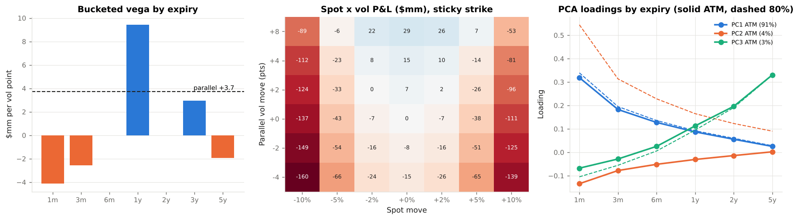
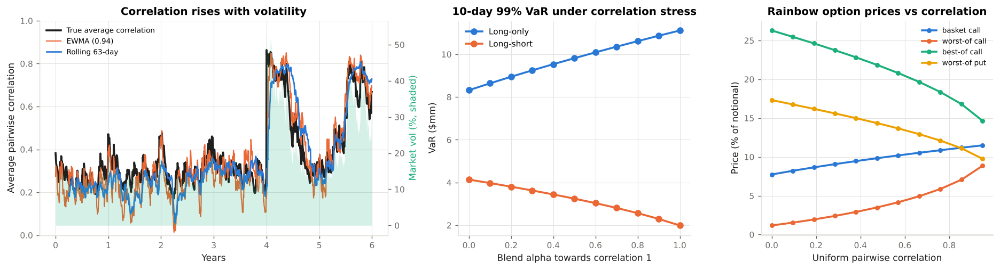

# Volatility & Correlation Risk Laboratory

**The two second-order risks of a trading book: an educational module on measuring, modelling, trading and capitalising volatility risk and correlation risk.**

Volatility & Correlation Laboratory takes a reader from estimating today's volatility to the capital charge a bank holds against an options book and a structured-products book. It covers historical and GARCH volatility, the implied volatility surface (SVI, no-arbitrage, local and stochastic volatility), vega risk management, variance and volatility swaps, correlation estimation, stress and repair, implied correlation and correlation products, and the FRTB treatment of both risks. Every formula is implemented in the companion Python package `vclab`, every implementation is tested against closed forms, Monte Carlo and no-arbitrage identities, and every regulatory statement cites the rule text.

All market data are illustrative and USD-denominated: an S&P 500-style implied volatility surface, five large-cap U.S. stocks with a one-factor correlation structure, and simulated return histories with a scheduled crisis. Nothing here is investment, legal or regulatory advice.

[Start with Chapter 1](01_volatility_and_correlation_risk.md){ .md-button .md-button--primary }
[Browse the code on GitHub](https://github.com/sguven/market-risk-toolkit/tree/main/vol_corr_lab){ .md-button }

---

## The course

<div class="grid cards" markdown>

-   :material-sine-wave: **1. Volatility and correlation risk**

    ---

    What the two risks are, where they sit in a bank's book, and the episodes from 1987 to 2020 that taught the industry to measure them.

    [:octicons-arrow-right-24: Read](01_volatility_and_correlation_risk.md)

-   :material-chart-bell-curve-cumulative: **2. Measuring volatility**

    ---

    Rolling windows, EWMA, GARCH(1,1), forecast term structures, the volatility cone and the variance risk premium.

    [:octicons-arrow-right-24: Read](02_measuring_volatility.md)

-   :material-chart-areaspline: **3. The implied volatility surface**

    ---

    Smile and skew, SVI, butterfly and calendar arbitrage, Dupire local volatility, Heston and spot-vol correlation, sticky rules.

    [:octicons-arrow-right-24: Read](03_implied_volatility_surface.md)

-   :material-tune-vertical: **4. Vega risk**

    ---

    Vanna and volga, bucketed vega, surface scenarios, the spot-vol grid, smile delta, P&L explain and PCA.

    [:octicons-arrow-right-24: Read](04_vega_risk.md)

-   :material-swap-horizontal: **5. Volatility products**

    ---

    Variance swap replication, the VIX methodology, convex payoffs and short-vol blow-ups, volatility swaps and their convexity.

    [:octicons-arrow-right-24: Read](05_volatility_products.md)

-   :material-vector-link: **6. Correlation risk**

    ---

    Correlation breakdown, estimation and shrinkage, stress and nearest-correlation repair, implied correlation, rainbow options, tail dependence.

    [:octicons-arrow-right-24: Read](06_correlation_risk.md)

-   :material-scale-balance: **7. The regulatory framework**

    ---

    FRTB vega and correlation scenarios, the residual risk add-on, liquidity horizons, non-modellable risk factors, U.S. and EU rules, margin.

    [:octicons-arrow-right-24: Read](07_regulation.md)

-   :material-console: **Example outputs and API**

    ---

    Captured output of the six runnable examples with their figures, and the reference for the `vclab` package.

    [:octicons-arrow-right-24: Outputs](08_example_outputs.md) · [:octicons-arrow-right-24: API](09_api_reference.md)

</div>

---

## Learning path

| Step | Read | Run | You should be able to… |
|------|------|-----|------------------------|
| 1 | Chapter 1 | — | Explain why volatility and correlation are risks, name the instruments that carry them, and say why both rise in a crisis. |
| 2 | Chapter 2 | `examples/01_measuring_volatility.py` | Compare rolling, EWMA and GARCH volatility; fit GARCH; build a forecast term structure; explain the variance risk premium. |
| 3 | Chapter 3 | `examples/02_implied_volatility_surface.py` | Read a vol surface; fit SVI; check butterfly and calendar arbitrage; derive local vol; explain how spot-vol correlation creates skew. |
| 4 | Chapter 4 | `examples/03_vega_risk.py` | Bucket vega so that it adds up; run weighted, twist and skew scenarios; explain sticky strike vs sticky moneyness; attribute P&L. |
| 5 | Chapter 5 | `examples/04_volatility_products.py` | Price a variance swap by replication; rebuild a VIX-style index; explain the convexity between variance and volatility swaps. |
| 6 | Chapter 6 | `examples/05_correlation_risk.py` | Estimate, shrink, stress and repair a correlation matrix; compute implied correlation; sign the cega of rainbow options. |
| 7 | Chapter 7 | `examples/06_regulatory_capital.py` | Compute the FRTB vega charge and the binding correlation scenario; apply the RRAO, the liquidity cascade and the RFET. |

---

## A glimpse of the results

<div class="grid" markdown>





</div>

The example SPX options book is long $3.7mm of parallel vega per point, yet loses $9.4mm when short-dated vols rise more than long-dated ones, as they usually do. In the simulated crisis the average correlation of five stocks jumps from 0.25 to 0.76 and the diversification ratio falls from 1.48 to 1.08. Worst-of calls are long correlation and best-of calls short. FRTB's standardised vega charge nets the book's term-structure risk almost entirely, and most implied correlations fail the risk-factor eligibility test.

---

## Quick start

```bash
git clone https://github.com/sguven/market-risk-toolkit.git
cd market-risk-toolkit/vol_corr_lab
pip install -r requirements.txt
python -m pytest -q              # 50 tests
python examples/run_all.py       # six walkthroughs, regenerates docs/figures/
```

```python
from vclab import *

s = SPX_SURFACE
book = example_book(s.spot, s)                                     # delta-hedged SPX options book
book.greeks(s.spot, s)                                             # vega, vanna, volga, theta
vega_buckets(book, s.spot, s, [1/12, 0.25, 0.5, 1, 2, 3, 5])       # bucketed vega, sums to parallel vega
book.value(s.spot, surface_scenario(s, "weighted", 0.01))          # sqrt-time weighted vol scenario
variance_swap_strike(s, 1.0) ** 0.5                                # 1y variance swap vol
nearest_correlation(override_pairs(STOCK_CORRELATION, {(0, 1): 0.95, (0, 4): -0.6}))
equity_vega_charge({("SPX", 12): vega_sensitivities(book, s.spot, s)}).charge   # FRTB-SA vega
```

## Regulatory sources

| Framework | Source text |
|-----------|-------------|
| FRTB standardised approach: vega, correlation scenarios | Basel Framework MAR21; BCBS d457 (2019) |
| Residual risk add-on | Basel Framework MAR23 |
| Internal models: ES, liquidity horizons, RFET, NMRF, P&L attribution | Basel Framework MAR31–MAR33 |
| U.S. market risk capital | 12 CFR 217 subpart F; proposal 88 FR 64028 (2023) |
| EU implementation | CRR2 (Regulation (EU) 2019/876), CRR3 (Regulation (EU) 2024/1623) |
| Model risk | FRB SR 11-7 / OCC 2011-12 |
| Volatility index methodology | Cboe VIX White Paper |

Full citations with links: [References](references.md).
