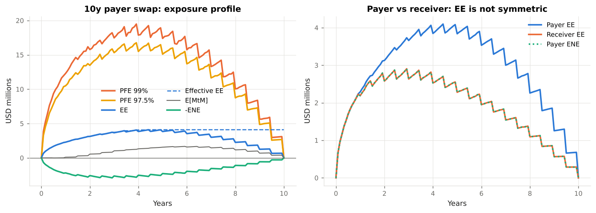
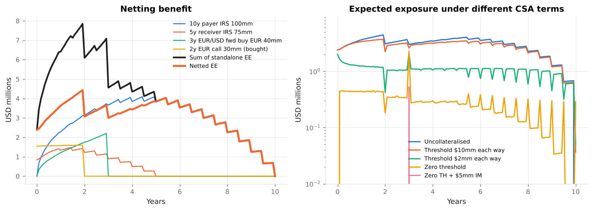
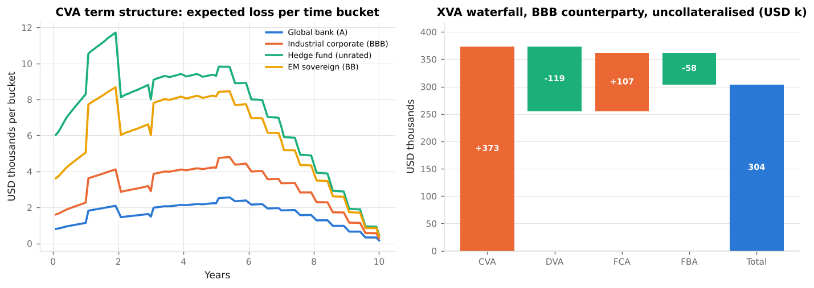
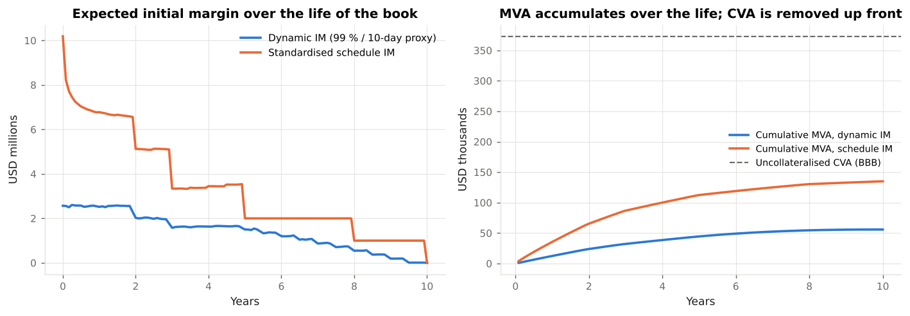
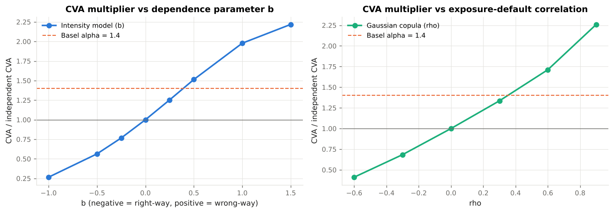
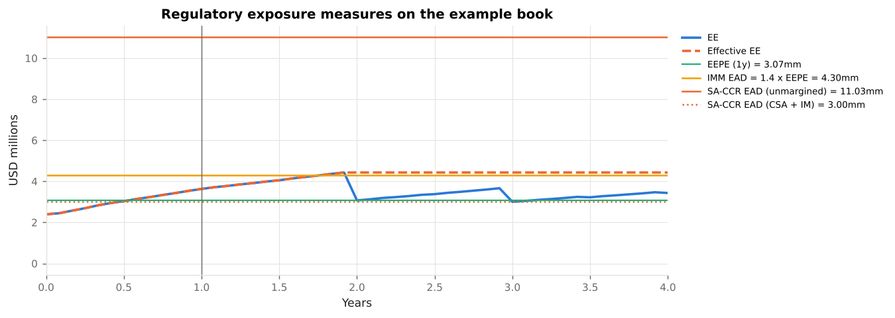

# Counterparty Exposure & XVA Laboratory

**An educational module on counterparty credit exposure simulation, netting and collateral, the XVA family (CVA, DVA, FVA, MVA, KVA), wrong-way risk, and the Basel / U.S. rules that govern them (SA-CCR, IMM, BA-CVA, uncleared margin).**

`xva_lab` is a self-contained Python project (package `xvalab`) that takes a reader from *"how much could this counterparty owe us when it defaults?"* to the valuation adjustments a dealer charges for that risk and the regulatory exposure and capital a bank holds against it. Every formula is implemented, every implementation is tested against no-arbitrage identities and the Basel Committee's published SA-CCR worked example, and every regulatory statement cites the rule text.

**Read it online:** https://sguven.github.io/market-risk-toolkit/xva-lab/ (built from `docs/` with MkDocs Material and deployed by GitHub Actions together with the rest of the repository's site).

All market data are **illustrative, USD/EUR-denominated** reference points (a SOFR and an €STR curve, EUR/USD spot and volatility, four stylised counterparties with CDS curves). Nothing here is investment, legal or regulatory advice.

---

## Contents

```
xva_lab/
├── README.md                      <- you are here
├── docs/                          <- the course text (read in order)
│   ├── 01_counterparty_credit_risk.md     What CCR is, the 2008 lessons, EE / PFE / EPE / EEPE, the XVA family
│   ├── 02_exposure_simulation.md          Hull-White + FX models, time grid, revaluation on paths, reading a profile
│   ├── 03_netting_and_collateral.md       Close-out netting, CSA terms, MPoR, cash-flow spikes, IM (schedule vs SIMM), clearing
│   ├── 04_cva_and_dva.md                  CVA formula and discretisation, hazard rates from CDS, bilateral CVA, DVA debate
│   ├── 05_fva_and_mva.md                  FCA / FBA, the FVA debate, MVA and the margin trade-off, KVA, ColVA
│   ├── 06_wrong_way_risk.md               General vs specific WWR, alpha, intensity model, copula, devaluation at default
│   ├── 07_regulation.md                   CRE50-54, MAR50, CAP30; 12 CFR 217.132, margin rules; CRR; ASC 820 / IFRS 13
│   ├── 08_example_outputs.md              Captured console output and figures of the six examples
│   ├── 09_api_reference.md                Auto-generated from docstrings
│   └── references.md                      Literature and rule texts with links
├── xvalab/                        <- the library
│   ├── market.py                  Discount curves, hazard curves (credit triangle), illustrative market data and counterparties
│   ├── models.py                  Hull-White 1F (exact simulation, affine bonds), lognormal FX, hybrid model, numeraire
│   ├── instruments.py             Interest rate swap (with fixings), FX forward, FX option; SA-CCR leg descriptions
│   ├── exposure.py                Time grid, netting sets, CSA (thresholds, MTA, MPoR, IM), exposure metrics (CRE50)
│   ├── xva.py                     CVA, DVA, FVA (FCA/FBA), MVA, KVA, running-spread conversion, dynamic IM proxy
│   ├── wwr.py                     Exposure-linked intensity (Hull-White 2012), Gaussian copula (Rosen-Saunders), jump at default
│   ├── regulatory.py              SA-CCR (CRE52), IMM EAD (CRE53), BA-CVA (MAR50), standardised IM schedule, reference registry
│   ├── book.py                    The four-trade example netting set
│   └── reporting.py               Console tables
├── examples/                      <- runnable walkthroughs that generate the figures
│   ├── 01_exposure_profiles.py
│   ├── 02_netting_and_collateral.py
│   ├── 03_cva_dva_fva.py
│   ├── 04_mva_initial_margin.py
│   ├── 05_wrong_way_risk.py
│   ├── 06_regulatory_capital.py
│   ├── run_all.py                 Run everything
│   └── _build_outputs_page.py     Regenerate docs/08_example_outputs.md from the captured output
├── tests/                         <- pytest suite (martingale tests, exposure identities, XVA monotonicities, BCBS SA-CCR example)
├── mkdocs.yml                     <- site configuration (MkDocs Material)
├── pyproject.toml
└── requirements.txt
```

---

## Quick start

```bash
cd xva_lab
pip install -r requirements.txt          # numpy, scipy, matplotlib, pytest
python -m pytest -q                      # 36 tests, ~3 s
python examples/run_all.py               # all six walkthroughs, ~30 s, writes docs/figures/
pip install mkdocs-material "mkdocstrings[python]" && mkdocs serve   # browse the site locally
```

Or use the library directly:

```python
from xvalab import *

engine = ExposureEngine(default_model(), n_paths=10_000)
swap = InterestRateSwap(100e6, USD_SOFR.swap_rate(0, 10), 10.0, pay_fixed=True)
csa = CSA(threshold_cpty=5e6, threshold_bank=5e6, mta=0.5e6, mpor_days=10)
exposure = engine.run(NettingSet([swap], csa))

exposure.summary()                                                    # EPE, EEPE, peak EE, peak PFE 97.5 % / 99 %
cpty = COUNTERPARTIES["Industrial corporate (BBB)"].hazard_curve()
cva(exposure, cpty).value                                             # unilateral CVA in USD
fva(exposure, FUNDING_SPREAD_BP, cpty, BANK_OWN_CDS.hazard_curve()).fva
mva(exposure.times, dynamic_im_profile(exposure), IM_FUNDING_SPREAD_BP, USD_SOFR, cpty).value
cva_wwr_intensity(exposure, cpty, b=0.5).ratio                        # wrong-way multiplier
saccr_for_netting_set(exposure.netting_set, exposure.market).ead      # SA-CCR EAD (CRE52)
imm_ead(exposure)["EAD"]                                              # IMM EAD = 1.4 x EEPE (CRE53)
```

---

## Learning path

| Step | Read | Run | You should be able to… |
|------|------|-----|------------------------|
| 1 | `docs/01` | — | Define EE, PFE, EPE, Effective EE, EEPE and EAD; name the six XVAs and the sign of each. |
| 2 | `docs/02` | `examples/01` | Explain why a swap's exposure is hump-shaped and a forward's is not; why payer and receiver differ; why discounting is path-wise. |
| 3 | `docs/03` | `examples/02` | Compute the netting benefit; explain thresholds, MTA, MPoR and cash-flow spikes; describe the standardised IM schedule and SIMM. |
| 4 | `docs/04` | `examples/03` | Price CVA from an exposure profile and a CDS curve; explain bilateral CVA and the DVA debate; quote CVA as a running spread. |
| 5 | `docs/05` | `examples/04` | Compute FCA / FBA and MVA; argue both sides of the FVA debate; show the CVA-vs-MVA trade-off created by the margin rules. |
| 6 | `docs/06` | `examples/05` | Price WWR with an intensity model and a copula; show right-way risk on the opposite trade; model devaluation at default. |
| 7 | `docs/07` | `examples/06` | Compute SA-CCR EAD by hand and reproduce the BCBS example; compare with IMM `α × EEPE`; compute BA-CVA capital. |

---

## What the examples show

### 01 — Exposure profiles
A 10y payer swap (hump, sawtooth from coupons, Effective EE), the payer/receiver asymmetry, and the monotone profile of an FX forward next to the one-sided profile of a bought option.



### 02 — Netting and collateral
Standalone vs netted EE for the four-trade book (26 % netting benefit), and the same book under seven CSA variants: thresholds, MTA, 5/10/20-day MPoR, initial margin — including the cash-flow spike at the forward's settlement.



### 03 — CVA, DVA, FVA
CVA for four counterparties with its term structure and running-spread equivalent, bilateral CVA and DVA, the effect of collateral, symmetric vs asymmetric FVA, and the XVA waterfall.



### 04 — Initial margin and MVA
Standardised-schedule vs dynamic IM profiles, the MVA each implies, and the trade-off table: variation margin removes 90 % of CVA + FVA, initial margin removes the rest and replaces it with MVA.



### 05 — Wrong-way risk
CVA multipliers from the exposure-linked intensity model and the Gaussian copula against Basel's α = 1.4, specific WWR as a devaluation jump on a sovereign FX forward, and right-way risk on the receiver swap.



### 06 — Regulatory capital
SA-CCR building blocks for the book (unmargined and margined with IM), the BCBS d279 Example 1 reproduction (EAD 569), IMM α × EEPE on the simulated profile, and BA-CVA capital for the four counterparties next to their accounting CVA.



---

## Regulatory references used

| Framework | Source text | Where applied |
|-----------|-------------|---------------|
| CCR definitions and metrics | Basel Framework CRE50 | `exposure.py`, `docs/01` |
| SA-CCR | Basel Framework CRE52; BCBS d279 worked examples; 12 CFR 217.132(c); 85 FR 4362 | `regulatory.saccr_ead`, `tests/test_regulatory.py`, `docs/07` |
| IMM | Basel Framework CRE53 (incl. wrong-way risk, CRE53.39–53.48); 12 CFR 217.132(d) | `regulatory.imm_ead`, `wwr.py`, `docs/06`, `docs/07` |
| CVA risk capital | Basel Framework MAR50 (BA-CVA, SA-CVA); BCBS d424, d507; 12 CFR 217.132(e); 88 FR 64028 (proposal) | `regulatory.ba_cva_capital`, `docs/07` |
| DVA deduction | Basel Framework CAP30.15; 12 CFR 217.22(b)(1)(iii) | `docs/04` |
| Uncleared margin | BCBS-IOSCO d499 (2020); 12 CFR 237; 17 CFR 23.150–161; 17 CFR 240.18a-3; EU 2016/2251 | `regulatory.standardised_im_schedule`, `docs/03`, `docs/05` |
| Clearing and CCPs | 7 U.S.C. 2(h); EMIR Art. 4; Basel CRE54 | `docs/03` |
| EU implementation | CRR Art. 274–294, 381–386; CRR3 | `docs/07` |
| Accounting | FASB ASC 820; IFRS 13 ¶42–44, 56; IFRS 9 ¶5.7.7 | `docs/04`, `docs/07` |
| Model risk | FRB SR 11-7 / OCC 2011-12 | `docs/02`, `docs/06` |

Full citations with links are in [`docs/references.md`](docs/references.md); the machine-readable list is `xvalab.regulatory.REGULATORY_REFERENCES`.

---

## Design notes

* **One simulation, every number.** The market is simulated once per grid and seed; netting sets, CSA variants and standalone trades are revalued on the *same* paths (`market=` argument), so every comparison in the examples is exact rather than noisy.
* **Exact rate dynamics.** Hull-White is simulated with its Gaussian transition density and bonds are priced with the affine closed form; tests verify the martingale property of discounted bonds and FX to 0.3 %.
* **Fixings on the path.** The swap records its floating fixing on each path at every reset date, so coupon sawtooth and cash-flow effects in collateralised exposure are real, not artefacts.
* **Collateral with a lag.** Variation margin is called on the MtM observed one margin period of risk earlier; thresholds and the MTA are applied sequentially; IM is a constant. The resulting cash-flow spikes are deliberate and discussed.
* **Regulatory formulas reproduce published numbers.** SA-CCR reproduces the BCBS worked example to 0.1 %; BA-CVA uses the MAR50.16 risk-weight table and the 0.65 scalar.
* **Explicit simplifications.** Each module docstring lists what is simplified relative to the rule text or to production practice (single curve, deterministic foreign rates, credit triangle, VaR proxy for SIMM, reduced BA-CVA, IR and FX only).

## Scope and disclaimer

Educational material. Regulatory parameters are those of the Basel Framework as in force on 1 January 2023 and of U.S. rules as published; the 2023 U.S. CVA proposal is described as pending. Market data are synthetic. Verify every figure against primary sources before any professional use.
