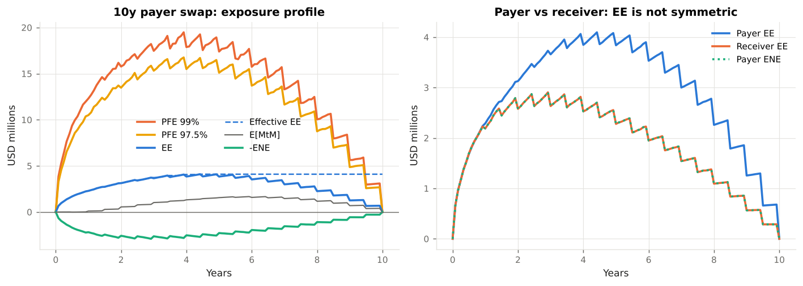
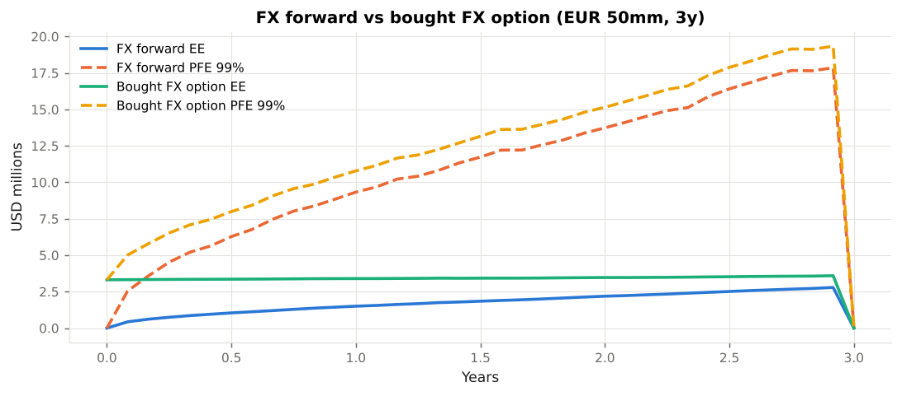

# 2. Simulating Future Exposure

This chapter builds the exposure engine: **risk-factor models, a time grid, revaluation of trades on simulated paths, and the exposure metrics read from the result.** Code: `xvalab/models.py`, `xvalab/instruments.py`, `xvalab/exposure.py`. Example: `examples/01_exposure_profiles.py`.

---

## 2.1 Why simulate

For a single European option the expected exposure has a closed form. For a netting set of swaps, forwards and options with a CSA it does not: the collateral rule is path-dependent, the netting is non-linear, and the time dimension matters. Every production exposure system is therefore a Monte Carlo engine with four steps:

1. **Simulate** the risk factors (rates, FX, equities, credit, commodities) on a grid of future dates.
2. **Revalue** every trade on every path and date.
3. **Aggregate**: sum within netting sets, apply collateral.
4. **Measure**: take expectations and quantiles across paths at each date.

Step 2 is the expensive one (banks spend most of their XVA compute budget on it), which is why the trades here have analytic prices in terms of the simulated state.

---

## 2.2 Risk-factor models

### Interest rates: one-factor Hull-White

```
dr_t = (θ(t) − a r_t) dt + σ dW_t
```

`θ(t)` is chosen so that the model reproduces today's discount curve exactly, `a` is the mean-reversion speed and `σ` the (normal) volatility of the short rate. Two properties make it the workhorse of exposure engines:

* **Bond prices are affine in the short rate**, so every swap on every path is priced in closed form from one number `r_t`:

  ```
  P(t, T) = A(t, T) · exp(−B(t, T) r_t)
  B(t, T) = (1 − e^{−a(T−t)}) / a
  ln A(t, T) = ln(P(0,T)/P(0,t)) + B(t,T) f(0,t) − σ²/(4a) (1 − e^{−2at}) B(t,T)²
  ```

* **The transition density is Gaussian and known**, so the short rate can be simulated *exactly* on any grid, with no discretisation error:

  ```
  r_s | r_t  ~  N( r_t e^{−a(s−t)} + α(s) − α(t) e^{−a(s−t)},   σ² (1 − e^{−2a(s−t)}) / (2a) )
  α(t) = f(0, t) + σ² (1 − e^{−at})² / (2a²)
  ```

`HullWhite1F` in `models.py` implements both formulas. The tests check that `E[D(t) P(t, T)] = P(0, T)` (discounted bond prices are martingales) and `E[r_t] = α(t)`.

!!! info "Illustrative parameters"
    `a = 3 %`, `σ = 85 bp`. With mean reversion the standard deviation of the 10y swap rate after 5 years is about `σ √((1 − e^{−2a·5})/(2a)) ≈ 1.7 %`, a plausible number for USD rates. Real engines calibrate `σ` (often time-dependent) to swaption prices and may use two factors so that the curve can twist.

### FX: lognormal spot with stochastic domestic rates

```
S_{t+Δ} = S_t · exp( (r_d(t) − r_f(t) − σ²/2) Δ + σ √Δ z )
```

The domestic rate is the simulated short rate, the foreign rate the deterministic instantaneous forward of the EUR curve. The FX and rate Brownian motions are correlated (`ρ = −0.25` in the examples, so that a USD rate rise comes with a stronger dollar on average). The test checks `E[D(t) S_t] = S_0 P_f(0, t)`: the discounted FX spot times the foreign bank account is a martingale.

### Why risk-neutral and not real-world?

Exposures used for **pricing** (CVA, FVA) must be computed under the risk-neutral measure, because CVA is a price. Exposures used for **risk management** (PFE limits) are often computed under the real-world measure with historically calibrated drifts and volatilities; Basel's IMM requires a *stressed* calibration as well (CRE53.19). This module uses one risk-neutral simulation for everything and flags the difference where it matters.

---

## 2.3 The time grid

The grid must contain every date at which something happens:

* **cash-flow and fixing dates** of every trade, so that coupon payments and resets are captured exactly;
* a **regular grid** (monthly here) so that the profile is smooth between them;
* if the netting set is collateralised, the **lagged dates `t − MPoR`** at which the collateral held at `t` was called.

`time_grid()` in `exposure.py` builds the union. Only regular and cash-flow dates are reported; the MPoR helper points are used and dropped.

---

## 2.4 Revaluing trades on a path

Every `Trade` implements `value(market, i)`: its USD mark-to-market on all paths at grid index `i`, **from the bank's point of view** (positive = the counterparty owes us). Three products are implemented.

**Interest rate swap.** Fixed leg `N c τ Σ P(t, T_k)` over remaining payment dates. Floating leg: at each reset date the simulation records the fixing `L_j = (1/P(T_{j−1}, T_j) − 1)/τ` on every path; between resets the leg is worth `N [(1 + τ L_j) P(t, T_j) − P(t, T_n)]`. This is what produces the **sawtooth** in the exposure profile: every coupon payment removes value from the swap. Payer swap: `V = floating − fixed`.

**FX forward.** `V = N_f [S_t P_f(t, T) − K P_d(t, T)]`. One cash flow, so nothing amortises.

**FX option.** Garman-Kohlhagen on the simulated spot and discount factors with a constant volatility. A *bought* option is an asset from inception (we paid the premium) and never a liability: its ENE is identically zero. A *sold* option is the mirror image.

---

## 2.5 Reading an exposure profile



The left panel is the 10-year payer swap of Example 01 (`$100mm`, at par).

* **EE starts at zero**: an at-market swap has nothing to lose yet.
* **It rises like `√t`** as rates diffuse away from the fixed rate, then **falls** as the remaining cash flows amortise. The product of the two gives the hump with a **peak around one-third of the life**. (For a forward, which has one cash flow, the second effect is absent and the profile is monotone: right panel of the FX figure below.)
* **PFE at 99 %** is roughly four to five times EE, as expected for a near-Gaussian value distribution (`Φ⁻¹(0.99) ≈ 2.33` versus `E[X⁺] = σ/√(2π) ≈ 0.4 σ` for a zero-mean normal).
* **Effective EE** (dashed) is the running maximum: once the peak is passed it stays flat. EEPE, its one-year average, is what the IMM capitalises.
* **E[MtM] drifts positive**: the illustrative curve is upward sloping, so the payer expects to receive more floating than it pays fixed later in the life. That is why the payer's EE is larger than the receiver's (right panel): the two swaps are mirror images in value but not in exposure.



---

## 2.6 Discounting the exposure

CVA needs the *present value* of the expected loss. There are two conventions:

* **Deterministic discounting**: `DF(0, t) × EE(t)` with today's discount factors. Simple, and exact if rates and exposure are independent.
* **Path-wise discounting**: `E[D(t) E(t)]` with the stochastic bank-account numeraire `D(t) = exp(−∫₀ᵗ r_u du)` on each path. Exact in the model; captures the covariance between rates and exposure (a payer swap has high exposure exactly when rates — and hence discounting — are high, which *reduces* its CVA relative to the deterministic version).

`ExposureResult.ee(discounted=True)` returns the second; all XVA functions use it by default. The difference is a few percent for the 10-year swap.

---

## 2.7 Monte Carlo error and model governance

With `n` paths the standard error of EE is about `σ_E / √n`; with 10,000 antithetic paths the examples resolve EE to roughly ±1 %. PFE at 99 % is noisier (it depends on the 100 worst paths), which is one reason credit limits are set with margin.

Model governance for exposure engines follows SR 11-7 / OCC 2011-12: conceptual soundness (does the model reproduce market prices? are the martingale tests passing?), ongoing monitoring (back-testing of EE and PFE against realised exposures, which Basel requires for IMM banks under CRE53.44–53.46), and outcomes analysis (benchmarking against SA-CCR). The test suite in `tests/test_market_models.py` and `tests/test_exposure.py` is a small version of the first pillar.

!!! warning "What the engine does not do"
    No multi-curve basis, no stochastic volatility, no stochastic credit spread for the counterparty (Chapter 6 adds dependence in a reduced way), no American-exercise or path-dependent products, and no collateral in a currency other than USD. Each of these is a well-trodden extension; none changes the structure of the pipeline.
