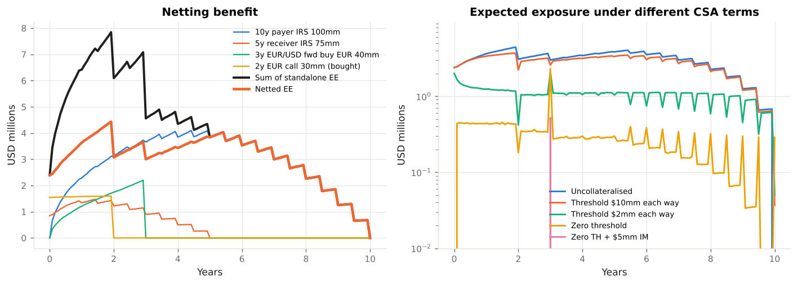
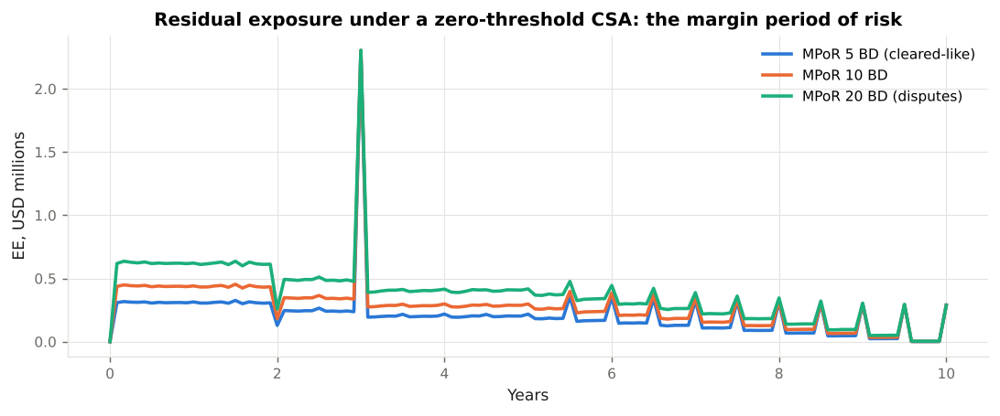
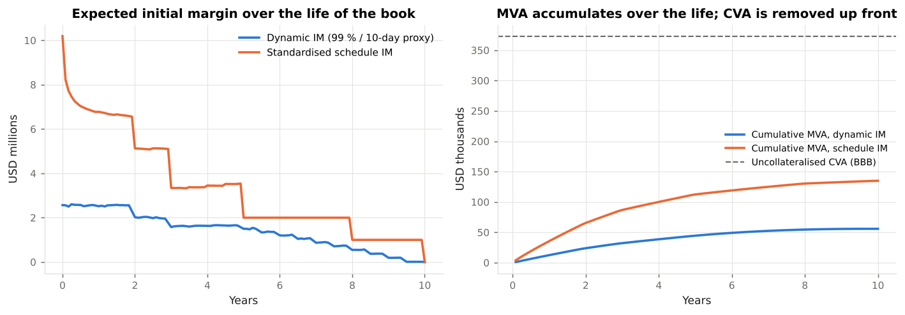

# 3. Netting, Collateral and Margin

This chapter covers **the two contractual mitigants that turn gross exposure into a small residual — close-out netting and collateral — and the margin rules that made the second mandatory.** Code: `xvalab/exposure.py` (`NettingSet`, `CSA`), `xvalab/regulatory.py` (`standardised_im_schedule`). Example: `examples/02_netting_and_collateral.py`, `examples/04_mva_initial_margin.py`.

---

## 3.1 Close-out netting

Under an **ISDA Master Agreement**, all transactions between two parties form a single contract. On default, every transaction is terminated and the mark-to-markets are **netted into one close-out amount**. The exposure is therefore

```
E = max( Σ_k V_k , 0 )        with netting
E = Σ_k max( V_k , 0 )        without netting (each trade a separate claim)
```

and the first is never larger than the second. Netting is a legal, not a mathematical, fact: the benefit may be recognised only where the agreement is **enforceable in the relevant jurisdictions**, which is why Basel defines a *qualifying master netting agreement* (CRE52.7 for SA-CCR, CRE53.61 for IMM; U.S. 12 CFR 217.2 "qualifying master netting agreement") and requires written legal opinions. Banks maintain netting-opinion libraries by counterparty type and jurisdiction, and exposure engines carry a flag per netting set.



In Example 02 the four-trade book nets to a lifetime EPE 26 % below the sum of the standalone profiles. The benefit comes from **offsetting directions** (the payer and receiver swaps) and **imperfect correlation** (rates versus FX). A book of 1,000 trades with a dealer typically nets by 80–90 %; a directional book with a corporate hedger (all swaps the same way round) nets hardly at all.

---

## 3.2 Collateral: the Credit Support Annex

The CSA to the ISDA specifies how the mark-to-market is collateralised. The terms the engine models:

| Term | Meaning | Effect on exposure |
|---|---|---|
| **Threshold** (`threshold_cpty`, `threshold_bank`) | Amount of exposure that need not be collateralised | Residual exposure ≈ threshold + MPoR move |
| **Minimum transfer amount** (`mta`) | Smallest collateral call that can be made | Adds a dead band: exposure can drift by MTA before a call |
| **Independent amount / initial margin** (`im_received`, `im_posted`) | Collateral posted up front, independent of MtM | Cuts exposure directly; IM received is a buffer against the MPoR gap |
| **Margin period of risk** (`mpor_days`) | Time from the last collateral exchange to close-out of the defaulted portfolio | The exposure that *remains* with a zero threshold |
| Call frequency, rounding, haircuts, eligible collateral, currency | Operational terms | Not modelled (cash, same currency, daily calls) |

The engine's collateral rule, for a zero-threshold CSA, is

```
C(t)  =  V(t − δ)          δ = margin period of risk
E(t)  =  max( V(t) − C(t) − IM_received , 0 )  =  max( V(t) − V(t − δ) − IM_received , 0 )
```

With thresholds and an MTA, `C` targets `max(V − TH_c, 0) − max(−V − TH_b, 0)` and moves only when the change exceeds the MTA (`CSA.collateral_path`, applied sequentially along each path).

### The margin period of risk

Even a perfectly collateralised netting set has exposure, because a defaulting counterparty stops posting collateral some days before the portfolio can be closed out. Basel sets the **supervisory floor at 10 business days** for bilateral OTC derivatives (CRE50.20, CRE53.26), doubled to 20 when the netting set has more than 5,000 trades, contains illiquid collateral or hard-to-replace trades, or has had margin disputes; 5 days for cleared client trades (CRE54). Over the MPoR the market can move by roughly `σ √δ`, so **residual EE scales with `√MPoR`**: Example 02 shows 5-, 10- and 20-day MPoR giving residual EPE in the ratio 0.7 : 1 : 1.4.



### Cash-flow spikes

The right panel of the CSA figure shows a spike at year 3 in every collateralised profile: the FX forward settles. A payment that falls **inside** the margin period of risk is not covered by collateral called on the pre-settlement mark-to-market — if we have paid and the counterparty has not, the whole payment is exposure. Andersen, Pykhtin and Sokol (2017) showed that such spikes dominate collateralised exposure for many portfolios and are routinely missed by engines that ignore cash flows within the MPoR. Initial margin is the mitigant.

---

## 3.3 Initial margin

Variation margin tracks the mark-to-market; **initial margin** covers the MPoR gap and the spikes. Before 2016 it was negotiated bilaterally (and rarely posted between dealers). The **BCBS-IOSCO margin requirements for non-centrally cleared derivatives** (2013, final text 2020) made two-way, segregated IM mandatory for covered entities above €8bn / $8bn aggregate average notional, phased in from September 2016 to September 2022. In the U.S. the rules are in **12 CFR Part 237** (prudential regulators: FRB, OCC, FDIC, FCA, FHFA), **17 CFR 23.150–161** (CFTC for swap dealers) and **17 CFR 240.18a-3** (SEC for security-based swap dealers); the EU rule is Commission Delegated Regulation (EU) 2016/2251 under EMIR.

Two ways to compute IM are permitted:

**The standardised schedule** (`regulatory.standardised_im_schedule`): a percentage of notional by asset class and remaining maturity, with a net-to-gross adjustment:

| Asset class | 0–2y | 2–5y | 5y+ |
|---|---|---|---|
| Interest rate | 1 % | 2 % | 4 % |
| Credit | 2 % | 5 % | 10 % |
| FX | 6 % | 6 % | 6 % |
| Equity | 15 % | 15 % | 15 % |
| Commodity / other | 15 % | 15 % | 15 % |

```
IM_net = 0.4 × IM_gross + 0.6 × NGR × IM_gross,     NGR = max(Σ V, 0) / Σ max(V_k, 0)
```

**An internal model**, in practice the **ISDA Standard Initial Margin Model (SIMM)**: a sensitivity-based calculation (delta, vega, curvature by risk class, with prescribed risk weights and correlations, calibrated to a 99 % / 10-day horizon including a stress period), structurally similar to FRTB's sensitivities-based method. This module does not implement SIMM; `xva.dynamic_im_profile` stands in with a 99 % / 10-day VaR proxy of the same magnitude and shape.



In Example 04 the schedule IM is three to four times the model IM at inception — the standard outcome, and the reason every in-scope firm runs SIMM.

IM must be **segregated** (held by a third-party custodian) and **cannot be rehypothecated**. That is what makes it effective against default and expensive to post: Chapter 5 prices the cost (MVA).

---

## 3.4 Central clearing

Clearing replaces the bilateral counterparty with a **central counterparty (CCP)** through novation. The CCP collects variation margin daily (or intraday), initial margin covering a 5-day (client) or 2-day (house, some CCPs) close-out, and default-fund contributions; it mutualises losses beyond a defaulter's margin across members. Dodd-Frank Title VII (7 U.S.C. 2(h)) and EMIR Article 4 mandate clearing of standardised interest-rate and index credit derivatives. For the bank, exposure to a qualifying CCP attracts a 2 % risk weight on trade exposures (CRE54) and clearing eliminates bilateral CVA — at the cost of IM (MVA) and default-fund capital.

---

## 3.5 How collateral changes the XVA picture

| Regime | Residual exposure | CVA / FVA | MVA | Typical counterparties |
|---|---|---|---|---|
| Uncollateralised | Full profile | Large | None | Corporates, sovereigns, supranationals |
| One-way CSA (we post, they don't) | Full for us; none for them | CVA large, DVA ≈ 0, FVA cost large | None | Sovereigns, some SSAs |
| Two-way CSA, thresholds | Threshold + MPoR | Reduced | None | Legacy inter-dealer, funds |
| Two-way zero-threshold CSA | MPoR gap and spikes | Small | None | Post-2017 bilateral |
| Two-way CSA + regulatory IM | Nearly zero | Negligible | Material | In-scope dealers and funds |
| Cleared | Nearly zero (to CCP) | None bilateral | Material | Standardised swaps |

Example 04 puts numbers on the last three rows: variation margin removes about 90 % of the CVA, initial margin almost all of the remainder, and in exchange MVA becomes the largest adjustment. **The margin rules did not eliminate counterparty risk; they converted it into funding cost.**

!!! note "The CSA as a pricing input"
    Because a trade's expected exposure depends on the CSA, the same swap has a different price with every counterparty. XVA desks therefore price *incrementally*: the CVA of a new trade is the change in the netting set's CVA, which can be negative if the trade offsets existing exposure. The `ExposureEngine` makes this easy to see: simulate the netting set with and without the new trade on the same market (`market=` argument) and difference the results.
