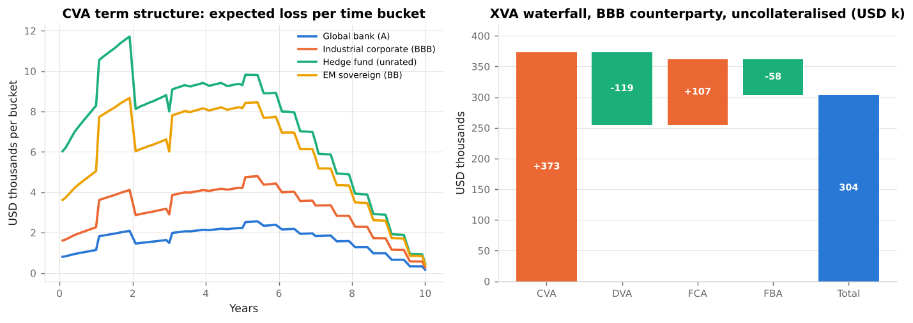

# 4. CVA and DVA

This chapter derives **the credit valuation adjustment, its discretisation, the inputs it needs from the credit market, and its bilateral extension, DVA.** Code: `xvalab/xva.py`, `xvalab/market.py` (`HazardCurve`). Example: `examples/03_cva_dva_fva.py`.

---

## 4.1 CVA as a price

The risk-free value of a derivative assumes the counterparty always pays. The risky value is lower by the expected discounted loss on default:

```
CVA = (1 − R) · E[ D(τ) · E(τ) · 1{τ ≤ T} ]
```

where `τ` is the counterparty's default time, `R` its recovery, `D(τ)` the discount factor to `τ` and `E(τ) = max(V(τ) − C(τ), 0)` the exposure at default. If the default time is **independent** of the exposure and discounting, the expectation factorises over a time grid:

```
CVA  =  (1 − R)  Σ_{i=1}^{n}  EE*(t_i)  ·  [ S(t_{i−1}) − S(t_i) ]
EE*(t_i) = E[ D(t_i) E(t_i) ]            discounted expected exposure (midpoint of the bucket in the code)
S(t)     = P(τ > t)                       survival probability
```

Every term is something Chapters 2 and 3 produced, except the survival curve. `xva.cva` implements this with the bucket exposure taken as the average of the two end-points.

### Reading the formula

* **CVA is a sum of expected losses by period.** Plotting the contributions (Example 03) shows where the risk is: for the swap book it is years 2–6, where exposure is highest and the counterparty is still likely to be alive.
* **It is a price, not a capital number.** It is computed under the risk-neutral measure with market-implied default probabilities, and hedged with CDS, so it moves daily. The regulatory charge for that movement is Chapter 7's CVA capital.
* **The order of magnitude**: for a flat hazard rate `λ` and a flat exposure profile `EPE`, `CVA ≈ (1 − R) λ · EPE · Annuity ≈ s · EPE · Annuity` where `s` is the CDS spread. A 10-year swap with lifetime EPE of 3 % of notional and a 140 bp counterparty costs about `0.014 × 0.03 × 8 ≈ 34 bp` of notional up front — close to the 37 bp in Example 03.

---

## 4.2 Default probabilities from the credit market

CVA uses **risk-neutral** default probabilities, because they are what the hedge (buying CDS protection) costs. The link between a CDS spread `s` and the hazard rate `λ` is the *credit triangle*:

```
s  ≈  λ (1 − R)        ⇒        λ  ≈  s / (1 − R)
```

(The protection leg pays `(1 − R)` at the default rate `λ`; the premium leg pays `s` while alive; the two must be equal at inception.) `HazardCurve.from_cds_spreads` applies it tenor by tenor: cumulative hazard `H(T) = s(T) T / (1 − R)`, piecewise-constant `λ` between pillars, survival `S(t) = e^{−H(t)}`.

| Counterparty (illustrative) | 5y CDS | R | 5y hazard | 10y default probability |
|---|---|---|---|---|
| Global bank (A) | 70 bp | 40 % | 1.2 % | 14 % |
| Industrial corporate (BBB) | 140 bp | 40 % | 2.3 % | 26 % |
| EM sovereign (BB) | 300 bp | 25 % | 4.0 % | 37 % |
| Hedge fund (unrated) | 400 bp | 25 % | 5.3 % | 45 % |

Two practical points:

* **Recovery matters twice**: it sets LGD `(1 − R)` *and* the implied hazard rate. A lower recovery assumption raises `λ` and lowers LGD; the CVA effect is roughly neutral for small spreads but not for large ones.
* **Most counterparties have no CDS.** Banks map them to a proxy curve by rating, sector and region (the "proxy spread" problem), which is itself a model-risk item: SA-CVA prescribes the same rating-sector-region mapping for illiquid names (MAR50.33), and the EU has EBA regulatory technical standards on proxy spreads.

---

## 4.3 Bilateral CVA and DVA

The unilateral formula assumes *we* never default. If we might, two things change: we can only suffer the counterparty's default while we are alive, and the counterparty suffers ours. Both parties' defaults enter:

```
BCVA  =  CVA_bilateral  −  DVA
CVA_bilateral  =  (1 − R_c) Σ_i  EE*(t_i)  · S_b(t_{i−1}) · [ S_c(t_{i−1}) − S_c(t_i) ]
DVA            =  (1 − R_b) Σ_i  ENE*(t_i) · S_c(t_{i−1}) · [ S_b(t_{i−1}) − S_b(t_i) ]
```

(subscript `c` for counterparty, `b` for the bank; Gregory 2020, eq. 17.6). `xva.cva(..., own=...)` and `xva.dva` implement these.

**DVA** is the mirror image of CVA on the negative exposure: the expected amount we would *not* pay because we had defaulted. It is a gain to us and a loss to the counterparty; the two parties' BCVAs are equal and opposite, which is what makes a bilateral price agreeable in principle.

### The DVA controversy

| For recognising DVA | Against |
|---|---|
| Fair value under **ASC 820 / IFRS 13** must reflect the *nonperformance risk of both parties*, including the reporting entity's own credit (ASC 820-10-35-17; IFRS 13 ¶42–44). | A bank cannot monetise its own default; the "gain" is realised only by going bankrupt. |
| Symmetry: the counterparty books CVA on us; without DVA the two sides' prices cannot agree. | It produces perverse P&L: banks reported billions of DVA *gains* in 2008 and 2011 as their own spreads widened. |
| It is an economic cost to the counterparty, so it is in the price. | It is (partly) the same thing as the funding benefit (FBA): counting both double counts (Chapter 5). |

The regulatory answer is unambiguous: **Basel III derecognises DVA from CET1** (CAP30.15: "derecognise in the calculation of CET1 all unrealised gains and losses that have resulted from changes in the fair value of liabilities that are due to changes in the bank's own credit risk"), and U.S. rules follow (12 CFR 217.22(b)(1)(iii)). Accounting keeps it; capital ignores it. Most XVA desks hedge CVA actively but not DVA (one cannot sell protection on oneself at scale), and many treat DVA and FBA as alternatives rather than additive.

---

## 4.4 The effect of collateral

Because `E(t)` in the CVA formula is already net of collateral, the CSA flows straight through: Example 03 shows the BBB counterparty's CVA falling from `$373k` uncollateralised to `$35k` under a zero-threshold CSA (the MPoR gap and cash-flow spikes) and to `$0.6k` with `$5mm` of initial margin received. Collateralised CVA is small but *not* zero, and it is concentrated at settlement dates.

---

## 4.5 Running CVA: the sales view

Up-front CVA is awkward in a quote. The desk converts it into a **running spread**: the flat number of basis points per annum on the notional, paid over the risky life, with the same present value:

```
CVA_bp/yr  =  CVA  /  ( N · Σ_i DF(t_i) S_c(t_i) Δt_i )  × 10⁴
```

(`xva.cva_as_spread_bp`). For the example book the BBB counterparty costs about 2 bp a year on gross notional — the number the salesperson adds to the swap rate.

---

## 4.6 CVA risk management

A CVA desk is a credit-and-market hybrid. Its P&L moves with:

* **counterparty spreads** — hedged with single-name CDS where available, index CDS otherwise (imperfectly: the basis between the proxy and the name is unhedgeable);
* **the exposure's market factors** — rates, FX, equity, since `EE` depends on them; hedged with the same instruments as the trading desk, at the CVA's sensitivities (`∂CVA/∂r`, `∂CVA/∂S`);
* **cross-gamma and wrong-way risk** — the dependence between the two (Chapter 6);
* **defaults** — the realised loss, against which the CVA reserve is the first line.

Basel's SA-CVA (MAR50.21 ff.) is built directly on the first two bullets: it capitalises CVA *sensitivities* to credit spreads and to market factors, recognising eligible hedges. BA-CVA (Chapter 7) does not need sensitivities and is what this module computes.



!!! note "Where the numbers come from"
    Left: expected loss per monthly bucket for the four illustrative counterparties, the hump of exposure multiplied by the survival-weighted hazard. Right: the full set of adjustments for the BBB counterparty — CVA `+373k`, DVA `−119k`, funding cost `+107k`, funding benefit `−58k` — netting to about `$304k` the bank should charge (or reserve) on a `$253mm` gross notional book.
