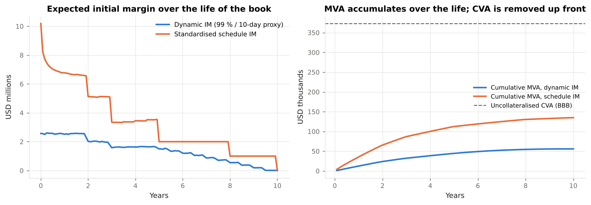

# 5. FVA, MVA and the Other Adjustments

This chapter covers **the funding adjustments: the cost of funding uncollateralised exposure (FVA), the cost of funding posted initial margin (MVA), and, briefly, capital (KVA) and collateral (ColVA).** Code: `xvalab/xva.py`. Examples: `examples/03_cva_dva_fva.py`, `examples/04_mva_initial_margin.py`.

---

## 5.1 Why funding enters a derivative's price

Consider a dealer that trades an uncollateralised 10-year payer swap with a corporate and hedges it with an identical receiver swap under a zero-threshold CSA with another dealer.

* When rates rise the client swap is in the money (`V > 0`) but the client posts nothing. The hedge is out of the money, and the dealer must **post variation margin** on it. That cash is borrowed at the dealer's unsecured rate, OIS + `s_F`, and earns OIS from the CSA counterparty. The dealer loses `s_F` on the balance for as long as it persists: a **funding cost**.
* When rates fall the hedge is in the money and the dealer **receives** margin, on which it pays OIS; it can use that cash instead of borrowing at OIS + `s_F`: a **funding benefit**.

The expected present value of these carry costs and benefits over the life of the trade is the **funding valuation adjustment**:

```
FCA  =  Σ_i  s_F(t_i) · EE*(t_i)  · S_c(t_i) S_b(t_i) · Δt_i        funding cost adjustment
FBA  =  Σ_i  s_F(t_i) · ENE*(t_i) · S_c(t_i) S_b(t_i) · Δt_i        funding benefit adjustment
FVA  =  FCA − FBA
```

(`xva.fva`). The survival factors appear because funding is only needed while both parties are alive; the exposure is net of any collateral, so a fully collateralised trade has no FVA.

---

## 5.2 The FVA debate

FVA was the most contested idea in derivatives pricing in the 2010s.

**Hull and White (2012)** argued that FVA should *not* be charged: by the Modigliani–Miller logic, a project's value does not depend on how it is financed; a dealer's funding spread is compensation to *its* creditors for *its* default risk, which is already DVA. Charging FVA double counts and makes prices depend on who is quoting.

**Practitioners** answered that desks are judged on funding-inclusive P&L, that treasury actually charges them the spread, that shareholders — not bondholders — bear the cost, and that in an incomplete market with a non-zero funding spread the law of one price does not hold anyway. **JPMorgan's $1.5bn FVA charge in Q4 2013** settled the practical question: since 2014 essentially every large dealer books FVA (typically with the benefit side either included — symmetric FVA — or replaced by DVA).

Three live choices remain, and `xva.fva` exposes them as parameters:

| Choice | Options | In the code |
|---|---|---|
| Benefit | Symmetric (FBA at the same spread), asymmetric (cost only), or DVA in lieu of FBA | `benefit_spread_bp` |
| Spread | Own CDS, bond-CDS basis adjusted, treasury transfer price | `funding_spread_bp` (flat or per bucket) |
| Survival weighting | Both parties, one party, none | `cpty`, `own` |

Example 03: uncollateralised BBB book, 50 bp funding spread, symmetric FVA `≈ $49k` (cost `107k`, benefit `58k`); under a zero-threshold CSA both sides collapse to about `$11k` and nearly cancel.

!!! tip "FVA and the discounting debate are the same thing"
    Before 2008 dealers discounted everything at LIBOR. Afterwards, collateralised trades were discounted at OIS (the rate paid on cash collateral) and uncollateralised ones at the dealer's funding rate. "Funding-rate discounting" of an uncollateralised trade is FVA by another name: the difference between discounting at OIS + `s_F` and at OIS is, to first order, `s_F × Σ E[V(t)] DF Δt`, which is FCA − FBA when the exposure profile is netted.

---

## 5.3 MVA: the cost of initial margin

Chapter 3 established that initial margin under the uncleared margin rules and at CCPs is segregated, cannot be rehypothecated, and is remunerated at (roughly) OIS. Posting it is therefore a **pure funding drain** for the life of the netting set:

```
MVA  =  Σ_i  s_IM(t_i) · E[IM(t_i)] · DF(t_i) · S_c(t_i) S_b(t_i) · Δt_i
```

(`xva.mva`). `E[IM(t)]` is the expected initial margin profile; `s_IM` the spread at which the firm funds it (its unsecured spread, or a lower one if the IM can be met with securities the firm already holds). IM *received* earns nothing beyond OIS and gives no offsetting benefit.

The hard part is the IM profile. In production it is **SIMM evaluated on every path and date** — a nested calculation that needs sensitivities on each path — or a regression approximation of it. This module offers two stand-ins (`xva.dynamic_im_profile`, `regulatory.standardised_im_schedule`), and Example 04 shows that the choice matters more than the spread: the schedule gives an MVA about 2.5 times that of the model-based profile.

| | Dynamic IM (99 % / 10-day proxy) | Standardised schedule |
|---|---|---|
| IM at inception (example book) | `$2.6mm` | `$10.2mm` |
| MVA at 50 bp | `$56k` | `$135k` |
| As % of uncollateralised CVA | 15 % | 36 % |

### The margin trade-off

Example 04's last table is the whole point of the chapter:

| Regime | CVA | FVA | MVA | Total |
|---|---|---|---|---|
| Uncollateralised | 373k | 49k | 0 | 422k |
| Variation margin only | 35k | −1k | 0 | 34k |
| Variation + two-way initial margin | 1k | 0 | 56k | 57k |

Variation margin removes nine-tenths of the credit and funding cost. Initial margin removes nearly all of the rest and replaces it with a funding cost of its own. **The margin rules did not make counterparty risk disappear; they converted a contingent credit loss into a certain funding cost**, which is cheaper for the system (no CVA volatility, no default losses) but not free. It is also why dealers **compress** portfolios (tear up offsetting trades to cut IM), **clear** what they can (CCP IM is typically lower than SIMM because of a shorter MPoR and larger netting sets) and price MVA into long-dated uncleared trades.



---

## 5.4 KVA: the cost of capital

A trade consumes regulatory capital — counterparty credit risk RWA via SA-CCR or IMM, CVA capital, market risk capital on the hedges, leverage ratio exposure — for its whole life. Shareholders require a return on it. The **capital valuation adjustment** prices that return:

```
KVA  =  Σ_i  CoC · K(t_i) · DF(t_i) · S_c(t_i) S_b(t_i) · Δt_i
```

(`xva.kva`), where `K(t)` is the expected capital held and `CoC` the hurdle rate (8–12 %). KVA has no accounting standing (capital is not a liability) and practice varies: some desks charge it fully to clients, some partially, some only as a pricing hurdle. It is nevertheless often the **largest XVA for long-dated uncollateralised trades**, because capital is held on the whole exposure profile for the whole life. Chapter 7's SA-CCR EAD × risk weight × 8 %, held on a profile that follows EE, is the simplest `K(t)`.

---

## 5.5 ColVA and the others

* **ColVA** (collateral valuation adjustment) prices the difference between the rate actually earned on collateral and OIS, and the **cheapest-to-deliver option** embedded in CSAs that allow several currencies or securities. Important for legacy CSAs; zero for a clean single-currency cash CSA, which is what this module assumes.
* **RVA / "rating-trigger" adjustments** price contractual features such as additional collateral on downgrade.
* **XVA on XVA**: the hedges of CVA themselves carry funding and capital. In practice desks stop at second order.

---

## 5.6 Organising the XVA desk

| Function | Owns | Hedges |
|---|---|---|
| **CVA desk** | CVA and its P&L; often DVA | Counterparty spreads (CDS), market sensitivities of exposure |
| **Funding / FVA desk** (often in Treasury) | FVA, MVA, ColVA | Term funding, collateral optimisation |
| **Capital management** | KVA, RWA | Trade compression, clearing, novation |
| **Trading desks** | Risk-free value | Market risk |

The central-desk model exists because the adjustments are **portfolio-level, non-linear quantities**: the CVA of a new trade is the change in the netting set's CVA, which only a desk that sees the whole counterparty relationship can compute and hedge. `ExposureEngine.run` on the netting set with and without a candidate trade, differenced, is the incremental-XVA calculation in miniature.
