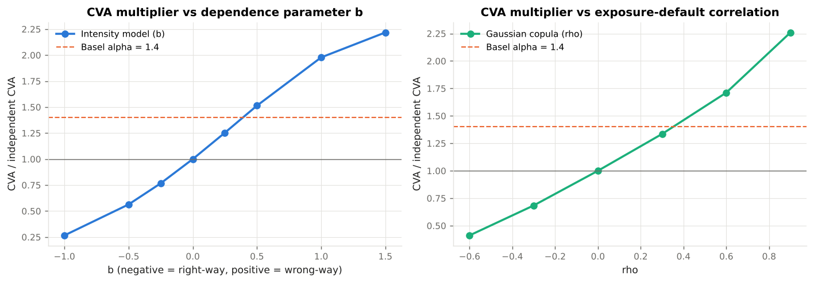

# 6. Wrong-Way Risk

This chapter covers **what happens when the counterparty's default is not independent of our exposure to it — the assumption that made the CVA formula factorise — and three ways to model and price the dependence.** Code: `xvalab/wwr.py`. Example: `examples/05_wrong_way_risk.py`.

---

## 6.1 Definitions

**Wrong-way risk (WWR)** is adverse dependence between exposure and the counterparty's credit quality: exposure tends to be high exactly when the counterparty is likely to default. **Right-way risk** is the opposite. Basel distinguishes two kinds (definitions in CRE50; requirements in CRE53.39–53.48):

| | General wrong-way risk | Specific wrong-way risk |
|---|---|---|
| Cause | Correlation between the counterparty's creditworthiness and **general market factors** that drive the exposure | A **legal or structural link** between the counterparty and the underlying of the trade |
| Examples | A corporate borrower with a payer swap: rising rates raise our exposure and strain the borrower. An EM bank selling us USD forward: a dollar rally raises exposure and tends to coincide with EM stress. Buying CDS protection from a bank on a correlated financial. | Buying a put on the counterparty's own stock. Buying CDS protection from a monoline on the tranche it wrapped. A mining company selling us gold forward (its revenue falls when our exposure rises). An FX forward with a sovereign whose default devalues the currency. |
| Regulatory treatment | Captured by `α = 1.4` in IMM and SA-CCR, stress testing, and identification processes (CRE53.39–53.44) | Must be identified trade by trade; for IMM banks EAD is set to the **full expected loss** on the instrument, not a simulated exposure (CRE53.47–53.48); the counterparty's PD may have to be raised |

The 2008 experience was mostly *specific* wrong-way risk — monolines and AIG wrote protection on exactly the assets whose decline would sink them — and it is the reason Basel's text on the topic is unusually prescriptive.

---

## 6.2 Why it breaks the CVA formula

The general CVA is `(1 − R) E[D(τ) E(τ) 1{τ ≤ T}]`. Chapter 4 wrote it as `Σ EE*(t_i) ΔPD_i` by assuming `E` and `τ` independent, so that `E[E(t_i) · 1{τ ∈ bucket i}] = EE(t_i) · ΔPD_i`. With dependence,

```
E[ E(t_i) · 1{τ ∈ (t_{i−1}, t_i]} ]  =  E[ E(t_i) | τ ∈ bucket i ] · ΔPD_i  ≠  EE(t_i) · ΔPD_i
```

The quantity that matters is the **exposure conditional on default**, and WWR models are different ways of specifying `E[E(t) | τ = t]`.

---

## 6.3 Approach 1: a multiplier

The crudest model is a constant: `CVA_WWR = α_WWR × CVA`. This is what the regulator does with `α = 1.4` (CRE53.39: *alpha … is intended to capture general wrong-way risk, concentration and model risk*), and what many banks did for pricing before 2008. It is transparent and easy to hedge but says nothing about *which* counterparties and *which* trades carry the risk. This module reports every WWR result as a ratio to the independent CVA so that it can be read as an implied `α`.

---

## 6.4 Approach 2: exposure-linked default intensity

Hull and White (2012) proposed making the counterparty's hazard rate a function of the exposure on each path. The version in `wwr.cva_wwr_intensity`:

```
λ_p(t_i)  =  λ̄(t_i) · exp( b · z_p(t_i) ) / E[ exp( b · z(t_i) ) ]
z_p(t_i)  =  ( V_p(t_i) − mean V(t_i) ) / std V(t_i)              standardised MtM on path p
```

* `λ̄(t_i)` is the CDS-implied hazard for the bucket; the normalisation keeps the **unconditional default probability equal to the market's**, so the CDS still reprices. Only *which paths* default changes.
* `b > 0`: hazard is higher on paths where the counterparty owes us more — wrong-way. `b < 0`: right-way. `b = 0` reproduces the independent CVA exactly.
* Path-wise survival `S_p(t_i) = exp(−Σ_j λ_p(t_j) Δt_j)` and `CVA = (1 − R) E[Σ_i D(t_i) E(t_i) (S_p(t_{i−1}) − S_p(t_i))]`.

The parameter `b` is the whole model. Hull and White calibrate it to historical co-movement of spreads and exposures, or to the bank's own loss experience; a common desk practice is to set it so that the implied multiplier for a "typical" directional counterparty is about 1.3–1.5 and to stress it. In Example 05, `b = 0.5` gives a 1.5× multiplier on the swap book; `b ≈ 0.4` reproduces Basel's 1.4.



The same borrower can be wrong-way on one trade and right-way on another: a payer swap with a rate-sensitive borrower (`b > 0` in MtM terms) and a receiver swap with the same borrower (`b < 0`) — Example 05's last table shows the payer's CVA rising 51 % and the receiver's falling 52 % for the same underlying dependence on rates. **WWR is a property of the trade–counterparty pair, not of the counterparty.**

---

## 6.5 Approach 3: a copula between exposure and default time

Rosen and Saunders (2012) ("CVA the wrong way") link the default time directly to the exposure through a Gaussian copula:

```
Z_c  =  ρ · Z_V  +  √(1 − ρ²) · ε             Z_V = standardised path-average MtM, ε independent
τ    =  S⁻¹( Φ(Z_c) )                          large Z_c  ⇒  low survival level  ⇒  early default
```

`wwr.cva_wwr_copula` samples `τ` on every path, interpolates the exposure and discount factor to it, and averages `(1 − R) D(τ) E(τ) 1{τ ≤ T}`. With `ρ > 0`, paths with high exposure default early. The independent benchmark uses the same `ε` with `ρ = 0`, so the ratio is clean.

| Pros | Cons |
|---|---|
| One intuitive parameter; easy to stress | Links default to the *whole path's* exposure, not to the exposure at the default time |
| Reprices the CDS by construction | Gaussian copula tails are thin; `ρ` is hard to estimate |
| Trivially extended to several counterparties with a common factor | Default-time sampling adds Monte Carlo noise (`≈ 3 %` here) |

Example 05: `ρ = 0.3 → 1.34×`, `ρ = 0.6 → 1.71×`, `ρ = 0.9 → 2.26×`.

---

## 6.6 Specific WWR: a jump at default

When the trade's value is structurally linked to the default event itself, neither a tilted hazard nor a copula is enough: the value **jumps** at `τ`. The classic case is an FX forward with a sovereign whose currency devalues on default (Ehlers and Schönbucher 2006; Levy and Levin's "devaluation at default" for Latin American sovereigns). `cva_wwr_copula(..., exposure_jump_at_default=γ)` scales the exposure at the sampled default time by `(1 + γ)`:

```
CVA  =  (1 − R) E[ 1{τ ≤ T} D(τ) E(τ) (1 + γ) ]
```

Example 05 sells EUR forward to an illustrative EM sovereign (EUR standing in for the sovereign's currency): a 25 % devaluation at default raises the CVA by exactly 25 %; combined with `ρ = 0.5` the multiplier is 2.2×. For the regulator this is the case where EAD is simply the full loss (CRE53.48: "the EAD … equals the full expected loss in the remaining fair value of the underlying instruments assuming the underlying issuer is in liquidation").

---

## 6.7 Managing wrong-way risk

| Tool | What it does |
|---|---|
| **Identification** | Per-trade flags for legal connection (specific WWR); per-counterparty review of sector vs trade direction (general WWR). Basel requires both and a report to senior management (CRE53.42–53.44). |
| **Pricing** | A WWR multiplier or one of the models above in the CVA; a higher charge, or refusal, for specific WWR. |
| **Structuring** | Collateral (reduces the exposure that can be wrong-way, but *collateral itself* can be wrong-way: a counterparty posting its own bonds), break clauses, trade direction (sell the client the right-way trade). |
| **Stress testing** | Joint stress of market factor and counterparty spread (CRE53.30: stress tests must include "the joint movement of exposures and counterparty creditworthiness"). |
| **Capital** | `α = 1.4`; SA-CVA's correlation parameters between credit spreads and market factors are supervisory, not bank-estimated. |

!!! warning "Collateral and WWR"
    Variation margin posted in the counterparty's own currency, or securities issued by the counterparty or a correlated entity, lose value at the same time as the counterparty. Basel disallows own-issued collateral and applies higher haircuts to correlated collateral; the exposure engine would model it as a negative jump in `C(t)` at default — the mirror of the jump in `E(t)` above.
