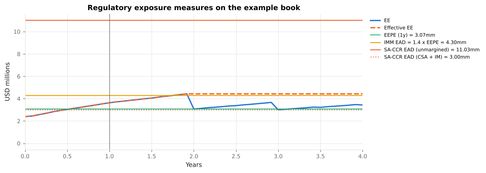

# 7. The Regulatory Framework

This chapter maps **the rules that consume the exposures and adjustments of Chapters 2–6: the Basel counterparty-credit-risk and CVA standards, their U.S. and EU implementations, the margin rules, and the accounting standards.** Code: `xvalab/regulatory.py`. Example: `examples/06_regulatory_capital.py`.

---

## 7.1 The map

```
                         ┌─────────────────────────── Basel Framework ────────────────────────────┐
                         │                                                                          │
  Exposure at default    │  CRE50 definitions   CRE51 overview   CRE52 SA-CCR   CRE53 IMM   CRE54 CCPs │
  (counterparty credit   │                                                                          │
   risk, part of credit  │  EAD  ──►  credit risk weight (standardised or IRB)  ──►  CCR RWA          │
   risk RWA)             │                                                                          │
                         ├──────────────────────────────────────────────────────────────────────────┤
  CVA risk (volatility   │  MAR50:  BA-CVA (reduced / full)   SA-CVA   materiality threshold          │
   of the CVA mark,      │  CVA capital  ──►  × 12.5  ──►  CVA RWA                                     │
   part of market risk)  │                                                                          │
                         ├──────────────────────────────────────────────────────────────────────────┤
  Deductions             │  CAP30.15: DVA removed from CET1                                           │
                         └──────────────────────────────────────────────────────────────────────────┘
  Margin                    BCBS-IOSCO margin requirements (2020)  ──►  12 CFR 237, 17 CFR 23.150-161 (U.S.); EU 2016/2251
  Accounting                ASC 820 (U.S. GAAP), IFRS 13: CVA and DVA in fair value
```

Two different things are capitalised: the **exposure** (what we lose if the counterparty defaults — a credit risk) and the **CVA's volatility** (what we lose when the counterparty's spread widens — a market risk). A bank with an approved internal model for the first (IMM) may still use the basic approach for the second.

---

## 7.2 Exposure at default: SA-CCR (CRE52)

The **standardised approach for counterparty credit risk** replaced the Current Exposure Method in the Basel text from 2017 and in the U.S. from 2020 (final rule 85 FR 4362; mandatory for advanced-approaches banks from 1 January 2022, optional for others). It is a formula, not a simulation, designed to approximate the IMM's `α × EEPE` with a handful of supervisory parameters.

```
EAD  =  α · ( RC + PFE ),      α = 1.4

RC   =  max( V − C, 0 )                                       unmargined
RC   =  max( V − C,  TH + MTA − NICA,  0 )                    margined
PFE  =  multiplier · AddOn_aggregate
multiplier  =  min( 1,  0.05 + 0.95 · exp( (V − C) / (2 · 0.95 · AddOn_aggregate) ) )
```

The add-on is built per asset class from **trade-level effective notionals** `D = δ · d · MF`:

| Element | Interest rate | FX |
|---|---|---|
| Adjusted notional `d` | notional × supervisory duration `SD = (e^{−0.05 S} − e^{−0.05 E}) / 0.05` | foreign-leg notional in domestic currency |
| Supervisory delta `δ` | ±1 (payer +, receiver −); options: Black delta with supervisory vol 50 % | ±1; options: Black delta with vol 15 % |
| Maturity factor `MF` | unmargined `√(min(M, 1y)/1y)`; margined `1.5 √(MPOR/1y)` | same |
| Hedging set | currency; three maturity buckets (<1y, 1–5y, >5y) aggregated with ρ = 70 % (adjacent) / 30 % | currency pair; full netting |
| Supervisory factor `SF` | 0.50 % | 4.0 % |

(`regulatory.saccr_ead`; `supervisory_duration`, `maturity_factor`, `supervisory_delta_option`.) The test suite reproduces **Example 1 of the BCBS worked examples** (three IR trades, EAD = 569) to within 0.1 %.

What the formula encodes, and where it is crude:

* **Netting** is recognised within a hedging set (the payer and receiver swaps partly offset in the USD set) but not across asset classes — the FX and IR add-ons simply add.
* **Collateral** enters through `C` in RC and the multiplier (over-collateralisation shrinks PFE, floored at 5 % of the add-on) and through the shorter margined maturity factor (`1.5 √(10/250) = 0.30` instead of 1).
* **Directionality**: for a single at-market 10-year swap SA-CCR gives about 2.4× the IMM EAD (Example 06); for large, well-hedged dealer portfolios the ratio is closer to 1, which is what it was calibrated to.

---

## 7.3 Exposure at default: IMM (CRE53)

With supervisory approval a bank may use its own exposure simulation:

```
EAD  =  α · Effective EPE,      α = 1.4  (own estimate permitted, floor 1.2)
```

`Effective EPE` is the one-year average of the non-decreasing Effective EE (Chapter 1), computed on the **higher of a current and a stressed calibration** (CRE53.19). `regulatory.imm_ead` implements the formula on an `ExposureResult`. Approval conditions (CRE53.14 ff.) include a use test (the model must drive limits and pricing, not just capital), back-testing of EE and PFE, stress testing including joint market-credit stress, a 10-day MPoR floor with the escalations of Chapter 3, and the wrong-way-risk processes of Chapter 6. Few banks outside the largest dealers hold IMM approval.



---

## 7.4 CVA risk capital (MAR50)

Basel III (2010) introduced a capital charge for **CVA volatility** after the crisis showed it to be the dominant source of counterparty losses. The 2017 reform (finalised with targeted revisions in July 2020, in the consolidated text from 1 January 2023) replaced the original formulas with two approaches:

**BA-CVA, reduced version** (`regulatory.ba_cva_capital`) — for banks without hedges or sensitivities:

```
SCVA_c      =  (1/α) · RW_c · M_c · EAD_c · DF_c,        DF_c = (1 − e^{−0.05 M_c}) / (0.05 M_c)  (1 for IMM banks)
K_reduced   =  √( (ρ Σ_c SCVA_c)² + (1 − ρ²) Σ_c SCVA_c² ),      ρ = 50 %
K_BA-CVA    =  DS_BA-CVA · K_reduced,                                 DS = 0.65
CVA RWA     =  12.5 · K_BA-CVA
```

The risk weight `RW_c` depends only on the counterparty's **sector and whether it is investment grade** (MAR50.16): sovereigns 0.5 % / 2 %, financials 5 % / 12 %, industrials 3 % / 7 %, technology 2 % / 5.5 %, and so on. `EAD_c` is the SA-CCR or IMM EAD of Section 7.2–7.3; `M_c` the effective maturity. The `ρ = 50 %` term gives a diversification benefit across counterparties (Example 06: 20 % for four names of similar size); the 0.65 scalar was added in the 2020 revision to recalibrate the charge downward.

**BA-CVA, full version** adds recognition of single-name and index CDS hedges. **SA-CVA** (MAR50.21 ff.) is a sensitivities-based method, structurally the FRTB standardised approach applied to CVA sensitivities with respect to counterparty credit spreads and to the market factors driving exposure, with supervisory risk weights and correlations and eligible hedge recognition; it needs a CVA desk, regulatory CVA computed under prescribed principles, and approval. Banks with aggregate notional of non-centrally-cleared derivatives at or below **€100 billion** may instead set CVA capital equal to the counterparty credit risk capital (MAR50.9).

!!! note "Accounting CVA versus CVA capital"
    Example 06 shows the BBB counterparty's accounting CVA at `$0.37mm` and its standalone BA-CVA capital at `$0.95mm` on the same book. The two are not comparable: the first is an expected loss already deducted from the P&L; the second is capital against an unexpected *increase* in that deduction over a one-year horizon at high confidence. The ratio (two to three times) is typical for investment-grade names and falls for high-yield names, whose CVA is already large.

---

## 7.5 United States

| Topic | Rule | Status |
|---|---|---|
| Exposure at default | **12 CFR 217.132(c)** (FRB; OCC 12 CFR 3.132, FDIC 12 CFR 324.132): SA-CCR, with the Current Exposure Method still available to non-advanced banks; **217.132(d)**: IMM | SA-CCR final rule January 2020 (85 FR 4362); mandatory for advanced-approaches banks from 1 January 2022 |
| CVA capital | **12 CFR 217.132(e)**: *simple CVA approach* (a formula with rating-based weights, derived from the 2010 Basel standardised CVA) and *advanced CVA approach* (VaR-based, for banks with market risk and IMM approval) | Current rule. The **July 2023 proposal** (88 FR 64028, "Basel III endgame") would replace both with BA-CVA and SA-CVA for large banks; the agencies announced in 2024 that a re-proposal would follow, and the final rule is pending as of this writing. |
| DVA | **12 CFR 217.22(b)(1)(iii)**: unrealised gains/losses from own credit on fair-valued liabilities removed from CET1 | In force |
| Margin for uncleared swaps | **12 CFR Part 237** (prudential regulators), **17 CFR 23.150–161** (CFTC), **17 CFR 240.18a-3** (SEC) | Phased in 2016–2022; IM threshold $50mm per group, $8bn AANA scope |
| Clearing mandate | **7 U.S.C. 2(h)** (Commodity Exchange Act §2(h), added by Dodd-Frank Title VII); CFTC 17 CFR Part 50 | In force since 2013 for IRS and index CDS |
| Exposure to CCPs | 12 CFR 217.35 (standardised) and 217.133 (advanced) | In force |
| Model risk | **SR 11-7 / OCC 2011-12** | Applies to exposure engines, XVA models and SIMM |
| Stress testing | 12 CFR 252 Subpart E (DFAST), 12 CFR 225.8 (CCAR), including the **counterparty default scenario component** for the largest firms | Annual |

The supervisory stress test's *largest counterparty default* component is worth noting: firms with substantial trading must assume the instantaneous default of their single largest counterparty under the global market shock, with losses computed on the stressed exposure net of collateral — a direct application of Chapters 2 and 3 at a stressed point.

---

## 7.6 European Union

| Topic | Rule |
|---|---|
| Exposure at default | **CRR Articles 274–280** (SA-CCR, from CRR2 in June 2021), **283–294** (IMM), simplified SA-CCR and original exposure method for small books |
| CVA capital | **CRR Articles 381–386**; CRR3 (Regulation (EU) 2024/1623, applicable from 1 January 2025) implements BA-CVA and SA-CVA. The EU keeps its exemptions for non-financial counterparties, pension funds and sovereigns from the CVA charge (Article 382), a long-running divergence from Basel. |
| Margin | EMIR Article 11 and Commission Delegated Regulation (EU) 2016/2251 |
| Clearing | EMIR Article 4 |
| Accounting | IFRS 13 ¶42–44 (own credit), ¶56 (nonperformance risk) |

---

## 7.7 Accounting

* **ASC 820 Fair Value Measurement** (U.S. GAAP, formerly FAS 157): fair value reflects "nonperformance risk", which "includes, but may not be limited to, a reporting entity's own credit risk" (ASC 820-10-35-17 ff.). Hence CVA *and* DVA.
* **IFRS 13**: same principle (¶42–44 on own credit for liabilities, ¶56 on counterparty risk), applied since 2013. IFRS 13 ¶48 permits the portfolio exception: measuring the net exposure to a counterparty where it is managed on a net basis — the accounting basis for computing CVA at netting-set level.
* **FVA** is not explicitly addressed by either standard; dealers book it as part of fair value on the basis that a market participant would price it, and disclose it. **MVA and KVA** are generally not booked.
* **Hedge accounting / own-credit presentation**: IFRS 9 ¶5.7.7 puts own-credit changes on fair-valued financial liabilities into OCI rather than P&L — a partial answer to the DVA P&L volatility problem for debt, though not for derivatives.

---

## 7.8 Where each rule touches the code

| Function / object | Rule |
|---|---|
| `ExposureResult.ee / pfe / epe / effective_ee / eepe` | CRE50.17–50.26 definitions |
| `CSA.mpor_days` (default 10) | CRE50.20, CRE53.26 margin period of risk floors |
| `saccr_ead`, `supervisory_duration`, `maturity_factor`, `supervisory_delta_option`, `SUPERVISORY_PARAMS` | CRE52.1–52.76; 12 CFR 217.132(c); BCBS d279 worked examples |
| `imm_ead`, `ALPHA` | CRE53.5–53.7, 53.39–53.41 |
| `ba_cva_capital`, `BaCvaCounterparty`, `BA_CVA_RISK_WEIGHTS`, `BA_CVA_RHO`, `BA_CVA_DISCOUNT_SCALAR` | MAR50.9–50.16 |
| `standardised_im_schedule`, `IM_SCHEDULE` | BCBS-IOSCO 2020 Appendix A; 12 CFR 237 Appendix A; 17 CFR 23.154 Table B |
| `cva_wwr_*` and the `α` comparison | CRE53.39–53.48 wrong-way risk |
| `cva`, `dva` | ASC 820, IFRS 13 (fair value); CAP30.15 (DVA deduction) |
| `REGULATORY_REFERENCES` | the registry of every source above, with URLs |

!!! warning "Versions"
    Basel parameters are those of the consolidated Framework as in force on 1 January 2023 (SA-CCR, IMM, BA-CVA with the 0.65 scalar). U.S. CVA capital is described as the *current* rule (simple / advanced CVA) with the 2023 proposal noted as pending; check the Federal Register before relying on the status. Nothing here is legal or regulatory advice.
