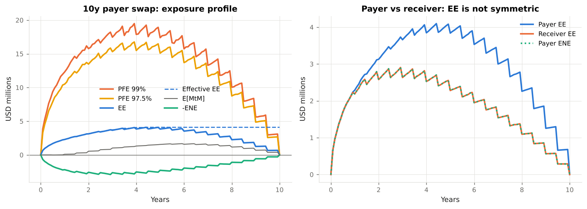
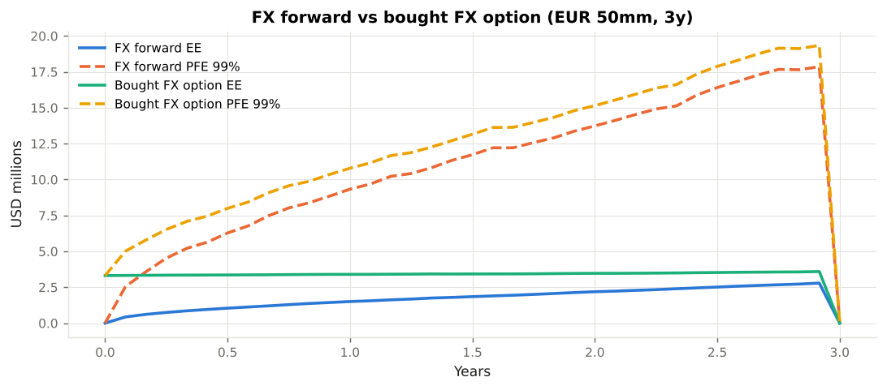
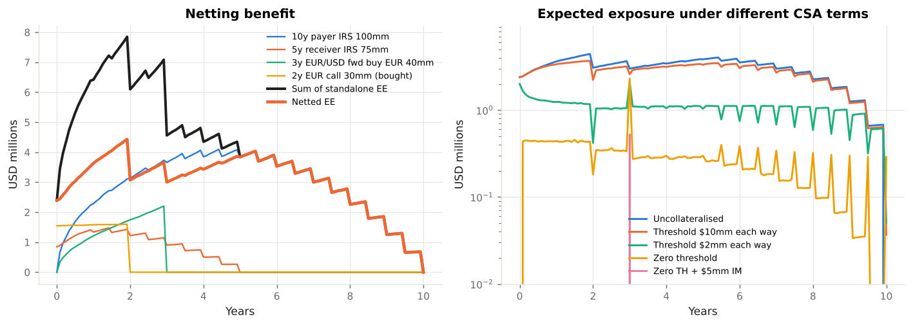
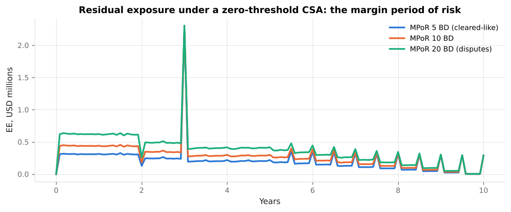
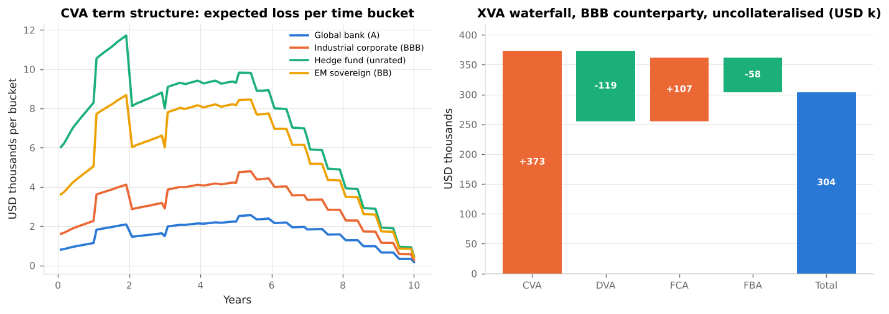
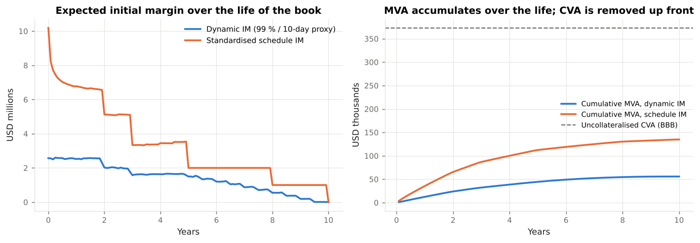
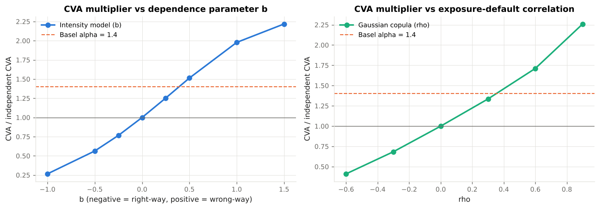
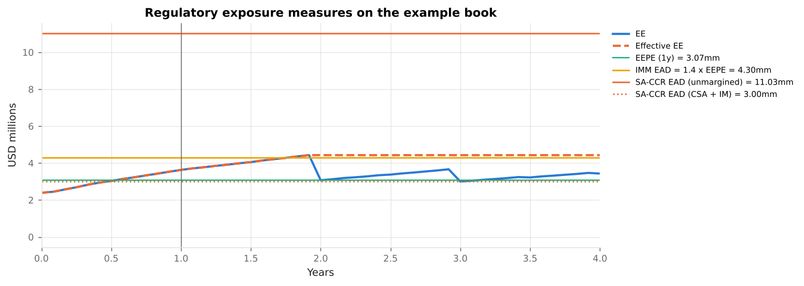

# Example Outputs

Console output captured from `python examples/run_all.py` with the illustrative market data in `xvalab/market.py` and the four-trade book in `xvalab/book.py`. Every number is reproducible: the simulation is seeded (10,000 antithetic paths, monthly grid) and the exact commands are in the `examples/` directory.

!!! note "Reading the tables"
    Exposures, XVAs and capital are in USD; `mm` is millions, `k` thousands, `bp` basis points. Monte Carlo quantities carry a standard error of roughly 1 % for expected exposures and 3 % for the copula default-time sampling.


## Example 01 — Simulating counterparty exposure

Source: `examples/01_exposure_profiles.py`

```text
========================================================================
  01  Exposure profile of a 10y USD payer swap (notional $100mm)
========================================================================
Par 10y swap rate (semi-annual, from the illustrative SOFR curve): 3.9097%

Payer swap, USD millions (positive = counterparty owes us):
+-------+--------+-------+-------+-----------+---------+---------+
| t (y) | E[MtM] | EE    | ENE   | PFE 97.5% | PFE 99% | Eff. EE |
+-------+--------+-------+-------+-----------+---------+---------+
|  0.50 | -0.009 | 1.687 | 1.696 |     7.876 |   9.367 |   1.687 |
|  1.00 |  0.101 | 2.290 | 2.189 |    10.501 |  12.306 |   2.290 |
|  2.00 |  0.551 | 3.128 | 2.578 |    13.480 |  15.775 |   3.128 |
|  3.00 |  1.026 | 3.659 | 2.634 |    15.322 |  17.471 |   3.731 |
|  5.00 |  1.559 | 3.839 | 2.279 |    15.099 |  17.395 |   4.097 |
|  7.00 |  1.458 | 3.001 | 1.543 |    11.651 |  13.296 |   4.097 |
|  9.00 |  0.690 | 1.255 | 0.565 |     4.871 |   5.634 |   4.097 |
|  9.50 |  0.373 | 0.660 | 0.286 |     2.580 |   2.972 |   4.097 |
+-------+--------+-------+-------+-----------+---------+---------+

Headline metrics (CRE50.17-50.26):
+--------------+--------+-------------------------------------------------------------------+
| Metric       | USD mm | Meaning                                                           |
+--------------+--------+-------------------------------------------------------------------+
| EPE (1y)     |  1.652 | time-weighted average EE over the first year                      |
| EEPE (1y)    |  1.652 | same, on the non-decreasing Effective EE -> IMM EAD = 1.4 x EEPE  |
| EPE (life)   |  2.873 | average EE over the whole life, the 'loan equivalent' for pricing |
| Peak EE      |  4.097 | maximum of the expected exposure profile                          |
| Peak PFE 99% | 19.486 | the credit-limit number: 1-in-100 worst exposure                  |
+--------------+--------+-------------------------------------------------------------------+

Reading the profile:
 * At inception the swap is at market, so EE(0) = 0: there is nothing to lose yet.
 * Exposure then grows as rates diffuse away from the fixed rate (~ sqrt(t)) and shrinks as the
   remaining cash flows amortise, giving the characteristic hump that peaks around 1/3 of the life.
 * The sawtooth comes from coupon dates: each net payment removes value from the swap.
 * The receiver swap is the mirror image in MtM, but not in exposure: with an upward-sloping
   curve the payer expects to *receive* more later (forward rates > fixed), so its expected MtM
   drifts positive and its EE is larger; the receiver's ENE is the payer's EE.
Receiver swap: EPE(life) = $1.90mm vs payer $2.87mm


========================================================================
  01  FX forward and FX option: different exposure shapes
========================================================================
3y EUR/USD forward rate: 1.1297 (spot 1.08, EUR rates below USD -> forward above spot)
Option premium paid today: $3.31mm
+-------+--------+---------+-------------+-----------+------------+----------------+
| t (y) | Fwd EE | Fwd ENE | Fwd PFE 99% | Option EE | Option ENE | Option PFE 99% |
+-------+--------+---------+-------------+-----------+------------+----------------+
|  0.50 |  1.042 |   1.044 |       6.277 |     3.355 |      0.000 |          7.993 |
|  1.00 |  1.504 |   1.505 |       9.328 |     3.397 |      0.000 |         10.786 |
|  2.00 |  2.187 |   2.183 |      13.735 |     3.469 |      0.000 |         15.146 |
|  2.92 |  2.787 |   2.782 |      17.858 |     3.592 |      0.000 |         19.339 |
+-------+--------+---------+-------------+-----------+------------+----------------+

 * The forward has a single cash flow at maturity, so nothing amortises: exposure grows monotonically
   (~ sqrt(t)) until settlement.  Its EE and ENE are nearly symmetric.
 * The bought option is an asset from day one (we paid the premium): EE starts at the premium and
   ENE is identically zero - the counterparty never owes us a negative amount.  A *sold* option is
   the opposite: zero EE, all ENE.  This asymmetry is why DVA matters for option sellers.
```








## Example 02 — Netting and collateral

Source: `examples/02_netting_and_collateral.py`

```text
========================================================================
  02  Netting: four trades, one counterparty
========================================================================
+-----------------------------+-----------+------------+--------------+
| Trade                       | MtM today | EPE (life) | Peak PFE 99% |
+-----------------------------+-----------+------------+--------------+
| 10y payer IRS 100mm         |     0.000 |      2.873 |       19.486 |
| 5y receiver IRS 75mm        |     0.849 |      0.488 |        6.982 |
| 3y EUR/USD fwd buy EUR 40mm |     0.000 |      0.417 |       14.777 |
| 2y EUR call 30mm (bought)   |     1.546 |      0.302 |        8.955 |
| Sum of standalone           |     2.395 |      4.081 |       50.200 |
| Netting set                 |     2.395 |      3.033 |       22.265 |
+-----------------------------+-----------+------------+--------------+

Netting benefit on life-time EPE: 25.7%
Netting works because the trades do not all move together: the payer swap gains when rates rise,
the receiver swap loses, and the FX trades respond to EUR/USD (negatively correlated with USD rates
in this model).  Under an enforceable ISDA Master Agreement the counterparty's default triggers a
single close-out amount, so we can only lose max(sum V, 0), never sum max(V, 0).

========================================================================
  02  Collateral: the same netting set under different CSA terms
========================================================================
+------------------------------------------+--------+---------+----------+--------------+---------+
| CSA terms                                | EPE 1y | EEPE 1y | EPE life | Peak PFE 99% | EPE cut |
+------------------------------------------+--------+---------+----------+--------------+---------+
| Uncollateralised                         |  3.069 |   3.069 |    3.033 |       22.265 |      0% |
| Threshold $10mm each way, MTA $1mm       |  2.989 |   2.989 |    2.764 |       12.337 |      9% |
| Threshold $2mm each way, MTA $0.5mm      |  1.354 |   2.000 |    1.054 |       10.600 |     65% |
| Zero threshold, MPoR 10 BD               |  0.440 |   0.448 |    0.278 |       12.022 |     91% |
| Zero threshold, MPoR 5 BD (cleared-like) |  0.311 |   0.317 |    0.209 |       11.925 |     93% |
| Zero threshold, MPoR 20 BD (disputes)    |  0.623 |   0.635 |    0.378 |       11.921 |     88% |
| Zero threshold + $5mm IM received        |  0.000 |   0.000 |    0.004 |        7.022 |    100% |
+------------------------------------------+--------+---------+----------+--------------+---------+

Mechanics (exposure.py):  C(t) = collateral called on the MtM observed at t - MPoR, subject to thresholds
and the minimum transfer amount; E(t) = max(V(t) - C(t) - IM received, 0).
 * Thresholds leave the first $X of exposure uncollateralised - the residual EE is roughly the
   threshold plus what the market can move in the margin period of risk.
 * With a zero threshold the only exposure left is the MPoR gap: the market moves between the last
   margin call and close-out.  Basel sets MPoR >= 10 business days for bilateral OTC (CRE50.20, 53.26),
   20 if the netting set has more than 5,000 trades or illiquid collateral, 5 for cleared client
   trades (CRE54).  Doubling MPoR raises residual EE by ~ sqrt(2).
 * Initial margin covers that gap: with $5mm IM received the expected exposure all but disappears.  That
   is exactly the purpose of the uncleared margin rules (BCBS-IOSCO 2020; 12 CFR 237; 17 CFR 23.150-161).
 * Why does the peak PFE stay near $12mm under the zero-threshold CSA?  It is a *cash-flow spike*: the
   FX forward settles at year 3, and a payment that falls inside the margin period of risk is not
   covered by collateral called on the pre-settlement MtM.  Such spikes are real, large and often
   ignored (Andersen, Pykhtin & Sokol 2017); initial margin is what covers them.
```








## Example 03 — CVA, DVA and FVA

Source: `examples/03_cva_dva_fva.py`

```text
========================================================================
  03  Unilateral CVA of the example book for four counterparties
========================================================================
Gross notional $253.19mm; EPE over life $3.03mm; uncollateralised.

+----------------------------+--------+----------+--------+-----------+----------------+---------------+
| Counterparty               | 5y CDS | Recovery | 10y PD | CVA ($mm) | bp of notional | running bp/yr |
+----------------------------+--------+----------+--------+-----------+----------------+---------------+
| Global bank (A)            |     70 |      40% |  13.9% |      0.20 |           7.80 |          0.99 |
| Industrial corporate (BBB) |    140 |      40% |  25.9% |      0.37 |          14.74 |          1.98 |
| Hedge fund (unrated)       |    400 |      25% |  45.1% |      0.86 |          34.12 |          5.21 |
| EM sovereign (BB)          |    300 |      25% |  37.3% |      0.70 |          27.65 |          3.99 |
+----------------------------+--------+----------+--------+-----------+----------------+---------------+

CVA = (1 - R) sum_i EE*(t_i) [S(t_{i-1}) - S(t_i)]  with EE* the discounted expected exposure (xva.cva).
 * CVA scales roughly with the CDS spread for investment grade names; for the hedge fund the high
   hazard rate front-loads defaults into the years when exposure is still small, so CVA grows less
   than proportionally.  Lower recovery (25 %) raises both the LGD and the implied hazard rate.
 * The running-spread column answers the sales question: 'how many bp a year on the notional pays
   for this counterparty risk?'

========================================================================
  03  Bilateral CVA and DVA (our own CDS: 5y 85 bp, recovery 40 %)
========================================================================
+----------------------------+----------------+---------------+-------+------------------+
| Counterparty               | Unilateral CVA | Bilateral CVA | DVA   | BCVA = CVA - DVA |
+----------------------------+----------------+---------------+-------+------------------+
| Global bank (A)            |          0.198 |         0.185 | 0.126 |            0.059 |
| Industrial corporate (BBB) |          0.373 |         0.349 | 0.119 |            0.231 |
| Hedge fund (unrated)       |          0.864 |         0.816 | 0.103 |            0.712 |
| EM sovereign (BB)          |          0.700 |         0.658 | 0.110 |            0.548 |
+----------------------------+----------------+---------------+-------+------------------+

 * Bilateral CVA weights each bucket by our own survival: we only lose if the counterparty defaults
   *while we are still alive*.  The reduction is small for good names and larger for long horizons.
 * DVA is the mirror image on the negative exposure: the gain we would make by defaulting on what we
   owe.  Accounting standards (ASC 820, IFRS 13) require it in fair value; Basel removes it from CET1
   (CAP30.15) because a bank cannot monetise its own default.  The receiver swap and the short
   FX-option leg of a book are the main DVA sources; here the book is net long (payer swap,
   bought option) so CVA > DVA.

========================================================================
  03  CVA with and without collateral
========================================================================
+----------------------------+----------------+----------+----------------+
| CSA                        | EPE life ($mm) | CVA ($k) | bp of notional |
+----------------------------+----------------+----------+----------------+
| Uncollateralised           |            3.0 |    373.2 |           14.7 |
| TH $10mm / MTA $1mm        |            2.8 |    340.6 |           13.5 |
| TH $2mm / MTA $0.5mm       |            1.1 |    129.6 |            5.1 |
| Zero threshold, MPoR 10 BD |            0.3 |     34.8 |            1.4 |
| Zero threshold + $5mm IM   |            0.0 |      0.6 |            0.0 |
+----------------------------+----------------+----------+----------------+
A zero-threshold CSA removes ~90 % of the CVA; what remains is the margin-period-of-risk gap.

========================================================================
  03  FVA: funding the uncollateralised exposure at 50 bp over OIS
========================================================================
+----------------------------+----------+----------+---------------+----------------------------+
| CSA                        | FCA ($k) | FBA ($k) | Symmetric FVA | Asymmetric FVA (cost only) |
+----------------------------+----------+----------+---------------+----------------------------+
| Uncollateralised           |    107.1 |    -57.9 |          49.2 |                      107.1 |
| Zero threshold, MPoR 10 BD |     10.8 |    -11.4 |          -0.6 |                       10.8 |
+----------------------------+----------+----------+---------------+----------------------------+

FCA = sum s_F EE* S_c S_b dt ;  FBA = sum s_F ENE* S_c S_b dt  (xva.fva)
 * When we are owed money on an uncollateralised trade we must fund the hedge's collateral at our
   unsecured spread: that is the funding cost.  When we owe, we hold the hedge's collateral and earn
   OIS on money we would otherwise borrow at OIS + spread: the funding benefit.
 * Whether to recognise the benefit (symmetric FVA) and whether to overlap it with DVA are the two
   live debates (Hull & White 2012 vs. practitioners; JPMorgan's $1.5bn FVA charge in Q4 2013).
   Collateralising the trade makes the question moot: FVA collapses with the exposure.
```





## Example 04 — Initial margin and MVA

Source: `examples/04_mva_initial_margin.py`

```text
========================================================================
  04  Two initial margin profiles for the example book
========================================================================
+-------+----------------------------+--------------------------+--------------+
| t (y) | Dynamic IM (99%/10d proxy) | Schedule IM (BCBS-IOSCO) | Trades alive |
+-------+----------------------------+--------------------------+--------------+
|   0.0 |                       2.57 |                    10.19 |            4 |
|   1.0 |                       2.52 |                     6.78 |            4 |
|   2.0 |                       2.02 |                     5.12 |            3 |
|   3.0 |                       1.58 |                     3.34 |            2 |
|   5.0 |                       1.50 |                     2.00 |            1 |
|   7.0 |                       0.87 |                     2.00 |            1 |
|   9.0 |                       0.19 |                     1.00 |            1 |
+-------+----------------------------+--------------------------+--------------+

 * The schedule is a percentage of notional by asset class and remaining maturity (IR 1/2/4 %, FX 6 %),
   scaled by 0.4 + 0.6 x NGR for netting.  It is simple, conservative and jumps when a trade crosses
   a maturity bucket or matures.
 * The dynamic proxy is 2.33 x the 10-day standard deviation of the netted MtM, estimated across
   paths - a stand-in for ISDA SIMM, which is sensitivity-based and risk-weight driven but produces a
   profile of the same shape: highest today, declining as the book ages.

========================================================================
  04  MVA: funding the posted IM at 50 bp
========================================================================
+-----------------------+----------+----------------+-------------------------+
| IM model              | MVA ($k) | bp of notional | vs uncollateralised CVA |
+-----------------------+----------+----------------+-------------------------+
| Dynamic (SIMM-like)   |     55.8 |            2.2 |                     15% |
| Standardised schedule |    134.9 |            5.3 |                     36% |
+-----------------------+----------+----------------+-------------------------+
MVA = sum s_IM x E[IM(t)] x DF(t) x S_c S_b x dt  (xva.mva).  IM must be segregated and cannot be
re-used, so posting it is a pure funding cost for the life of the trade; receiving it earns nothing
beyond OIS.  For long-dated books under the schedule the MVA can rival the CVA it replaces.

========================================================================
  04  The margin trade-off: CVA + FVA saved vs MVA paid
========================================================================
+-------------------------------------+----------+----------+----------+-----------------+
| Collateral regime                   | CVA ($k) | FVA ($k) | MVA ($k) | CVA + FVA + MVA |
+-------------------------------------+----------+----------+----------+-----------------+
| Uncollateralised                    |    373.2 |     49.2 |      0.0 |           422.4 |
| VM only (zero TH, MPoR 10)          |     34.8 |     -0.6 |      0.0 |            34.1 |
| VM + two-way IM (dynamic IM at t=0) |      1.4 |     -0.3 |     55.8 |            56.9 |
+-------------------------------------+----------+----------+----------+-----------------+
Variation margin removes most of the CVA and FVA.  Initial margin removes nearly all of what is left,
but it costs MVA every year of the trade's life: the regime moves counterparty risk into funding
cost.  That is the intended effect of the uncleared margin rules - and the reason banks clear or
compress whatever they can.
```





## Example 05 — Wrong-way risk

Source: `examples/05_wrong_way_risk.py`

```text
==============================================================================================
  05  Intensity model: hazard rate tilted by the netting set's MtM (Hull & White 2012 style)
==============================================================================================
+-------+----------+----------------------+----------------+
| b     | CVA ($k) | ratio to independent | interpretation |
+-------+----------+----------------------+----------------+
| -1.00 |     98.7 |                0.27x | right-way      |
| -0.50 |    209.3 |                0.56x | right-way      |
| -0.25 |    284.6 |                0.77x | right-way      |
| +0.00 |    371.2 |                1.00x | independent    |
| +0.25 |    465.3 |                1.25x | wrong-way      |
| +0.50 |    562.0 |                1.51x | wrong-way      |
| +1.00 |    734.2 |                1.98x | wrong-way      |
| +1.50 |    823.3 |                2.22x | wrong-way      |
+-------+----------+----------------------+----------------+
lambda_p(t) = lambda_bar(t) exp(b z_p(t)) / E[exp(b z)],  z = standardised MtM on path p  (wwr.cva_wwr_intensity)
 * The normalisation keeps the counterparty's CDS-implied default probabilities unchanged; only *which
   paths* default moves.  b = 0.5 means a one-standard-deviation rise in our MtM raises the hazard by
   ~65 %; the CVA rises by ~50 %.  Basel's alpha = 1.4 corresponds to b of roughly 0.4-0.5 here.
 * Negative b is right-way risk: the counterparty is more likely to default when it owes us little.
   A payer swap with a corporate borrower is the textbook case - rising rates hurt the borrower, so a
   payer swap carries wrong-way risk; a receiver swap with the same borrower carries right-way risk.

=====================================================================================
  05  Gaussian copula between exposure and default time (ordered-scenario approach)
=====================================================================================
+------+----------+----------------------+
| rho  | CVA ($k) | ratio to independent |
+------+----------+----------------------+
| -0.6 |    149.0 |                0.41x |
| -0.3 |    247.9 |                0.68x |
| +0.0 |    362.4 |                1.00x |
| +0.3 |    483.9 |                1.34x |
| +0.6 |    620.3 |                1.71x |
| +0.9 |    818.9 |                2.26x |
+------+----------+----------------------+
(independent CVA by the copula simulation 362.4k vs analytic 373.2k - the difference is Monte Carlo noise in the default-time sampling)
Z_c = rho Z_V + sqrt(1 - rho^2) eps,  tau = S^{-1}(Phi(Z_c))  (wwr.cva_wwr_copula)
Default times are drawn so that high-exposure paths default early when rho > 0.  The copula is easy to
explain and to stress (rho is one number) but, unlike the intensity model, it links default to the
*whole path's* exposure rather than to the exposure at the default time.


================================================================================================
  05  Specific wrong-way risk: selling EUR forward to an EM sovereign that devalues on default
================================================================================================
Set-up: we sell EUR 50mm 5y forward to the sovereign (we deliver EUR and receive USD at maturity);
in this stylised case EUR stands in for the sovereign's own currency.  If the sovereign defaults its
currency drops, so the forward moves in our favour - by, say, 25 % - exactly when the counterparty
cannot pay.  That jump at default is specific wrong-way risk: exposure and default are the *same event*.
+---------------------------+----------+-------+
| Scenario                  | CVA ($k) | ratio |
+---------------------------+----------+-------+
| independent               |    295.3 | 1.00x |
| general WWR, rho = 0.5    |    513.3 | 1.74x |
| 25 % jump at default only |    369.1 | 1.25x |
| rho = 0.5 and 25 % jump   |    641.6 | 2.17x |
+---------------------------+----------+-------+
Basel treats specific WWR by fiat: where a legal connection exists between counterparty and
underlying, EAD is set to the full expected loss on the instrument rather than a simulated exposure
(CRE53.47-53.48; 12 CFR 217.132(d)(5)).  Our jump factor is a pricing-side approximation of the same idea.

========================================================================
  05  Right-way risk: the same borrower, a receiver swap
========================================================================
+----------------------------------+----------------------+------------------------------------+-------+
| Trade                            | Independent CVA ($k) | CVA with rates-linked default ($k) | ratio |
+----------------------------------+----------------------+------------------------------------+-------+
| Payer swap (we pay fixed)        |                360.1 |                              542.7 | 1.51x |
| Receiver swap (we receive fixed) |                258.6 |                              123.2 | 0.48x |
+----------------------------------+----------------------+------------------------------------+-------+
Same borrower, same dependence on rates: the payer swap's CVA rises, the receiver swap's falls.
```





## Example 06 — Regulatory exposure and CVA capital

Source: `examples/06_regulatory_capital.py`

```text
===========================================================================
  06  SA-CCR (CRE52 / 12 CFR 217.132(c)) for the example book, unmargined
===========================================================================
Trade-level inputs:
+-----------------------------+-------+---------------------+------------+-------+--------+
| Trade                       | Class | Adj. notional ($mm) | Sup. delta | Start | End    |
+-----------------------------+-------+---------------------+------------+-------+--------+
| 10y payer IRS 100mm         | IR    |             786.939 |      1.000 | 0.000 | 10.000 |
| 5y receiver IRS 75mm        | IR    |             331.799 |     -1.000 | 0.000 |  5.000 |
| 3y EUR/USD fwd buy EUR 40mm | FX    |              43.200 |      1.000 | 0.000 |  3.000 |
| 2y EUR call 30mm (bought)   | FX    |              32.400 |      0.570 | 0.000 |  2.000 |
+-----------------------------+-------+---------------------+------------+-------+--------+

Aggregation:
  IR USD effective notional: D1 = 0.000, D2 = -331.80mm, D3 = 786.94mm, EffNot = 603.17mm, AddOn = 3.02mm
  FX EURUSD: EffNot = 61.65mm, AddOn = 2.47mm
+-------------------------------------+--------+
| Component                           | USD mm |
+-------------------------------------+--------+
| Replacement cost RC = max(V - C, 0) |  2.395 |
| Add-on IR (SF 0.50 %)               |  3.016 |
| Add-on FX (SF 4.0 %)                |  2.466 |
| Aggregate add-on                    |  5.482 |
| Multiplier (= 1.000)                |  5.482 |
| EAD = 1.4 x (RC + PFE)              | 11.028 |
+-------------------------------------+--------+
Supervisory duration turns an IR notional into a sensitivity-like number (SD(0,10) = 7.87); maturity
buckets net with 70 % / 30 % correlations inside a currency; FX nets fully within a pair.  The payer
and receiver swaps partly offset in the USD hedging set, which is the regulator's recognition of netting.

========================================================================
  06  The same book under a zero-threshold CSA with two-way IM of $5mm
========================================================================
+---------------------------------------------+------------+---------------+
| Component                                   | Unmargined | Margined + IM |
+---------------------------------------------+------------+---------------+
| RC                                          |      2.395 |         0.500 |
| Aggregate add-on (MF 1 vs 1.5 sqrt(10/250)) |      5.482 |         1.645 |
| Multiplier                                  |      1.000 |         1.000 |
| EAD                                         |     11.028 |         3.002 |
+---------------------------------------------+------------+---------------+
Margining shrinks the maturity factor to 1.5 x sqrt(MPoR / 1y) = 0.30, and RC becomes TH + MTA - NICA.  Two-way IM
nets to NICA = 0, so the multiplier stays at 1; IM received *without* posting (NICA > 0) would push it below 1.

=====================================================================================
  06  Check: BCBS d279 Annex 4a, Example 1 (three IR trades, unmargined) -> EAD 569
=====================================================================================
  RC = 60, AddOn = 346.8, multiplier = 1.00, EAD = 569.5  (BCBS: 569)

================================================================================
  06  IMM alternative: EAD = alpha x Effective EPE from the simulation (CRE53)
================================================================================
+------------------------+--------+
| Measure                | USD mm |
+------------------------+--------+
| EPE (1y)               |  3.069 |
| Effective EPE (1y)     |  3.069 |
| EAD = 1.4 x EEPE       |  4.296 |
| SA-CCR EAD, unmargined | 11.028 |
| Ratio SA-CCR / IMM     |  2.567 |
+------------------------+--------+
Effective EPE is the one-year average of the *non-decreasing* EE: the regulator refuses to let
exposure fall because trades roll off, assuming the bank will replace them.  Alpha = 1.4 covers general
wrong-way risk, granularity and model risk (CRE53.39-53.41; banks may estimate their own alpha, floored
at 1.2).  SA-CCR is calibrated to be conservative relative to IMM for directional, uncollateralised
books - here by a factor of roughly two - which is the price of not running an internal model.


========================================================================
  06  BA-CVA capital (MAR50, reduced version) vs accounting CVA
========================================================================
Each counterparty is assumed to hold a copy of the book: EAD 11.03mm, effective maturity 6.23y, DF = (1 - e^(-0.05 M)) / (0.05 M).

+----------------------------+--------------------------------------+-------+-------+------------+----------------------------------+----------------------+
| Counterparty               | Sector                               | Grade | RW    | SCVA ($mm) | Standalone capital = 0.65 x SCVA | Accounting CVA ($mm) |
+----------------------------+--------------------------------------+-------+-------+------------+----------------------------------+----------------------+
| Global bank (A)            | financials                           | IG    |  5.0% |      2.107 |                            1.370 |                0.198 |
| Industrial corporate (BBB) | basic materials, energy, industrials | IG    |  3.0% |      1.264 |                            0.822 |                0.373 |
| Hedge fund (unrated)       | financials                           | HY    | 12.0% |      5.058 |                            3.288 |                0.864 |
| EM sovereign (BB)          | sovereigns                           | HY    |  2.0% |      0.843 |                            0.548 |                0.700 |
+----------------------------+--------------------------------------+-------+-------+------------+----------------------------------+----------------------+

Portfolio: K_reduced = sqrt((0.5 sum SCVA)^2 + 0.75 sum SCVA^2) = 6.76mm; capital = 0.65 x K = 4.40mm; RWA = 12.5 x capital = 55.0mm
Sum of standalone capital 6.03mm -> diversification benefit 27%.

The CVA capital charge is not the CVA: it is capital against the *volatility* of CVA (the P&L a bank
books when counterparties' spreads widen), which two-thirds of 2008 counterparty losses were made of.
BA-CVA needs only EAD, maturity, sector and rating; SA-CVA (MAR50.21+) needs CVA sensitivities to
spreads and market factors and is available to banks with a CVA desk and supervisory approval.

========================================================================
  06  Rule texts cited by this module
========================================================================
+-----------------+------------------------------------------------------------------+
| Id              | Used in                                                          |
+-----------------+------------------------------------------------------------------+
| CRE50           | exposure.py metrics (EE, PFE, EPE, Effective EE, EEPE, MPoR)     |
| CRE51           | docs/07 choice of SA-CCR vs IMM                                  |
| CRE52           | regulatory.saccr_ead                                             |
| CRE53           | regulatory.imm_ead, wrong-way risk requirements (CRE53.39-53.48) |
| CRE54           | docs/03 clearing                                                 |
| MAR50           | regulatory.ba_cva_capital, docs/07                               |
| CAP30           | docs/04 DVA                                                      |
| BCBS-d279       | tests/test_regulatory.py Example 1                               |
| BCBS-IOSCO-d499 | regulatory.standardised_im_schedule, docs/03, docs/05            |
| BCBS-d424       | docs/07                                                          |
| BCBS-d507       | regulatory.BA_CVA_DISCOUNT_SCALAR, docs/07                       |
| 12CFR217.132    | docs/07 U.S. implementation                                      |
| 85FR4362        | docs/07                                                          |
| 88FR64028       | docs/07 proposed U.S. BA-CVA / SA-CVA                            |
| 12CFR237        | docs/03, docs/05 initial margin                                  |
| 17CFR23.150     | docs/03, docs/05                                                 |
| 7USC2h          | docs/03 clearing                                                 |
| SR11-7          | docs/02, docs/06 model governance                                |
| ASC820          | docs/04 CVA / DVA in accounting                                  |
| IFRS13          | docs/04                                                          |
| CRR-Art381      | docs/07 EU                                                       |
+-----------------+------------------------------------------------------------------+
```



