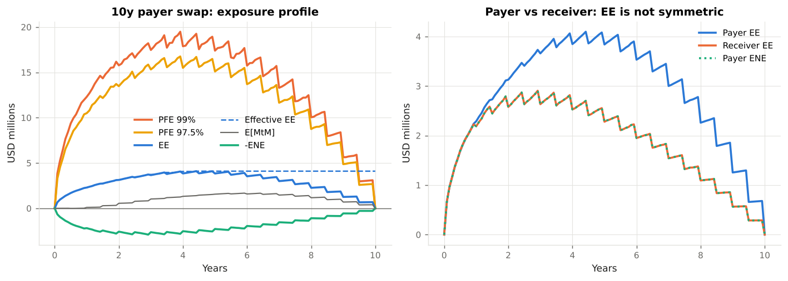
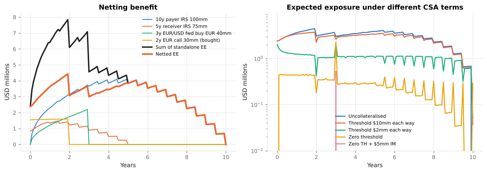

# Counterparty Exposure & XVA Laboratory

**From a simulated exposure profile to the capital charge: an educational module on counterparty credit risk, netting and collateral, CVA / DVA / FVA / MVA, wrong-way risk and the Basel and U.S. rules that govern them.**

XVA Laboratory takes a reader from the question *"how much could this counterparty owe us when it defaults?"* through the full set of valuation adjustments a dealer charges for that risk, to the regulatory exposure (SA-CCR, IMM) and CVA capital (BA-CVA) a bank holds against it. Every formula is implemented in the companion Python package `xvalab`, every implementation is tested against no-arbitrage identities and the Basel Committee's published worked example, and every regulatory statement cites the rule text.

All market data are illustrative and USD/EUR-denominated: a SOFR and an €STR curve, EUR/USD spot and volatility, and four stylised counterparties with CDS curves. Nothing here is investment, legal or regulatory advice.

[Start with Chapter 1](01_counterparty_credit_risk.md){ .md-button .md-button--primary }
[Browse the code on GitHub](https://github.com/sguven/market-risk-toolkit/tree/main/xva_lab){ .md-button }

---

## The course

<div class="grid cards" markdown>

-   :material-handshake-outline: **1. Counterparty credit risk**

    ---

    Why derivatives differ from loans, the 2008 lessons, the measures (EE, PFE, EPE, EEPE) and the XVA family in one table.

    [:octicons-arrow-right-24: Read](01_counterparty_credit_risk.md)

-   :material-chart-timeline-variant: **2. Simulating future exposure**

    ---

    Hull-White rates, lognormal FX, the time grid, trade revaluation on paths, discounting, and how to read an exposure profile.

    [:octicons-arrow-right-24: Read](02_exposure_simulation.md)

-   :material-safe-square-outline: **3. Netting, collateral and margin**

    ---

    Close-out netting, CSA terms, the margin period of risk, cash-flow spikes, initial margin (schedule vs SIMM) and clearing.

    [:octicons-arrow-right-24: Read](03_netting_and_collateral.md)

-   :material-cash-minus: **4. CVA and DVA**

    ---

    The CVA formula and its discretisation, hazard rates from CDS, bilateral CVA, the DVA controversy, CVA as a running spread.

    [:octicons-arrow-right-24: Read](04_cva_and_dva.md)

-   :material-bank-transfer: **5. FVA, MVA and the others**

    ---

    Funding cost and benefit, the FVA debate, the cost of initial margin, the margin trade-off, KVA and ColVA.

    [:octicons-arrow-right-24: Read](05_fva_and_mva.md)

-   :material-swap-vertical-circle-outline: **6. Wrong-way risk**

    ---

    General and specific WWR, the alpha multiplier, exposure-linked intensity, copula default times, devaluation at default.

    [:octicons-arrow-right-24: Read](06_wrong_way_risk.md)

-   :material-scale-balance: **7. The regulatory framework**

    ---

    SA-CCR, IMM, BA-CVA / SA-CVA, margin rules, U.S. and EU implementation, accounting (ASC 820, IFRS 13), and a map from rule to code.

    [:octicons-arrow-right-24: Read](07_regulation.md)

-   :material-console: **Example outputs and API**

    ---

    Captured output of the six runnable examples with their figures, and the reference for the `xvalab` package.

    [:octicons-arrow-right-24: Outputs](08_example_outputs.md) · [:octicons-arrow-right-24: API](09_api_reference.md)

</div>

---

## Learning path

| Step | Read | Run | You should be able to… |
|------|------|-----|------------------------|
| 1 | Chapter 1 | — | Define EE, PFE, EPE, Effective EE, EEPE and EAD; name the six XVAs and the sign of each. |
| 2 | Chapter 2 | `examples/01_exposure_profiles.py` | Explain why a swap's exposure is hump-shaped and a forward's is not; why payer and receiver differ; why discounting is path-wise. |
| 3 | Chapter 3 | `examples/02_netting_and_collateral.py` | Compute the netting benefit; explain thresholds, MTA, MPoR and cash-flow spikes; describe the standardised IM schedule and SIMM. |
| 4 | Chapter 4 | `examples/03_cva_dva_fva.py` | Price CVA from an exposure profile and a CDS curve; explain bilateral CVA and the DVA debate; quote CVA as a running spread. |
| 5 | Chapter 5 | `examples/04_mva_initial_margin.py` | Compute FCA / FBA and MVA; argue both sides of the FVA debate; show the CVA-vs-MVA trade-off of the margin rules. |
| 6 | Chapter 6 | `examples/05_wrong_way_risk.py` | Price WWR with an intensity model and a copula; show right-way risk on the opposite trade; model devaluation at default. |
| 7 | Chapter 7 | `examples/06_regulatory_capital.py` | Compute SA-CCR EAD by hand and reproduce the BCBS example; compare with IMM `α × EEPE`; compute BA-CVA capital. |

---

## A glimpse of the results

<div class="grid" markdown>





</div>

A 10-year at-market payer swap has zero exposure today, a peak expected exposure of about 4 % of notional in year 4, and a 99 % PFE nearly five times that. Netting the four-trade example book cuts lifetime EPE by a quarter; a zero-threshold CSA cuts it by 90 %, leaving the margin-period-of-risk gap and a spike where the FX forward settles; initial margin removes the rest, at a funding cost that MVA prices.

---

## Quick start

```bash
git clone https://github.com/sguven/market-risk-toolkit.git
cd market-risk-toolkit/xva_lab
pip install -r requirements.txt
python -m pytest -q              # 36 tests
python examples/run_all.py       # six walkthroughs, regenerates docs/figures/
```

```python
from xvalab import *

engine = ExposureEngine(default_model(), n_paths=10_000)
swap = InterestRateSwap(100e6, USD_SOFR.swap_rate(0, 10), 10.0, pay_fixed=True)
exposure = engine.run(NettingSet([swap], csa=CSA(threshold_cpty=5e6, threshold_bank=5e6, mta=0.5e6, mpor_days=10)))

exposure.summary()                                                   # EPE, EEPE, peak EE, peak PFE
cpty = COUNTERPARTIES["Industrial corporate (BBB)"].hazard_curve()
cva(exposure, cpty).value                                            # unilateral CVA, USD
fva(exposure, FUNDING_SPREAD_BP, cpty, BANK_OWN_CDS.hazard_curve()).fva
cva_wwr_intensity(exposure, cpty, b=0.5).ratio                       # wrong-way multiplier
saccr_for_netting_set(exposure.netting_set, exposure.market).ead     # SA-CCR EAD
```

## Regulatory sources

| Framework | Source text |
|-----------|-------------|
| Counterparty credit risk: definitions, SA-CCR, IMM, CCPs | Basel Framework CRE50–CRE54; BCBS d279 worked examples |
| CVA risk capital (BA-CVA, SA-CVA) | Basel Framework MAR50; BCBS d424 (2017), d507 (2020) |
| DVA deduction | Basel Framework CAP30.15; 12 CFR 217.22(b)(1)(iii) |
| U.S. counterparty credit risk and CVA RWA | 12 CFR 217.132; SA-CCR final rule 85 FR 4362 (2020); proposal 88 FR 64028 (2023) |
| Uncleared margin | BCBS-IOSCO d499 (2020); 12 CFR 237; 17 CFR 23.150–161; 17 CFR 240.18a-3; EU 2016/2251 |
| Clearing | 7 U.S.C. 2(h); EMIR Article 4; Basel CRE54 |
| Accounting | FASB ASC 820; IFRS 13 ¶42–44, 56; IFRS 9 ¶5.7.7 |
| Model risk | FRB SR 11-7 / OCC 2011-12 |

Full citations with links: [References](references.md).
